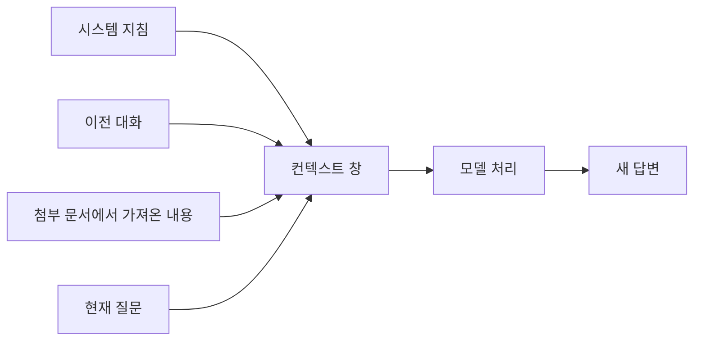

# 01. 토큰화와 컨텍스트 창

> **비개발자를 위한 AI 시스템 설계 입문서 · 01**  
> 이번 장의 질문: **AI는 내 글을 어떻게 읽고, 왜 긴 대화가 비용과 품질에 영향을 줄까?**

- 난이도: ★★☆☆☆ — 개념을 이해하면 충분
- 예상 학습 시간: 20~30분
- 먼저 읽기: [00. 처음 읽는 AI 시스템 설계](00_처음_읽는_AI_시스템_설계.md)
- 참고 원문: [AI System Design Guide — Tokenization Deep Dive](https://github.com/ombharatiya/ai-system-design-guide/blob/main/01-foundations/02-tokenization-deep-dive.md)

> 이 글은 원문을 옮긴 번역본이 아니라, 원문의 핵심 개념을 초보자 눈높이에 맞춰 새로 풀어 쓴 **독립 해설**이에요. API 요금과 모델 한도는 수시로 바뀌니까 실제 값은 제공업체 문서에서 확인해 주세요.

---

## 먼저 상황 하나

AI에게 이렇게 부탁했다고 해 볼게요.

> "우리 브랜드의 웹사이트 메인 화면을 기획해 줘. 타깃은 20대 직장인이고, 브랜드는 친환경을 강조해. 히어로, 제품 소개, 후기, CTA를 포함해."

사람은 이 문장을 단어와 뜻으로 읽죠. 그런데 AI 모델은 문장을 안에서 **토큰(token)**이라는 단위로 쪼갠 다음 처리해요.

토큰은 꼭 한 글자도 아니고, 한 단어도 아니에요. 자주 나오는 단어는 통째로 토큰 하나가 되기도 하고, 낯선 표현은 여러 조각으로 나뉘기도 해요. 그리고 **어떻게 나뉘는지는 모델마다 달라요.**

### 오늘 배울 핵심 세 가지

1. **토큰화(Tokenization):** 글을 AI가 처리할 수 있는 조각으로 나누는 과정
2. **컨텍스트 창(Context Window):** 한 번에 모델에 담을 수 있는 정보량의 한도
3. **토큰 비용(Token Cost):** 입력·출력 토큰 수가 API 비용에 영향을 주는 방식

이 세 가지를 알고 나면 프롬프트가 길어지면 왜 문제가 되는지, 대화 기록은 왜 관리해야 하는지, AI 서비스 비용은 왜 측정해야 하는지가 하나로 연결돼요.

---

## 1. 토큰은 '단어'가 아니라 'AI가 읽는 조각'

`웹사이트를 리뉴얼해 줘`라는 문장을 떠올려 볼게요.

사람 눈에는 단어 몇 개로 보이지만, 모델 안의 토크나이저(tokenizer)는 **모델별 규칙에 따라** 이걸 여러 조각으로 나눠요.

```text
사용자가 쓴 문장
      ↓
토크나이저: 모델이 사용하는 조각으로 분해
      ↓
토큰 ID의 나열
      ↓
AI 모델이 토큰 사이의 관계를 계산
      ↓
다음 토큰을 생성하면서 답변 완성
```

토큰 ID는 사전에 등록된 조각마다 붙은 번호라고 생각하면 돼요. 어떤 문장이 실제로 어떻게 나뉘는지는 **그 모델의 토크나이저로 직접 확인**해 봐야 알 수 있어요.

### 왜 글자 수와 토큰 수가 다를까요?

- `design`처럼 자주 나오는 표현은 적은 토큰으로 처리될 수 있음
- 드문 고유명사, 낯선 조합, 특수문자는 여러 토큰으로 쪼개질 수 있음
- 한국어·영어·일본어는 같은 뜻이어도 토큰 수가 다를 수 있음
- 같은 한국어 문장도 모델을 바꾸면 토큰 수가 달라질 수 있음

그러니까 "한글 1글자 = 1토큰", "영어 1단어 = 1토큰" 같은 공식은 외우지 않는 게 좋아요.

---

## 2. 토큰화 때문에 생기는 의외의 현상

AI에게 "strawberry에는 r이 몇 개야?"라고 물으면 가끔 틀리게 세기도 해요.

그렇다고 AI가 글자를 아예 못 센다는 뜻은 아니에요. 글자를 조각 단위로 처리하는 방식과 언어 모델의 예측 특성이 맞물리면서, **철자를 하나씩 세는 일이 생각보다 까다로워지는 거예요.** 모델이 글자를 하나씩 나눠서 확인하거나 코드를 쓰면 정확도가 올라가요.

### 실제 서비스에서 얻는 교훈

**숫자, 글자 수, 날짜, 결제 금액**처럼 정확해야 하는 값은 AI의 자연어 답변만 믿지 않는 게 좋아요.

- 글자 수는 프로그램으로 세기
- 날짜 계산은 날짜 라이브러리로 하기
- 가격 합산은 계산 코드로 하기
- AI는 설명과 판단 보조에만 쓰고, 검증 가능한 값은 따로 확인하기!

이건 모델이 똑똑하냐 아니냐의 문제가 아니라 **어떤 일을 어떤 도구에 맡기느냐**의 문제예요.

---

## 3. 토크나이저는 왜 여러 종류가 있을까요?

기술 자료를 보다 보면 **BPE, WordPiece, Unigram** 같은 이름이 나와요.

| 이름 | 쉬운 이해 | 지금 알아야 할 수준 |
|---|---|---|
| BPE | 자주 함께 나타나는 문자·바이트 조각을 점점 합쳐 사전을 만드는 방식 | 이름과 기본 원리만 |
| WordPiece | 유용한 조각을 통계적 기준으로 고르는 방식 | 이런 방식도 있다는 정도 |
| Unigram | 여러 조각 후보의 확률을 보고 나누는 방식 | 심화 학습 때 |

예를 들어 `low`, `lower`, `lowest`가 자주 나온다면, 반복되는 `low` 부분을 하나의 조각으로 다루는 게 유리하겠죠.

실무에서 중요한 건 알고리즘을 직접 구현하는 게 아니라, **모델마다 토큰 수가 달라진다는 사실을 아는 것**이에요.

---

## 4. 컨텍스트 창: AI의 작업 책상 크기

이번엔 다른 장면을 떠올려 볼게요.

책상 위에 기획서, 브랜드 가이드, 경쟁사 분석, 사용자 인터뷰, 이전 대화 내용까지 다 펼쳐 놓고 보고 싶어요. 그런데 책상이 너무 작으면 한꺼번에 다 펼칠 수가 없잖아요.

AI의 **컨텍스트 창(Context Window)**도 비슷해요. 모델이 한 번의 요청에서 처리할 수 있는 정보의 양을 토큰 기준으로 제한한 거예요.



여기에는 현재 질문뿐 아니라 시스템 지침, 함께 보낸 대화 기록, 검색해서 넣은 문서, 도구 결과 등이 들어갈 수 있어요. **출력할 수 있는 토큰 한도**는 모델이나 API 설정에 따라 따로 정해져 있기도 하고요.

### 컨텍스트 창이 크면 무조건 좋을까요?

그렇지 않아요. 책상이 커서 자료를 많이 올릴 수 있어도, 정리가 안 되어 있으면 중요한 문서를 찾기 어렵잖아요.

- 긴 문서를 넣을 수 있다 ≠ 문서의 모든 세부사항을 정확히 찾아 쓴다
- 서로 충돌하는 옛 지침과 새 지침을 같이 넣으면 결과가 흔들림
- 자료가 많을수록 처리 시간과 비용이 늘어남

결국 핵심은 **많이 넣기보다 지금 필요한 정보를 잘 골라 넣기!**

---

## 5. 대화가 길어지면 AI는 무엇을 기억할까요?

"챗봇이 아까 한 말은 기억하고 있겠지?" 하고 생각하기 쉬운데요, 여기서는 두 가지를 꼭 구분해야 해요.

**대화 기록을 다음 요청에 다시 보내는 것**과 **서비스가 장기 기억을 따로 저장하는 것**은 다른 기술이에요.

API로 챗봇을 만든다고 해 볼게요.

```text
첫 요청: 사용자의 질문 → 답변
두 번째 요청: 이전 대화 일부 + 새 질문 → 답변
세 번째 요청: 이전 대화 일부 + 새 질문 → 답변
```

보통은 서비스 개발자가 어떤 대화 기록을 계속 보낼지 직접 관리해요. 대화 상태를 서버에서 관리해 주는 API도 있지만, **결국 어떤 정보가 다음 요청에 들어가는지, 얼마나 보관되는지는 직접 확인해야 해요.**

### 좋은 서비스는 대화 기록을 이렇게 관리해요

1. 오래된 대화는 핵심 사실만 요약하기
2. 현재 질문과 관련된 정보만 다시 불러오기
3. 절대 바뀌면 안 되는 규칙은 별도 지침으로 유지하기
4. 개인정보나 민감한 기록은 보관이 꼭 필요한지 확인하기
5. 중요한 계산 결과는 자연어 기억에 맡기지 말고 DB에서 다시 조회하기

이 방식이 뒤에서 배울 **메모리(Memory)**와 **RAG(검색 증강 생성)**의 기초가 돼요.

---

## 6. 예시: 찐망고 사주풀이에서는 어떤 일이 벌어질까요?

사용자가 생년월일을 입력하면 AI가 사주 해석을 만든다고 해 볼게요. 이때 AI API로 가는 요청에는 "해석해 줘" 한 줄만 들어가는 게 아닐 수 있어요.

```text
[서비스 지침]
- 쉬운 한국어로 설명하기
- 단정적인 표현 피하기
- 미리 정한 결과 구조 따르기

[계산된 기초 데이터]
- 년주 / 월주 / 일주 / 시주
- 오행과 십성의 구조
- 대운 정보

[사용자 요청]
- 성격과 직업 관련 해석

[AI가 생성할 답변]
- 주요 성향
- 이유와 상황별 예시
- 주의할 점
```

여기서 **지침도 토큰, 데이터도 토큰, 답변도 토큰**이에요.

만약 해석 요청마다 긴 설명서와 필요 없는 이력까지 몽땅 보내면 비용도 늘고, 지침끼리 부딪힐 수도 있어요.

그렇다고 필수 규칙까지 너무 줄여 버리면 결과의 일관성이 떨어지죠. 그래서 **줄여도 되는 반복 내용과 꼭 지켜야 하는 규칙을 나눠야 해요.**

> 실무 판단: 프롬프트를 짧게 만드는 것 자체가 목표는 아니에요. **품질은 지키면서 불필요한 토큰만 줄이는 것**이 목표예요.

---

## 7. AI API 비용은 어떻게 계산할까요?

대부분의 텍스트 생성 API는 **입력(Input) 토큰**과 **출력(Output) 토큰**에 각각 다른 단가를 매겨요. 캐시된 입력, 아주 긴 컨텍스트, 추론 토큰 등에 별도 규칙을 두는 곳도 있고요.

### 계산식

```text
예상 비용 = (입력 토큰 ÷ 1,000,000 × 입력 단가)
          + (출력 토큰 ÷ 1,000,000 × 출력 단가)
```

*가상의 요금*이 이렇다고 해 볼게요.

- 입력 100만 토큰당 1달러
- 출력 100만 토큰당 4달러
- 한 번 요청: 입력 3,000토큰 / 출력 1,000토큰

그러면 1회 비용은 이렇게 나와요.

```text
입력: 3,000 ÷ 1,000,000 × $1 = $0.003
출력: 1,000 ÷ 1,000,000 × $4 = $0.004
합계: $0.007 (가상 예시)
```

이 요청이 한 달에 10만 번 생기면 단순 계산으로 **700달러**예요. 실제로는 모델별 단가, 캐싱, 오류 재시도, 긴 컨텍스트 정책, 부가 기능에 따라 달라지고요.

### 비용 줄이기 체크포인트

| 점검 항목 | 예시 |
|---|---|
| 입력을 반복해서 보내고 있나? | 매 요청마다 똑같은 긴 자료를 넣는지 확인 |
| 필요한 자료만 불러오나? | 전체 문서 대신 현재 질문 관련 부분만 가져오기 |
| 답변이 너무 길지 않나? | 화면에 필요한 분량으로 출력 제한 |
| 어떤 모델을 쓰나? | 단순 분류에 지나치게 비싼 모델을 쓰는지 확인 |
| 실제 사용량을 기록하나? | API 응답의 `usage` 데이터 저장·집계 |

**주의:** 사용자가 보는 글자 수만으로는 사용량을 정확히 알 수 없어요. 도구 사용, 특수 토큰, 추론 모델의 내부 처리 등도 과금에 영향을 줄 수 있으니 **실제 API 사용량을 기준으로 측정**해야 해요.

---

## 8. 한국어 서비스라면 더 확인할 것

같은 뜻의 문장이라도 한국어와 영어의 토큰 수는 모델에 따라 달라질 수 있어요. 그렇다고 **"한국어는 무조건 영어보다 몇 배 비싸다"**고 단정하면 안 돼요.

국내 사용자용 서비스를 만든다면 직접 테스트해 보는 게 제일 정확해요.

- 실제 사용자 질문 20개 모으기
- 서비스에서 쓸 모델로 입력 토큰 수 측정하기
- 짧은 질문 / 긴 질문 / 줄바꿈·특수문자 포함 질문 나눠서 보기
- 평균만 보지 말고 유난히 토큰이 많은 사례도 확인하기

그리고 **토큰을 아끼겠다고 사용자에게 영어로 입력하라고 할 필요는 없어요.** 한국어 사용 경험과 답변 품질을 같이 생각해야 해요.

---

## 9. 화면 기획·개발 수업에 연결하기

학생들에게 같은 웹사이트 기획을 두 가지 방식으로 요청하게 해 보세요.

**A안: 생각나는 대로 길게 쓴 프롬프트**

> "웹사이트를 만들어 줘. 친환경이고 멋있고 트렌디하고 감성적이고 세련되어야 하고, 요즘 인기 많은 스타일이면 좋겠어. 좀 더 고급스럽고 특별하게..."

**B안: 필요한 정보를 구조화한 프롬프트**

```markdown
## 목표
친환경 생활용품 브랜드 메인페이지 기획

## 사용자
20~30대 직장인, 모바일 우선

## 필요한 섹션
Hero / 베스트 상품 / 브랜드 가치 / 후기 / CTA

## 출력 형태
각 섹션의 목적, 제목, 핵심 콘텐츠를 표로 작성

## 제한
확인되지 않은 수치나 후기를 임의로 만들지 않기
```

어느 쪽이 토큰을 덜 쓰는지는 **직접 재 봐야** 알아요. 여기서 배울 포인트는 **짧은 게 좋다**가 아니라, **목표·정보·출력 조건이 분명한가**예요.

### 15분 실습

1. 같은 과제를 A안과 B안으로 질문하기
2. 결과를 **목적 적합성 / 내용 누락 / 수정 필요량** 세 항목으로 비교하기
3. 가능하면 입력·출력 토큰 수도 함께 확인하기
4. 토큰이 조금 더 들어도 수정 횟수가 줄면 전체 비용과 작업 시간은 어떻게 될지 토론하기

**강사용 질문:** "한 번의 프롬프트 비용이 가장 싼 방식이, 전체 제작 비용도 가장 쌀까?"

---

## 10. 지금 알아야 할 수준

| 개념 | 지금의 목표 | 나중에 공부할 것 |
|---|---|---|
| Token | 단어와 토큰은 다르다는 점 | 토크나이저 구현 |
| BPE·WordPiece | 모델마다 분할 방식이 다름 | 학습 알고리즘 |
| Context Window | 한 번에 넣을 수 있는 정보량의 한계 | 장문 컨텍스트 최적화 |
| Conversation State | 대화가 자동으로 영구 저장되는 건 아님 | 상태 저장·요약 설계 |
| Input / Output Tokens | 비용과 사용량을 구분 | 실제 요청 로그 기반 원가 분석 |
| RAG | 필요한 정보만 찾아 넣는 방식이 있다는 것 | 검색 인덱스·청킹·임베딩 |

### 이해 확인 문제

**Q1. 1,000글자짜리 프롬프트는 항상 1,000토큰일까?**  
아니에요. 모델의 토크나이저, 언어, 문자 구성에 따라 달라져요.

**Q2. 컨텍스트 창이 아주 크면 정확한 답변도 보장될까?**  
아니에요. 긴 자료 속에서 필요한 정보를 정확히 활용하는 건 또 다른 문제예요.

**Q3. 비용을 줄이려면 무조건 답변을 짧게 해야 할까?**  
아니에요. 품질이 떨어져서 다시 요청하거나 고치는 비용까지 같이 봐야 해요.

**Q4. 챗봇이 이전 대화를 아는 것과 영구 기억은 같을까?**  
달라요. 대화 기록 전달, 서버 상태 관리, 장기 메모리는 구분해야 해요.

---

## 한 장 요약

- **토큰** = AI가 읽는 조각 → 글자 수로 짐작하지 말고 실제로 재기
- **컨텍스트 창** = AI가 한 번에 펼쳐 볼 수 있는 작업 책상 → 많이 넣기보다 잘 골라 넣기
- **비용** = 입력 토큰 + 출력 토큰 → 가상 단가로 계산 습관 들이고, 실제 단가는 공식 요금표에서 확인하기
- 대화 기록 전달과 장기 기억은 다른 기술이라는 것 기억하기!
- BPE·WordPiece 계산법은 지금 안 외워도 OK

---

## 다음 장 예고

**[02. 프롬프트와 컨텍스트 설계](02_프롬프트와_컨텍스트_설계.md)**  
같은 모델인데 왜 프롬프트 구조에 따라 답변 품질이 달라질까요? AI에게 맡길 일과 코드로 검증할 일을 나눠 볼게요.

## 참고 자료

- [원문: Tokenization Deep Dive — AI System Design Guide](https://github.com/ombharatiya/ai-system-design-guide/blob/main/01-foundations/02-tokenization-deep-dive.md)
- [OpenAI Tokenizer 도구](https://platform.openai.com/tokenizer)
- [OpenAI API Pricing](https://openai.com/api/pricing/)
- [Hugging Face Tokenizers 문서](https://huggingface.co/docs/tokenizers/index)
