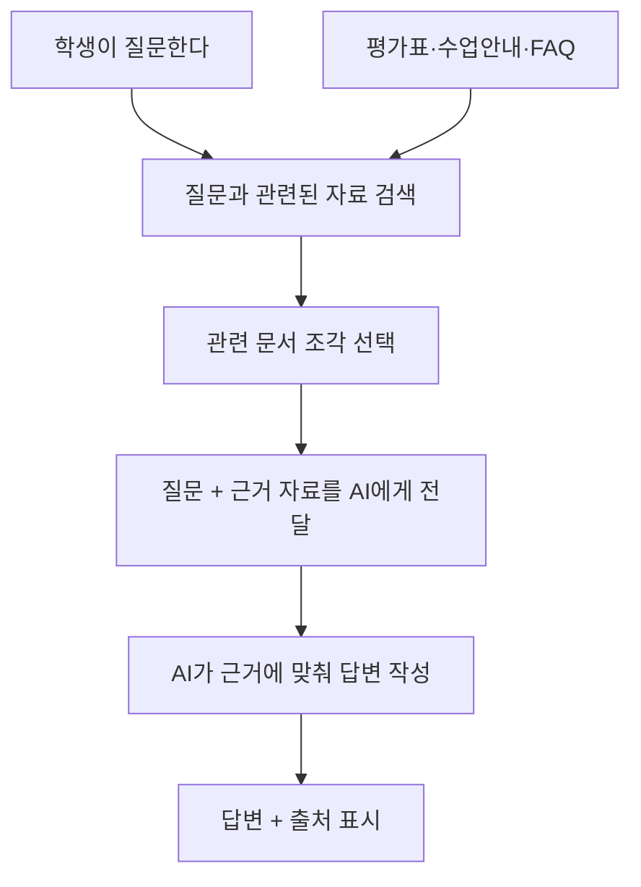

# 03. RAG — AI가 모르는 자료를 찾아 답하는 방법

> **비개발자를 위한 AI 시스템 설계 입문서 · 03**  
> 이번 장의 질문: **AI가 우리 회사 매뉴얼이나 수업 자료를 모를 때, 어떻게 근거를 찾아 답하게 할까?**

- 난이도: ★★☆☆☆ — 개념을 이해하면 충분
- 예상 학습 시간: 25~35분
- 먼저 읽기: [02. 프롬프트와 컨텍스트 설계](02_프롬프트와_컨텍스트_설계.md)
- 참고 원문: [AI System Design Guide — RAG Fundamentals](https://github.com/ombharatiya/ai-system-design-guide/blob/main/06-retrieval-systems/01-rag-fundamentals.md)

> 이 글은 원문을 옮긴 번역본이 아니라, 원문의 핵심 개념을 초보자를 위해 새로 풀어 쓴 **독립 해설**이다. 기술 선택 기준과 실제 구현 방식은 서비스 규모와 모델에 따라 달라질 수 있다.

---

## 이 장을 읽고 나면

- RAG가 무엇인지 한 문장으로 설명할 수 있다.
- PDF를 대화창에 업로드하는 것과 RAG 시스템을 만드는 것의 차이를 안다.
- 문서를 잘게 나누는 **청킹(Chunking)**, 의미로 찾는 **임베딩(Embedding)**, 검색 결과를 다시 고르는 **리랭킹(Reranking)**이 왜 필요한지 이해한다.
- RAG를 사용해야 할 때와 굳이 사용하지 않아도 될 때를 구분한다.
- AI가 답을 지어내지 않도록 검색·권한·출처·평가를 어떻게 설계할지 생각할 수 있다.

## 1. AI가 모르는 질문을 받았을 때

학생이 이렇게 질문했다.

> “우리 수업 2차 평가에서 반응형 웹은 몇 점이고, 어떤 기준으로 평가해요?”

일반 AI 모델은 그 수업의 실제 평가표를 **학습한 적이 없을 수 있다.** 그런데도 그럴듯하게 “20점입니다”라고 답할 수 있다. 이것이 문제가 되는 순간은 **사실처럼 보이는 오답이 학생의 행동을 바꿀 때**다.

그렇다면 AI가 추측하지 않고, 실제 평가표를 찾아 읽은 다음 답하게 만들면 어떨까?

> “제공된 평가표에 따르면 반응형은 15점이며, PC·Tablet·Mobile에 맞춰 화면을 구성했는지를 평가합니다.”

이처럼 AI가 *평가표에서 관련 내용을 먼저 검색한 뒤* 답하도록 만드는 방식이 **RAG**다.

**RAG = Retrieval-Augmented Generation**, 한국어로는 보통 **검색 증강 생성**이라고 한다.

- **Retrieval(검색):** 관련 자료를 찾아온다.
- **Augmented(증강):** 찾은 자료를 질문과 함께 AI에게 제공한다.
- **Generation(생성):** AI가 자료를 참고해 답을 작성한다.

**한 줄로 기억하기:** *AI의 기억만 믿지 말고, 필요한 자료를 찾아서 펼쳐 준 다음 답하게 하는 구조.*

## 2. RAG는 ‘책을 외운 AI’가 아니라 ‘책을 찾아보는 AI’

아래 세 가지를 구분하면 쉽다.

| 구분 | 비유 | 특징 |
|---|---|---|
| 모델의 사전 학습 | 여러 책을 공부한 사람 | 넓은 지식이 있지만 내부 지식이 최신·정확하다고 보장되지 않음 |
| 파인튜닝(Fine-tuning) | 특정 방식으로 답하도록 추가 훈련 | 말투·형식·작업 패턴을 익히게 하는 데 활용 가능 |
| RAG | 필요한 책에서 관련 페이지를 찾아 펼쳐 주기 | 외부 자료에 근거해 답하도록 도움 |

핵심은 RAG가 **AI 모델을 새로 훈련하는 작업과 다르다**는 점이다.

예를 들어 수업 평가기준이 바뀌었다면, RAG에서는 **검색 대상 문서를 최신 버전으로 교체**하고 색인을 갱신하면 된다. 이미 학습된 AI 내부 지식을 다시 훈련시킬 필요는 없다.

단, 문서를 바꿨다고 답이 자동으로 정확해지지는 않는다. 최신 문서가 실제 검색 결과에 포함되는지 확인해야 한다.

## 3. RAG는 이렇게 움직인다

여기서 중요한 것은 **검색된 문서 조각이 AI의 답변에 실제로 사용되는가**다. 검색 결과가 틀렸다면 생성 모델이 아무리 똑똑해도 잘못된 답을 할 수 있다.

### 실무 화면으로 바꿔서 생각해 보기

사용자 화면에는 다음 세 가지만 보여도 충분할 수 있다.

1. **질문 입력창:** “반응형 웹 평가 기준 알려줘.”
2. **답변 영역:** “반응형 웹은 15점이며…”
3. **출처 영역:** “출처: 2차 평가표, 반응형 항목”

이때 출처는 문서 제목만 보여 주기보다 **누르면 원본의 해당 위치를 확인할 수 있게** 설계하는 편이 좋다.

## 4. PDF를 업로드하면 그게 RAG일까?

**항상 그렇지는 않다.** 겉모습은 비슷해 보여도 안쪽 처리 방식이 다를 수 있다.

### A. 채팅창에 작은 PDF 하나를 올린 경우

AI 서비스는 파일 내용을 읽어 대화 컨텍스트에 넣거나, 서비스 내부의 검색 도구를 이용할 수 있다. **파일 업로드 자체만으로 RAG라고 단정하면 안 된다.**

- 장점: 바로 질문할 수 있어 간편함
- 단점: 파일이 많아지고 버전이 쌓이면 관리가 어려워질 수 있음

### B. 우리 서비스에 문서 검색 기능을 구축한 경우

1. 여러 문서를 수집한다.
2. 검색하기 쉽게 처리하고 색인한다.
3. 사용자가 질문하면 관련 문서만 검색한다.
4. 찾은 부분을 AI에게 전달한다.
5. 근거와 함께 답한다.

이렇게 **반복해서 사용할 수 있는 검색+답변 시스템**을 보통 RAG 시스템이라고 부른다.

**무조건 RAG를 구축할 필요는 없다.** 문서가 몇 개 없고 수정도 드물다면, 필요한 내용을 프롬프트에 직접 넣는 편이 더 단순할 수 있다.

## 5. 문서를 잘라서 보관한다: 청킹(Chunking)

100페이지짜리 수업 자료에서 단 한 줄을 찾는다고 해 보자. 매번 100페이지를 전부 AI에게 주면 번거롭고 비용도 커질 수 있다.

그래서 문서를 의미 있는 크기로 나누어 보관한다. 이를 **청킹(Chunking)**이라고 한다.

예를 들어 평가표를 이렇게 나눠 볼 수 있다.

- 조각 A: UI 구조 설계 / 15점 / 세부 기준
- 조각 B: Figma 기능 활용 / 20점 / 세부 기준
- 조각 C: HTML·CSS / 20점 / 세부 기준
- 조각 D: 반응형 웹 / 15점 / 세부 기준

질문이 반응형에 관한 것이라면 **조각 D를 우선 검색**하면 된다.

### 잘못 나누면 생기는 일

문장을 길이로만 기계적으로 자르면 이런 일이 생길 수 있다.

> 조각 1: “반응형 웹은 PC, 태블릿, 모바일에 맞춰…”  
> 조각 2: “…구성할 수 있는가? (15점)”

질문에 필요한 문장과 점수가 서로 떨어져 버렸다. 이런 경우 AI가 질문에 대한 근거를 온전히 찾지 못할 수 있다.

**실무 메모:** 청킹은 단순히 글자 수를 정하는 작업이 아니라 **질문에 답할 정보가 한 덩어리로 남게 만드는 일**이다. 제목·표의 머리글·문서 버전도 함께 유지하면 좋다.

## 6. 단어가 달라도 뜻이 비슷하면 찾을 수 있을까? 임베딩(Embedding)

학생은 이렇게 물었다.

> “핸드폰에서 화면이 깨지면 몇 점 깎여요?”

그런데 평가표에는 “모바일 환경을 고려한 반응형 레이아웃 설계”라고 적혀 있다.

문장은 다르지만 두 문장이 **비슷한 문제를 가리킨다**는 것을 알아채야 한다.

여기에서 **임베딩(Embedding)**이 등장한다. 문장이나 문서의 의미적 특징을 숫자 벡터로 표현해서, 비슷한 의미의 문서를 찾도록 도와주는 방식이다.

- “모바일에서 화면 깨짐”
- “작은 화면에 맞는 반응형 구성”

단어가 완전히 같지 않아도 의미 기반 검색에서는 가까운 결과로 잡힐 수 있다.

하지만 의미 검색만으로 충분하지 않을 때도 있다. **정확한 모델명, 제품 코드, 학생 과제명, CSS 속성명**처럼 글자 자체가 중요한 경우다.

그래서 실무에서는 **키워드 검색 + 의미 검색**을 결합한 **하이브리드 검색(Hybrid Search)**을 고려한다.

| 질문 | 더 중요할 수 있는 검색 방식 |
|---|---|
| “모바일에서 깨지는 문제” | 의미 기반 검색 |
| “`flex-basis`와 `width` 차이” | 정확한 키워드 + 의미 검색 |
| “평가표에서 15점 항목” | 키워드·숫자 매칭 |
| “로그인 화면에서 접근성을 어떻게 평가해?” | 의미 검색 + 문서 필터 |

어느 검색 방식을 쓸지는 **실제 질문으로 테스트해서** 정해야 한다.

## 7. 검색했다고 끝이 아니다: 리랭킹(Reranking)

관련 자료 10개를 검색했는데, 가장 중요한 문서가 8등으로 나왔다고 해 보자.

상위 3개만 AI에게 전달한다면 **정답 문서는 검색되었어도 답변에는 들어가지 못할 수 있다.**

리랭킹은 이미 찾은 후보를 **질문과의 관련성에 맞게 다시 정렬**하는 과정이다.

> 검색 = 후보를 넓게 모으는 일  
> 리랭킹 = 그중 질문에 가장 맞는 후보를 다시 고르는 일

다만 리랭킹에도 추가 처리 비용과 시간이 든다. 간단한 서비스라면 처음부터 넣기보다 **검색 실패 사례를 모은 뒤 도입을 판단**하는 편이 좋다.

## 8. AI가 틀리는 지점은 어디일까?

RAG를 썼다고 환각(사실과 다른 답)이 사라지지는 않는다. 실패 원인을 단계별로 나누면 더 쉽게 개선할 수 있다.

| 문제가 생긴 단계 | 예시 | 먼저 점검할 것 |
|---|---|---|
| 문서 수집 | 구버전 평가표만 들어 있음 | 최신 문서 여부·갱신 방식 |
| 문서 분리 | 제목과 점수가 다른 조각으로 분리됨 | 청킹 방식·문서 구조 |
| 검색 | 해당 조각을 찾지 못함 | 키워드/의미 검색·검색 필터 |
| 결과 선택 | 중요한 자료가 순위에서 밀림 | 리랭킹·선택 개수 |
| 답변 생성 | 찾은 근거에 없는 내용을 덧붙임 | 근거 기반 지침·답변 검증 |
| 출처 표시 | 엉뚱한 페이지를 출처로 표시함 | 인용 대상과 원문 위치 일치 여부 |

문제가 생겼을 때 **무조건 프롬프트부터 고치면 안 되는 이유**가 여기 있다. 검색이 틀렸다면 프롬프트만 바꿔서는 해결되지 않을 수 있다.

## 9. 긴 컨텍스트가 있으면 RAG는 필요 없지 않을까?

요즘 모델은 한 번에 많은 텍스트를 처리할 수 있다. 그렇다면 필요한 문서를 전부 넣으면 되지 않을까?

작은 자료 묶음이라면 실제로 그 편이 더 편할 수 있다. 하지만 대규모로 운영한다면 네 가지를 생각해야 한다.

1. **비용:** 질문마다 방대한 문서를 계속 전달하면 입력 비용이 커질 수 있음
2. **속도:** 읽어야 할 자료가 많아지면 응답이 느려질 수 있음
3. **최신성:** 자주 바뀌는 내용을 매번 관리해야 함
4. **접근 권한:** 사용자마다 볼 수 있는 문서가 다를 수 있음

따라서 **긴 컨텍스트 vs RAG**는 승패의 문제가 아니다.

**작은 자료 + 적은 질문:** 문서를 그대로 전달하는 방법부터 검토.  
**많은 자료 + 자주 바뀌는 정보 + 다양한 사용자:** 검색 구조와 권한 관리까지 고려.

원본 가이드에 나오는 문서량별 기준값은 환경에 따라 달라지므로 **절대적인 기준선처럼 쓰지 않는 편이 좋다.**

## 10. 찐망고 사주풀이에 RAG를 적용한다면?

여기서는 **실제 서비스에 이미 RAG가 구축되어 있다는 뜻이 아니라**, 적용 가능성을 생각해 보는 예시다.

### 지금처럼 프롬프트와 데이터를 전달하는 방식

사용자가 생년월일과 시간을 입력하면, 서비스가 사주 계산 결과와 해석 지침을 AI에 전달할 수 있다.

이 경우 핵심은 **계산 데이터의 정확성, 해석 규칙, 출력 검증**이다. 꼭 RAG가 필요하지는 않다.

### 만약 ‘명리학 자료 검색 기능’을 추가한다면

사용자가 “경금 일간이 인월에 태어나면 어떤 해석 차이가 있나요?”라고 묻는다고 해 보자.

- 검색 대상으로 **사용 권한을 확보한 명리학 자료**를 모은다.
- 질문에 맞는 해설을 찾아온다.
- AI가 서로 다른 해석 관점이 있음을 구분해 설명한다.
- 참고 자료의 제목과 해당 부분을 출처로 보여 준다.

이때는 RAG가 의미 있어질 수 있다. 다만 명리학 해석은 검증된 자연과학적 사실과 구분해야 하므로, **출처가 있다고 해서 해석 자체가 객관적으로 입증되는 것은 아니다.**

### 찐망고 레퍼런스 서비스에 적용한다면?

사이트의 Hero, CTA, 브랜드 스토리 같은 섹션에 **직접 기록한 분석 메모와 태그**가 있다면, 이런 질문에 답하도록 만들 수 있다.

> “회원가입 유도를 잘 설계한 국내 웹사이트 사례 3개 찾아줘.”

RAG는 저장된 분석 메모를 바탕으로 사례를 제안할 수 있다. 하지만 이미지 캡처만 저장되어 있고 설명·태그가 없다면, **무엇을 기준으로 검색할지**부터 설계해야 한다.

이때 중요한 것은 모델 성능보다 **좋은 원천 자료를 얼마나 구조화했는가**일 수 있다.

## 11. 학생용 실습: 평가표를 읽는 AI 만들기 전에

실제로 서버를 개발하지 않아도 RAG 설계를 연습할 수 있다.

### 준비물

공개 가능한 **가상 평가표** 1개, 예상 질문 5개, 종이 또는 Figma.

예시 질문:

1. “모바일 레이아웃은 몇 점인가요?”
2. “Figma 컴포넌트도 평가에 들어가나요?”
3. “작업 결과물이 디자인 시안과 달라도 괜찮나요?”
4. “지각하면 몇 점이 깎이나요?”
5. “CSS가 아닌 JavaScript로 작성해도 점수를 주나요?”

### 실습 순서

1. 평가표를 4~6개의 의미 있는 조각으로 나눈다.
2. 질문마다 찾아야 할 **정답 조각**을 표시한다.
3. 답을 만들 때 **문서에 있는 것 / 없는 것**을 구분한다.
4. 근거가 없는 질문에는 “이 평가표에서 확인할 수 없습니다”라고 답하도록 정한다.
5. 답변 아래에 자료 제목과 항목을 붙인다.

### 관찰 포인트

- 근거가 있는 답변을 했는가?
- 질문이 바뀌어도 맞는 조각을 찾는가?
- 평가표에 없는 내용을 지어내지 않았는가?
- 학생이 출처를 눌러 확인할 수 있는가?

이 실습이 좋은 이유는 **프롬프트 작성 실력뿐 아니라 정보 구조 설계 능력**을 함께 기를 수 있기 때문이다.

## 12. 운영한다면 반드시 생각할 세 가지

### ① 권한: 검색하면 안 되는 자료는 검색하지 않는다

교사만 볼 수 있는 상담 기록이나 개인 정보를 학생용 검색 대상에 넣으면 안 된다. **검색 이전에 사용자 권한을 확인**해야 한다. “이 자료를 보여 주지 마”라는 프롬프트만으로 접근 권한을 보호해서는 안 된다.

### ② 출처: AI의 문장이 아닌 원본을 확인할 수 있어야 한다

출처는 신뢰를 높이는 장치지만 **출처 제목이 붙었다고 답이 정확해지는 것은 아니다.** 답변 문장과 인용된 원문의 실제 내용이 맞는지 확인해야 한다.

### ③ 평가: 그럴듯함보다 정답 검색률을 본다

테스트 질문 20개를 정하고, 다음 항목을 기록해 보자.

- 정답이 포함된 문서를 검색했는가?
- 답변이 근거의 범위를 벗어났는가?
- 모르는 질문에 모른다고 했는가?
- 답변에 걸리는 시간이 적절한가?
- 수정된 문서가 갱신되었는가?

## 13. 내가 알아야 할 수준은 어디까지일까?

| 개념 | 지금 필요한 수준 | 더 깊이 배울 때 |
|---|---|---|
| RAG | 왜 검색을 붙이는지 설명 가능 | 파이프라인 직접 구축 |
| 청킹 | 문서 분리 방식이 품질에 영향을 줌을 이해 | 조각 크기·중첩 비교 실험 |
| 임베딩 | 의미로 비슷한 문서를 찾는 원리 이해 | 모델별 검색 성능 비교 |
| 하이브리드 검색 | 키워드+의미를 함께 쓰는 이유 이해 | 검색 점수 결합 방식 |
| 리랭킹 | 검색 결과를 다시 정렬한다는 점 이해 | 속도·정확도 최적화 |
| 벡터 DB | 임베딩 검색을 위한 저장·검색 수단임을 이해 | 색인, 필터, 운영 설계 |
| 평가 | 답변 전에 검색 품질부터 점검 | 검색·답변 평가 지표 구축 |

**지금 단계의 목표는 벡터 데이터베이스를 직접 만드는 것이 아니다.**  
**“어떤 자료를, 어떤 기준으로 찾아, 어떤 근거를 AI에게 주어야 하지?”**라는 질문을 할 수 있으면 충분하다.

## 14. 다 읽었는지 확인하는 질문

1. RAG와 파인튜닝은 무엇이 다른가?
2. PDF를 채팅창에 업로드했다고 무조건 RAG라고 할 수 있을까?
3. 평가표의 점수와 기준이 다른 문서 조각에 있으면 어떤 문제가 생길까?
4. “모바일 화면 깨짐”과 “반응형 레이아웃”을 연결하는 검색은 무엇을 활용할까?
5. 정답이 없을 때 AI는 어떤 행동을 해야 할까?

생각해 볼 답

1. RAG는 외부 자료를 찾아 답에 제공하고, 파인튜닝은 모델을 추가 학습한다.
2. 아니다. 서비스 내부 구현에 따라 다르다.
3. 정답을 검색하지 못하거나 일부 정보만 보고 잘못 답할 수 있다.
4. 임베딩 기반 의미 검색과 필요시 키워드 검색을 조합할 수 있다.
5. 근거 부족을 밝히고, 확인 가능한 자료를 안내하거나 추가 정보를 요청해야 한다.

## 이번 장에서 기억할 세 문장

> **RAG는 AI가 외부 근거를 찾아 답하도록 만드는 설계 방식이다.**  
> **RAG의 품질은 답변 문장만큼이나 ‘무엇을 찾아왔는가’에 달려 있다.**  
> **작은 문서 몇 개라면 RAG보다 간단한 방법이 나을 수도 있다.**

---

## 다음 장 예고

**[04. AI 에이전트 — 대답을 넘어 일을 처리하는 AI](04_AI_에이전트_대답을_넘어_일을_처리하는_AI.md)**  
검색하고 설명하는 것을 넘어, 도구를 선택하고 여러 단계를 실행하는 AI 시스템을 살펴본다.

## 참고 자료

- [Om Bharatiya, *AI System Design Guide — RAG Fundamentals*](https://github.com/ombharatiya/ai-system-design-guide/blob/main/06-retrieval-systems/01-rag-fundamentals.md)
- [Lewis et al., *Retrieval-Augmented Generation for Knowledge-Intensive NLP Tasks* (2020)](https://arxiv.org/abs/2005.11401)
- [Anthropic, *Introducing Contextual Retrieval* (2024)](https://www.anthropic.com/news/contextual-retrieval)
