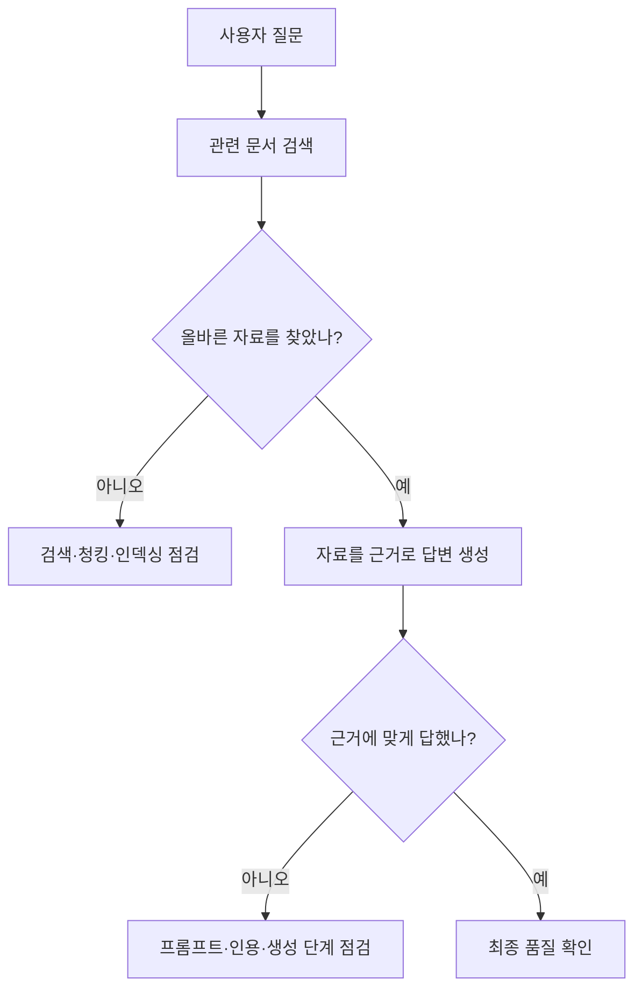

# 05. AI 서비스의 품질을 평가하는 방법

> **비개발자를 위한 AI 시스템 설계 입문서 · 05**  
> 이번 장의 질문: **AI가 그럴듯하게 답했다고 해서, 정말 잘한 걸까?**

- 난이도: ★★☆☆☆ — 복잡한 수식보다 평가 기준을 만드는 연습이 중요
- 예상 학습 시간: 25~35분
- 먼저 읽기: [04. AI 에이전트 — 대답을 넘어 일을 처리하는 AI](04_AI_에이전트_대답을_넘어_일을_처리하는_AI.md)
- 참고 원문: [AI System Design Guide — LLM Evaluation](https://github.com/ombharatiya/ai-system-design-guide/blob/main/14-evaluation-and-observability/01-llm-evaluation.md)

> 이 글은 원문을 옮긴 번역본이 아니라, 원문과 공개 기술 자료의 평가 개념을 초보자 눈높이에 맞춰 새로 풀어 쓴 **독립 해설**이에요. 플랫폼의 평가 기능과 API는 바뀔 수 있으니, 실제로 도입할 때는 최신 문서를 확인해 주세요.

---

## 1. AI는 왜 시험을 봐야 할까요?

AI에게 "웹사이트의 문제점을 찾아줘"라고 했다고 해 볼게요.

AI가 이렇게 답할 수 있어요.

> "사용자 경험을 개선하고 직관적인 디자인을 적용하면 좋겠습니다."

말은 자연스럽죠. 그런데 어느 화면의 뭐가 문제인지, 어떤 사용자가 불편한지, 어떻게 고치라는 건지는 알 수가 없어요.

이런 답은 **유창하다**고는 할 수 있어도, **실무에 쓸 수 있다**고 하긴 어려워요.

AI 서비스도 똑같아요. 누군가 답변을 보고 "좋네요" 하는 것만으로는 품질을 판단하기 어려워요. 어떤 조건에서 잘 되고, 어디서 틀리는지 확인해야 하죠.

이렇게 AI 결과를 정해 둔 기준과 사례로 검사하는 일을 **평가(Evaluation, 줄여서 Eval)**라고 해요.

### 오늘의 핵심

**AI를 잘 만드는 일은 좋은 프롬프트를 쓰는 데서 끝나지 않아요. 좋은 결과가 뭔지 정의하고, 실제로 그렇게 나오는지 계속 확인해야 해요.**

---

## 2. 일반 프로그램 테스트와 AI 테스트는 뭐가 다를까요?

평범한 로그인 기능을 떠올려 볼게요.

- 맞는 비밀번호를 넣으면 로그인 성공
- 틀린 비밀번호를 넣으면 로그인 실패
- 빈칸으로 제출하면 오류 안내

기대 결과가 꽤 분명하죠.

그런데 AI에게 "이 학생의 웹사이트 리뉴얼 기획을 평가해 줘"라고 하면 어떨까요?

같은 자료를 줘도 문장과 표현이 조금씩 달라질 수 있어요. 두 답이 다르다고 해서 하나가 틀렸다고 볼 수도 없고요.

그래서 AI 평가는 보통 두 가지를 함께 봐요.

| 구분 | 검사하는 것 | 예시 |
|---|---|---|
| **정답이 비교적 명확한 항목** | 규칙·형식·사실 | 필수 항목 5개가 모두 있는가? JSON 형식이 유효한가? 존재하지 않는 출처를 만들지 않았는가? |
| **판단이 필요한 항목** | 적절성·도움됨·문장 품질 | 설명이 초보자에게 이해되는가? 개선 제안이 문제와 연결되는가? |

**둘 중 하나만 보면 안 돼요.** 문장이 자연스러워도 사실이 틀릴 수 있고, 필수 항목을 다 채워도 쓸모없는 답일 수 있거든요.

---

## 3. '좋은 답변'부터 정의해 볼게요

찐망고 사주풀이의 궁합 해설로 예를 들어 볼게요.

가상의 테스트 입력:

> A는 문제가 생기면 해결책부터 제시하고, B는 먼저 자신의 기분을 정리할 시간이 필요한 관계를 설명해 줘.

### 답변 A

> 두 사람은 서로 다르지만 이해하고 배려하면 좋은 관계를 이어갈 수 있어요.

### 답변 B

> A는 상대가 힘들어 보이면 빨리 해결해 주고 싶어요. 그런데 B는 해결책을 듣기 전에 자기 마음을 정리하고 싶을 수 있죠. A는 '왜 내 도움을 거절하지?' 하고 서운해지고, B는 '지금은 해결보다 내 말을 들어줬으면 좋겠어'라고 느낄 수 있어요. 그래서 A가 먼저 "지금은 들어주는 게 좋을까, 같이 방법을 찾을까?"라고 물어보면 도움이 될 수 있어요.

어느 쪽이 더 나을까요? 서비스 목표가 **관계에서 행동 차이를 구체적으로 이해시키는 것**이라면 B가 더 잘 맞아 보여요.

그럼 평가 기준도 구체적으로 만들 수 있어요.

1. **차이를 설명했나?** 두 사람의 행동 방식이 구별되나?
2. **원인과 반응이 이어지나?** 왜 서운하고 답답한지 설명하나?
3. **말이 쉬운가?** 어려운 추상어를 남발하지 않나?
4. **실천할 방법이 있나?** 바로 써 볼 수 있는 대화나 행동이 있나?
5. **근거 없이 단정하지 않나?** 사주 해석이나 사용자가 준 정보만으로 실제 성격과 미래를 못 박지 않나?

마지막 5번이 특히 중요해요. **읽기 좋은 글**과 **근거 있는 글**은 별개거든요. 사주 해석은 검증된 심리 진단과 다르니까, 해석적인 제안과 사실 진술이 섞이지 않았는지도 평가해야 해요.

---

## 4. 평가표(Rubric)를 만들면 뭐가 달라질까요?

수업에서 학생 평가표를 쓸 때를 떠올려 보세요.

"완성도가 좋아 보인다"가 아니라, IA가 사용자 목적에 맞는지, 레퍼런스가 문제 해결과 연결되는지, 메인 화면 콘텐츠 순서가 합리적인지를 나눠서 보잖아요.

AI도 똑같이 검사할 수 있어요.

### 예시: AI 웹사이트 분석 결과 평가표 — 100점

| 항목 | 배점 | 확인 질문 |
|---|---:|---|
| 문제의 구체성 | 25점 | 어떤 화면·콘텐츠·사용자 행동이 문제인지 특정했나? |
| 근거 | 20점 | 관찰 자료와 주장 사이에 연결이 있나? |
| 개선안의 연결성 | 25점 | 해결책이 문제를 직접 해결하나? |
| 실행 가능성 | 15점 | 디자인 또는 퍼블리싱 단계에서 구현할 수 있나? |
| 설명의 명료성 | 15점 | 초보자도 이해할 수 있는 문장인가? |

**주의:** 이 배점은 실습용 예시라서, 실제로 운영 중인 학생 평가표와는 별개예요. 실제 채점에는 공지된 공식 기준을 그대로 써야 해요.

숫자만 넣으면 객관적일 것 같지만, 채점하는 사람마다 '좋음'의 기준이 다르면 결과가 흔들려요. 그래서 점수 구간마다 **이런 답이면 몇 점**이라는 예시를 붙여 두는 게 좋아요.

---

## 5. 테스트 데이터셋: 한두 번 잘했다고 끝이 아니에요

프롬프트를 고치고 같은 질문을 딱 한 번 다시 보냈다고 해 볼게요.

답이 좋아졌다면 성공한 걸까요?

**아직은 몰라요.** 다른 질문에서는 오히려 나빠졌을 수도 있거든요.

그래서 평가용 질문과 기대 결과를 여러 개 모아 둬요. 이걸 **테스트 데이터셋(Dataset)**이라고 해요.

| 테스트 ID | 상황 | 기대하는 결과 | 특히 확인할 오류 |
|---|---|---|---|
| T01 | 관계에서 해결 방식이 다름 | 행동 차이를 구체적으로 설명 | 두 인물의 입장 뒤바뀜 |
| T02 | 관계에서 갈등이 거의 없음 | 억지로 갈등을 만들어 내지 않음 | 없는 문제를 단정 |
| T03 | 사용자 정보가 부족함 | 모르는 점을 인정 | 세부 성격 지어냄 |
| T04 | 설명을 짧게 요청 | 핵심만 간결하게 작성 | 지나치게 긴 답변 |
| T05 | 출력 형식을 JSON으로 지정 | 정해진 필드만 반환 | 파싱 오류 |
| T06 | 서로 반대되는 지시가 있음 | 상위 규칙과 정책을 우선 | 사용자 지시로 필수 규칙 무시 |

처음부터 1,000개를 만들 필요는 없어요. **실제로 자주 났던 오류 10~20개부터** 모아도 충분히 시작할 수 있어요.

### 테스트 데이터 쉽게 만드는 법

1. AI가 잘못 답했던 사례 고르기
2. 개인정보는 지우거나 가명으로 바꾸기
3. 그때의 입력과 기대했던 결과 적어 두기
4. 다시 나오면 안 되는 오류 표시하기
5. 프롬프트나 모델을 바꿀 때마다 같은 사례 다시 돌리기

AI 서비스에서 오류 사례는 실패 기록이 아니라, **다음 버전을 검증해 줄 자산**이에요.

---

## 6. 세 가지 평가 방법

### 방법 A. 규칙으로 검사하기

JSON 필수 필드, 최대 글자 수, 금지 표현, 빈 값 여부 같은 걸 코드로 검사해요.

```python
# 간단한 예시: AI 응답이 필요한 구조를 갖췄는지 확인
required = ["summary", "difference", "suggestion"]
response = {
    "summary": "두 사람은 문제에 접근하는 순서가 달라요.",
    "difference": "A는 해결부터, B는 감정 정리부터 시작해요.",
    "suggestion": "먼저 원하는 도움의 형태를 물어보세요."
}

passed = all(isinstance(response.get(k), str) and response[k].strip() for k in required)
print(passed)  # True
```

- **장점:** 빠르고, 몇 번을 돌려도 같은 결과
- **한계:** 문장이 정말 좋은지는 판단 못 함

### 방법 B. 사람이 직접 평가하기

실제 사용자나 분야 전문가가 결과를 보고 기준표에 따라 판단해요.

- **장점:** 뉘앙스와 실제 쓸모를 볼 수 있음
- **한계:** 시간과 비용이 들고, 사람마다 의견이 다를 수 있음

### 방법 C. AI가 다른 AI의 답을 평가하기 (LLM-as-a-Judge)

평가용 AI에게 기준표와 답변을 주고, 항목별로 충족했는지 판단하게 해요.

- **장점:** 많은 답변을 빠르게 검토할 수 있음
- **한계:** 평가용 AI도 틀리거나 특정 문체를 선호할 수 있음. 자기 답을 평가하게 하면 편향이 생길 수도 있음

**실무 추천:** 형식은 코드로 검사하고, 의미와 문장 품질은 AI로 1차 평가하고, 중요한 결과와 애매한 사례는 사람이 확인하기!

---

## 7. 프롬프트를 고쳤는데 진짜 좋아졌을까요?

원래 프롬프트를 **A**, 고친 프롬프트를 **B**라고 할게요.

같은 테스트 20개를 두 버전에 모두 돌려 봐요.

| 지표 | A | B |
|---|---:|---:|
| 필수 항목 충족 | 15/20 | 19/20 |
| 인물 혼동 | 4/20 | 1/20 |
| 근거 없는 단정 | 5/20 | 2/20 |
| 사람이 '이해하기 쉽다'고 평가 | 12/20 | 17/20 |

*위 수치는 방법을 설명하려고 만든 가상의 예시예요.*

이 결과라면 B가 나아졌다고 볼 근거가 생겨요. 다만 표본이 작고 AI 출력은 매번 조금씩 달라지니까, 중요한 변경이라면 여러 번 반복하고 다른 종류의 입력도 확인해 보는 게 좋아요.

그리고 **평균 점수만 보면 안 돼요.** 전체 점수는 올랐는데 특정 사용자에게 위험한 오류가 늘었다면, 배포를 멈춰야 할 수도 있어요.

---

## 8. '회귀 테스트'가 중요한 이유

**회귀(Regression)**는 뭔가를 고쳤더니 원래 잘되던 기능이 다시 망가지는 걸 말해요.

예를 들어 궁합 해설 문장을 더 자연스럽게 만들려고 프롬프트를 고쳤는데:

- 문장은 좋아졌는데 두 사람 역할이 뒤바뀌고,
- 문장은 짧아졌는데 필수 카드가 사라지고,
- 예시는 다양해졌는데 입력에 없는 성격을 지어낸다면?

새 기능을 넣은 게 아니라 다른 데 오류를 만든 셈이죠.

그래서 고칠 때마다 **이번에 고친 문제 + 원래 잘되던 문제**를 같이 확인해야 해요. AI 서비스에도 회귀 테스트가 필요한 이유예요.

---

## 9. RAG 서비스는 뭘 평가해야 할까요?

앞에서 배운 RAG를 떠올려 볼게요.

RAG 답변이 틀렸다고 항상 생성 모델 탓은 아니에요.



그래서 **검색 품질**과 **답변 품질**을 나눠서 재요.

| 평가 단계 | 질문 |
|---|---|
| 검색 정확도 | 필요한 문서를 찾아왔나? |
| 검색 누락 | 정답에 필요한 문서를 빠뜨리지 않았나? |
| 근거 충실성 | 자료에 없는 주장을 새로 만들어 내지 않았나? |
| 답변 유용성 | 사용자가 실제로 필요한 답을 받았나? |
| 출처 검증 | 표시된 링크가 실제 근거를 가리키나? |

찐망고 레퍼런스에서 "브랜드 스토리를 강조한 히어로 섹션 찾아줘"라고 했는데, AI가 설명은 멋지게 해 놓고 전혀 다른 유형의 화면을 가져왔다면요? 그럴 땐 **검색 결과부터** 확인해야 해요.

---

## 10. 에이전트는 최종 답변만 보면 안 돼요

AI 에이전트가 GitHub에 파일을 저장했다고 말한다고 해 볼게요.

말로만 "저장했습니다"라고 했다면 성공이 아니에요. 진짜 파일이 생겼는지 확인해야 하죠.

에이전트 평가는 이런 것까지 살펴봐요.

- 요청한 도구를 제대로 썼나?
- 허용되지 않은 변경은 안 했나?
- 실패했을 때 적절히 멈추거나 다시 시도했나?
- 사람 승인이 필요한 단계에서 승인을 받았나?
- **최종 결과가 실제 환경에서 확인되나?**

예를 들어 학생 코드를 고치는 에이전트라면 '수정 완료'라는 대답보다 **실제로 바뀐 파일과 테스트 결과**가 중요해요.

---

## 11. 운영하면서 꼭 챙길 지표

평가 점수만 높다고 좋은 서비스는 아니에요.

| 분류 | 예시 지표 | 왜 볼까? |
|---|---|---|
| 품질 | 테스트 통과율, 오류 유형 | 결과가 개선되는지 |
| 안정성 | 요청 실패율, JSON 파싱 실패율 | 기능이 멈추지 않는지 |
| 속도 | 응답 시간, 첫 응답까지 시간 | 사용자가 기다리다 떠나지 않는지 |
| 비용 | 요청당 토큰, 요청당 비용 | 서비스가 지속 가능한지 |
| 사용자 경험 | 재생성·수정 요청 비율 | 결과가 실제로 만족스러운지 |

**주의:** 재생성 버튼을 많이 누르는 건 불만족 때문일 수도 있고, 여러 결과를 비교해 보는 습관일 수도 있어요. 지표 하나만 보고 만족도를 단정하면 안 돼요.

그리고 실제 사용자 데이터로 평가할 때는 개인정보를 익명화하고, 원문을 필요 이상으로 로그에 남기지 않는 게 중요해요.

---

## 12. 직접 해 봐요 — 20분 실습

### 실습 A. AI 웹사이트 분석의 평가 기준 만들기 (7분)

AI에게 이렇게 물어보세요.

> 웹사이트의 메인 화면을 분석하고 개선안을 제시해 줘.

답을 받은 다음 아래 세 가지를 찾아봐요.

1. 사용자와 사용 목적이 구체적인가?
2. 문제와 해결책이 한 쌍으로 연결되는가?
3. 실제 화면에서 고칠 수 있는 내용인가?

**질문:** '좋은 답변'이라고 할 수 있는 최소 조건 3개를 적어 보세요.

### 실습 B. 프롬프트 A/B 비교하기 (8분)

**A 프롬프트**

> 이 웹사이트를 분석해 줘.

**B 프롬프트**

> 이 웹사이트를 처음 방문한 고객이 상품을 찾고 구매하기까지의 흐름을 기준으로 분석해 줘. 확인 가능한 화면 정보만 근거로 사용하고, 각 문제마다 사용자 영향과 수정 방향을 함께 적어 줘. 확인하지 못한 내용은 추측이라고 구분해 줘.

같은 웹사이트 자료를 두 프롬프트에 넣고, 직접 만든 기준으로 비교해 보세요. **B가 무조건 이긴다는 보장은 없어요.** 중요한 건 어떤 점이 좋아졌고, 어떤 점은 부족한지 설명할 수 있는 거예요.

### 실습 C. 실패 사례 저장하기 (5분)

오늘 AI 답변에서 찾은 오류 하나를 이렇게 기록해 보세요.

```json
{
  "id": "test-001",
  "task": "웹사이트 개선안 작성",
  "input": "제공된 메인 화면에서 문제를 찾아줘",
  "expected": "화면에서 확인한 근거와 문제, 개선안을 연결할 것",
  "failure_type": "근거 없는 일반론",
  "reviewer_note": "실제 화면 요소를 하나도 특정하지 않음"
}
```

이런 기록이 쌓이면 내 서비스만의 테스트 데이터셋이 돼요.

---

## 13. 지금 어디까지 알아야 할까요?

| 지식 | 지금 중요도 | 이유 |
|---|---|---|
| 좋은 답변의 조건 정하기 | **매우 중요** | AI를 쓰는 누구에게나 필요 |
| 테스트 사례 모으기 | **매우 중요** | 프롬프트 개선을 검증할 수 있음 |
| A/B 비교와 회귀 테스트 | **중요** | 서비스 품질이 다시 나빠지는 걸 막음 |
| RAG 검색과 답변 별도 평가 | **필요할 때 중요** | 문서 검색 서비스를 만들 때 필요 |
| LLM 평가 자동화 코드 | 나중에 | 테스트가 많아진 뒤 도입해도 됨 |
| 복잡한 통계와 벤치마크 설계 | 심화 | 대규모 운영·연구에서 필요 |

### 이 장 핵심 정리

- 프롬프트는 할 일을 알려 주고, **평가는 정말 해냈는지 확인**하는 것
- 좋은 답변 기준부터 정하기 → 유창함과 근거는 별개
- 실패 사례 10~20개부터 모아서 테스트셋 만들기!
- 고칠 때마다 **이번 문제 + 원래 잘되던 문제** 같이 다시 돌리기
- 형식은 코드로, 의미는 AI로 1차, 중요한 건 사람이 확인

---

## 다음 장 예고

**[06. AI 서비스의 오류와 안전장치](06_AI_서비스의_오류와_안전장치.md)**  
지금까지 AI가 답을 만들고, 자료를 찾고, 도구로 일을 하는 과정과 그 결과를 검사하는 방법을 봤어요. 다음 장에서는 잘못된 답을 줄이는 방법은 물론, AI가 접근하면 안 되는 정보와 실행하면 안 되는 행동을 어떻게 막을지까지 이어서 살펴볼게요.

---

## 참고 자료

- [Om Bharatiya, *AI System Design Guide — LLM Evaluation*](https://github.com/ombharatiya/ai-system-design-guide/blob/main/14-evaluation-and-observability/01-llm-evaluation.md)
- [OpenAI — Evaluation best practices](https://developers.openai.com/api/docs/guides/evaluation-best-practices)
- [OpenAI — Getting started with datasets](https://developers.openai.com/api/docs/guides/evaluation-getting-started)
- [OpenAI Academy — Evaluate AI Applications](https://academy.openai.com/public/courses/evaluate-ai-applications-j8hr8)
- [Anthropic — Building effective agents](https://www.anthropic.com/research/building-effective-agents)
