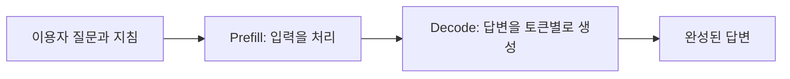
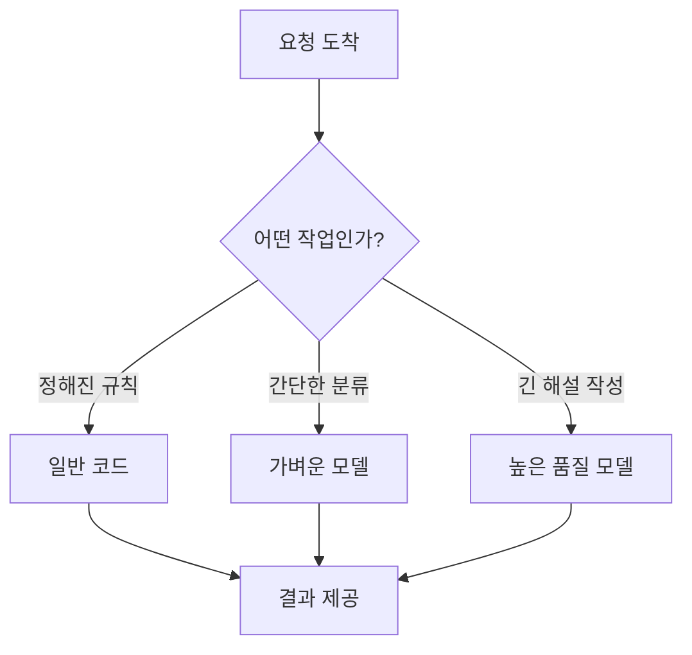
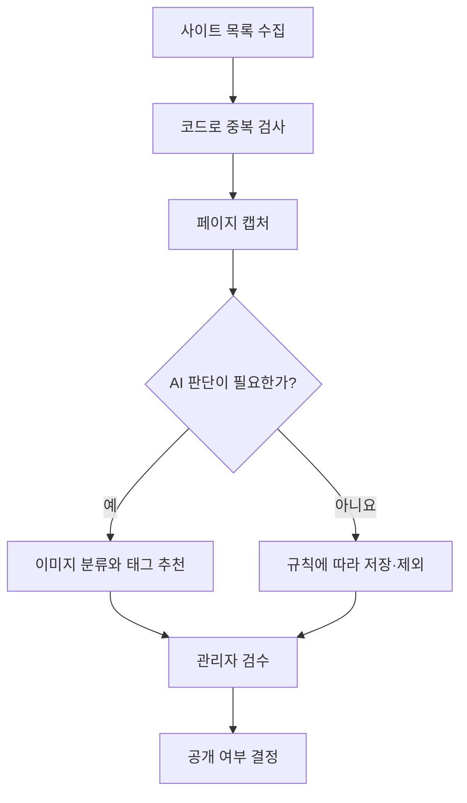

# 07. AI 서비스의 비용과 속도

> **비개발자를 위한 AI 시스템 설계 입문서 · 07**  
> 이번 장의 질문: **AI에게 한 번 질문했을 뿐인데 왜 비용이 발생하고, 어떤 답변은 왜 오래 걸릴까?**

- 난이도: ★★☆☆☆ — 계산식은 간단, 설계 습관이 중요
- 예상 학습 시간: 20~30분
- 먼저 읽기: [06. AI 서비스의 오류와 안전장치](06_AI_서비스의_오류와_안전장치.md)
- 참고 원문: [AI System Design Guide — Cost Optimization Playbook](https://github.com/ombharatiya/ai-system-design-guide/blob/main/04-inference-optimization/07-cost-optimization-playbook.md)

> 이 글은 원문을 옮긴 번역본이 아니라, 원문의 추론 최적화·시스템 설계 주제를 초보자를 위해 새로 풀어 쓴 **독립 해설**이다. 이 글의 비용 예시는 설명을 위한 가상 단가이며, 특정 AI 서비스의 실제 청구액이나 현재 요금을 의미하지 않는다.

---

## 1. 무료로 질문하는 것 같은데, AI 서비스는 무엇에 돈을 쓸까?

AI 채팅 화면에서 질문을 입력할 때는 마치 검색창을 쓰는 것 같다. 하지만 뒤에서는 상당한 계산이 일어난다.

카페를 떠올려 보자. 커피 한 잔을 주문하면 손님은 주문하고 기다리기만 한다. 하지만 가게는 원두, 머신, 전기, 직원, 공간에 비용을 쓴다.

AI도 비슷하다. 사용자는 질문하고 답을 받지만, 서비스 제공자는 계산을 실행하는 서버와 GPU, 데이터 전송, 저장소 등에 비용을 쓴다. 외부 AI API를 연결해 만든 앱이라면 개발자는 보통 **API 사용량에 따라 청구되는 요금**을 부담한다.

**꼭 구별할 것**

- ChatGPT 같은 완성된 서비스의 구독료
- 개발자가 OpenAI·Google·Anthropic 등의 **API를 호출하는 비용**
- Vercel·데이터베이스·파일 저장소·이메일 등 **AI 외의 서비스 운영비**

이 셋은 서로 다르게 계산된다. ChatGPT를 구독한다고 내가 만든 웹사이트에서 쓰는 API가 자동으로 무료가 되지는 않는다.

### 실제 사례: 찐망고 사주풀이

방문자가 생년월일을 입력하고 ‘결과 보기’를 누르면, 시스템은 입력값을 계산·정리하고 AI에 해설을 요청할 수 있다.

사용자는 **버튼 한 번**을 눌렀지만 서버에서는:

1. 입력값을 검사하고
2. 사주 계산에 필요한 데이터를 만들고
3. 해설 지침과 계산 결과를 AI API로 보내고
4. AI 응답을 받아 화면에 표시하고
5. 필요한 경우 결과를 저장하는

여러 단계가 실행된다. 이 가운데 AI API 호출 비용과 데이터 저장 비용은 별개다.

> **이 장의 첫 번째 핵심:** ‘버튼 클릭 횟수’와 ‘AI API 요청 횟수’는 같지 않을 수 있다.

---

## 2. 토큰은 AI 사용량을 재는 단위다

[01. 토큰화와 컨텍스트 창](01_토큰화와_컨텍스트_창.md)에서 토큰은 AI가 글을 처리하기 위한 작은 단위라고 배웠다.

대부분의 텍스트 AI API는 사용량을 **입력 토큰(Input tokens)**과 **출력 토큰(Output tokens)**으로 구분한다. 모델이나 기능에 따라 캐시된 입력, 이미지·오디오 처리, 도구 호출 등이 별도로 청구될 수도 있다.

| 구분 | 뜻 | 예시 |
|---|---|---|
| 입력 토큰 | AI에게 보내는 내용 | 시스템 지침, 이용자 질문, 사주 계산 결과, 이전 대화 |
| 출력 토큰 | AI가 생성하는 내용 | 사주 해설, 궁합 설명, 추천 문구 |
| 캐시 입력 | 재사용할 수 있어 제공자가 캐시로 처리한 입력 | 여러 요청에 반복해서 넣는 고정 안내문 |

### 실수하기 쉬운 부분

사용자가 ‘오늘 운세 알려줘’라고 열 글자 남짓 입력했다고 입력 비용도 아주 작을 거라고 생각하면 안 된다.

개발자가 뒤에서 다음 내용을 함께 보낼 수 있기 때문이다.

- 서비스의 성격과 금지 규칙
- 사주 풀이의 상세 해석 지침
- 해설의 문체와 예시
- 만세력 계산 결과
- 이전에 생성했던 대화 일부

즉 **사용자에게 보이는 질문 길이 ≠ 실제 API 입력 길이**다.

---

## 3. 비용 계산은 생각보다 간단하다

01장에서 한 번 해 본 계산을, 이번에는 실제 운영 상황으로 넓혀 보자. 가장 기본적인 계산식은 다음과 같다.

```text
입력 비용 = 입력 토큰 수 ÷ 1,000,000 × 입력 단가
출력 비용 = 출력 토큰 수 ÷ 1,000,000 × 출력 단가
기본 호출 비용 = 입력 비용 + 출력 비용
```

왜 백만으로 나눌까? API 요금표가 보통 **100만 토큰당 가격**으로 표시되기 때문이다.

### 가상의 연습 문제

아래 숫자는 실제 제품의 요금이 아니라 계산을 연습하기 위한 **가정**이다.

- 입력 단가: 100만 토큰당 $1
- 출력 단가: 100만 토큰당 $4
- 한 번 요청할 때 입력 4,000토큰
- AI가 생성한 출력 1,000토큰

```text
입력 비용 = 4,000 / 1,000,000 × $1 = $0.004
출력 비용 = 1,000 / 1,000,000 × $4 = $0.004
합계 = $0.008 / 요청 1회
```

이 요청을 하루 1,000회, 30일 동안 실행한다면:

```text
$0.008 × 1,000 × 30 = $240 / 월
```

여기에는 재시도, 이미지·검색 도구, 데이터베이스, 서버 요금, 환율과 세금 등이 포함되지 않았다.

**중요한 것은 $240이라는 숫자가 아니라 계산하는 습관이다.** 서비스를 무료로 할지 유료로 할지 정하기 전에 ‘한 이용자당 몇 번 호출하는가’를 알아야 한다.

### 단가가 달라지는 이유

모델마다 입력과 출력 단가가 다르고, 같은 제공자라도 처리 속도·배치 처리·컨텍스트 길이·캐시 설정에 따라 가격이 달라질 수 있다. 실제로 운영하기 전에는 반드시 공식 요금표를 확인해야 한다.

- [OpenAI API 요금표](https://developers.openai.com/api/docs/pricing)
- [Google Gemini API 요금표](https://ai.google.dev/gemini-api/docs/pricing)
- [Anthropic Claude API 요금표](https://platform.claude.com/docs/en/about-claude/pricing)

> 참고: 이 문서는 특정 모델의 현재 단가를 고정해서 적지 않는다. 가격과 모델 이름은 계속 바뀌기 때문이다.

---

## 4. AI가 답변하기까지는 두 가지 시간이 있다

AI가 느리게 느껴질 때, 그 시간을 한 덩어리로 보면 해결하기 어렵다.

크게 나눠 보자.

**① 첫 글자가 나오기까지의 시간**  
**② 첫 글자가 나온 뒤 답변이 완성될 때까지의 시간**

식당으로 비유하면 이렇다.

- 첫 글자까지의 시간: 주문 후 첫 음식이 나오기까지 기다리는 시간
- 답변 완성까지의 시간: 코스 요리가 차례대로 다 나오는 데 걸리는 시간

전문 용어도 알아 두자.

| 기술 용어 | 쉬운 뜻 | 체감 예시 |
|---|---|---|
| TTFT (Time to First Token) | 첫 출력이 도착하기까지 | 화면이 언제 말하기 시작하는가 |
| TPS (Tokens per Second) | 초당 생성 토큰 수 | 말하기 시작한 다음 얼마나 빨리 적히는가 |
| Latency | 요청부터 응답까지의 지연 시간 | 실제 사용자 대기 시간 |
| Throughput | 일정 시간에 처리하는 작업량 | 같은 시간에 몇 명을 처리하는가 |

**TTFT가 짧다고 전체 응답까지 빠른 것은 아니다.** 글이 길면 첫 문장이 빨리 보여도 끝까지는 오래 걸릴 수 있다.

---

## 5. Prefill과 Decode: 읽는 시간과 쓰는 시간

AI의 처리 과정에는 크게 두 단계가 있다.



**Prefill(입력 처리)**은 사용자가 보낸 질문, 지침, 자료를 먼저 처리하는 단계다. **Decode(출력 생성)**는 처리한 내용을 바탕으로 답을 하나씩 만들어 내는 단계다.

학생이 과제를 풀 때도 비슷하다.

1. 문제와 참고자료를 읽고 이해한다.
2. 답안지를 작성한다.

참고자료가 너무 많으면 읽는 시간이 늘 수 있고, 답안지 분량이 지나치게 길면 작성 시간도 길어질 수 있다.

다만 실제 속도는 모델 구조, 캐시, 서버 혼잡, 장비, 네트워크에 따라 달라진다. **입력이 두 배 길다고 대기 시간도 정확히 두 배가 되는 것은 아니다.**

---

## 6. 스트리밍: 속도를 높이지 않아도 빨라 보일 수 있다

사주 해설을 생성한다고 해 보자.

**방식 A: 완성 후 한 번에 보여 주기**

```text
사용자 클릭 → 화면은 로딩 중 → 전체 답변 완성 → 결과 표시
```

**방식 B: 만들어지는 내용부터 보여 주기(Streaming)**

```text
사용자 클릭 → 첫 문장 표시 → 다음 문장 표시 → 결과 완성
```

스트리밍은 **AI 자체의 계산을 반드시 더 빠르게 만드는 기술이 아니라**, 사용자가 답을 일찍 읽기 시작하도록 돕는 방식이다.

### 그런데 항상 스트리밍이 좋을까?

그렇지 않다. 궁합 결과를 카드 여섯 개로 나눠서 정해진 구조대로 표시해야 한다면, 생성 중인 불완전한 JSON 데이터를 그대로 보여 주기 어려울 수 있다.

그런 경우에는 다음 방법도 있다.

- 단계별 진행 상태 표시
- 결과 생성 뒤 카드별로 순차 노출
- 짧은 요약을 먼저 만들고 상세 설명은 나중에 제공

**사용자가 체감하는 속도와 서버가 처리하는 속도는 구별해서 설계하자.**

---

## 7. 같은 설명을 매번 다시 보내는 건 낭비일까?

찐망고 사주풀이에서 모든 사용자에게 공통으로 적용할 지침이 있다고 생각해 보자.

```text
해설은 쉬운 한국어로 설명한다.
확실하지 않은 내용은 단정하지 않는다.
두 사람의 역할을 혼동하지 않는다.
카드별 제목과 본문 구조를 유지한다.
```

이처럼 반복되는 입력을 효율적으로 처리하기 위한 기술이 **프롬프트 캐싱(Prompt Caching)**이다.

학생이 매 수업마다 교과서 첫 장부터 다시 공부하지 않고, 앞에서 익힌 내용을 재활용하는 것과 비슷하다.

하지만 캐싱에 대해 반드시 알아야 할 세 가지가 있다.

1. **캐시는 제공자와 모델에 따라 지원 조건이 다르다.**
2. **반복된 내용을 보내기만 하면 무조건 캐시가 적용되는 것은 아니다.** 정확히 일치하는 앞부분, 최소 길이, 유지 시간 등의 조건이 있을 수 있다.
3. **캐시 기록에도 비용이나 유효 기간이 있을 수 있다.** 캐시 쓰기와 읽기 요금을 구분하는 서비스도 있다.

공식 설명: [Anthropic Prompt Caching](https://platform.claude.com/docs/en/build-with-claude/prompt-caching)

> **실무 포인트:** 반복되는 긴 지침을 고정된 앞부분에 배치할 수 있는지 살펴보되, 실제 캐시 적중률과 비용을 측정한 뒤 적용하자.

---

## 8. 가장 비싼 실수는 필요 없는 AI 호출이다

예를 들어 ‘저장 버튼을 누르지 않았습니다’라는 오류 문구를 생각해 보자.

이 문장을 만들려고 AI에게 매번 물어볼 필요는 없다.

```javascript
if (!isSaved) {
  return "아직 저장되지 않았어요. 저장 버튼을 눌러 주세요.";
}
```

이런 결과는 코드로 처리하는 편이 더 안정적이고 빠르며 비용도 예측하기 쉽다.

AI에게 맡기면 좋은 일과 코드로 충분한 일을 나눠 보자.

| 해야 할 일 | 권장 방식 | 이유 |
|---|---|---|
| 날짜 형식 검사 | 코드 | 규칙이 명확함 |
| 사주 계산값 산출 | 검증된 계산 로직 | 일관성과 재현성이 중요함 |
| 해설을 자연스러운 문장으로 작성 | AI 활용 가능 | 다양한 표현이 필요함 |
| 필수 항목이 모두 나왔는지 확인 | 코드 검증 | 누락 여부를 명확하게 판정할 수 있음 |
| 웹사이트 카테고리 태그 추천 | 규칙 + AI 조합 | 분류 기준과 의미 판단을 함께 활용 |
| 같은 오류를 수정하려고 무한 재요청 | 피해야 함 | 비용과 장애 위험이 커짐 |

**AI를 잘 쓰는 설계는 AI를 최대한 많이 호출하는 설계가 아니다.**

---

## 9. 큰 모델이 항상 정답은 아니다

모든 질문에 가장 비싸고 무거운 모델을 쓰는 것은, 메모 한 장을 쓰려고 전문 편집팀 전체를 부르는 것과 비슷하다.

간단한 텍스트 분류는 작은 모델로도 충분할 수 있고, 복잡한 추론과 세밀한 글쓰기에는 더 강력한 모델이 필요할 수 있다.

### 모델 라우팅(Model Routing)

질문의 종류에 따라 사용할 모델이나 처리 방식을 정하는 접근이다.



다만 모델을 나누면 시스템이 복잡해지고, 분기 기준을 잘못 잡으면 품질이 낮아질 수 있다. **먼저 평가 기준을 만들고 나서** 모델을 바꾸는 것이 순서다. ([05. AI 서비스의 품질을 평가하는 방법](05_AI_서비스의_품질을_평가하는_방법.md) 참고)

---

## 10. 사용자가 많아지면 왜 갑자기 느려질까?

손님이 한 명일 때는 주문을 바로 받지만, 동시에 백 명이 주문하면 줄이 생긴다.

AI 서비스도 마찬가지다. 혼잡하면 요청이 대기할 수 있고, API 제공자의 **요청·토큰 사용량 제한(Rate Limits)** 때문에 일부 요청이 거절될 수도 있다.

단순히 ‘사용자가 100명이니 AI 비용도 100배’라고만 생각하면 안 된다. **동시에 몰리는지**, **한 사람이 여러 번 요청하는지**, **실패 후 재시도가 발생하는지**가 중요하다.

### 재시도 때문에 오히려 더 큰 문제가 생기는 경우

```text
사용자 클릭
  ↓
AI 호출 실패
  ↓
브라우저가 즉시 재시도
  ↓
또 실패 → 또 재시도 → 요청 폭증
```

이런 상황을 막으려면 다음이 필요하다.

- 버튼 연타 방지 및 중복 요청 방지
- 재시도 횟수 제한
- 재시도 사이에 간격 두기(Exponential Backoff)
- 한 사용자 또는 계정의 호출량 제한
- 비용 상한 또는 알림 설정
- 실패해도 사용자가 이해할 수 있는 안내 제공

서버가 실제로 요청을 처리했는데 브라우저만 응답을 못 받은 경우도 있다. 따라서 **모든 재시도가 무료이거나 무해하다고 가정하면 안 된다.**

---

## 11. 찐망고 사주풀이에 적용하면?

가상의 운영 점검 사례다. 현재 서비스에 실제로 문제가 있다는 의미는 아니다.

### 상황 A: 해설이 너무 길다

- 문제: 출력 토큰이 많이 들고 완료까지 오래 걸릴 수 있다.
- 먼저 할 일: 이용자가 실제로 읽는 길이 확인.
- 개선 실험: 요약 카드 + 선택적으로 펼치는 상세 설명.
- 주의: 무조건 짧게 줄여 해설의 유용성이 떨어지지 않는지 평가해야 한다.

### 상황 B: 모든 요청에 매우 긴 공통 지침을 넣는다

- 문제: 입력 사용량이 불필요하게 클 수 있다.
- 개선 실험: 중복 문장 제거, 지침 우선순위 정리, 캐싱 조건 검토.
- 주의: 정확성을 지키는 필수 규칙을 무작정 삭제하지 않는다.

### 상황 C: AI가 응답 형식을 잘못 보내 재생성한다

- 문제: 추가 호출로 비용과 지연이 늘 수 있다.
- 개선 실험: 구조화된 출력, 스키마 검증, 제한된 재시도.
- 주의: 스키마 검사는 문장 내용의 정확성까지 보장하지 않는다.

### 상황 D: 무료 이용자가 반복해서 버튼을 누른다

- 문제: 실제 이용자 수보다 API 요청이 훨씬 많아질 수 있다.
- 개선 실험: 요청 중 버튼 비활성화, 사용량 제한, 동일 요청 중복 방지.
- 주의: 같은 생년월일이라도 개인 정보와 사용자별 설정이 섞인 결과를 다른 사람에게 그대로 재사용해서는 안 된다.

---

## 12. 찐망고 레퍼런스에 적용하면?

레퍼런스 수집 파이프라인은 모든 단계에 AI를 쓸 필요가 없다.



이미 같은 사이트가 등록되어 있는지, 파일이 정상 저장되었는지는 AI가 아니라 코드로 판단할 수 있다.

반대로 캡처 이미지가 히어로 섹션인지, 콘텐츠가 지나치게 잘려 있는지, 시각적으로 적절한지는 AI나 사람이 판단하면 도움이 될 수 있다.

여기서 목표는 단순히 비용을 줄이는 것이 아니다. **불필요한 AI 판단을 줄이고, 정말 필요한 판단에만 비용을 쓰는 것**이다.

---

## 13. 운영 대시보드에서 확인할 숫자 6개

처음부터 복잡한 분석 시스템을 만들 필요는 없다. 아래 여섯 개만 기록해도 서비스 운영이 훨씬 명확해진다.

| 지표 | 무엇을 알려 줄까? |
|---|---|
| 요청 수 | 사용자가 얼마나 호출했는가 |
| 요청당 평균 비용 | 한 번의 결과를 만드는 데 얼마가 드는가 |
| 입력·출력 토큰 수 | 비용이 늘어난 이유가 무엇인가 |
| P50·P95 응답 시간 | 보통 사용자와 느린 사용자 경험이 어떤가 |
| 실패율·재시도 횟수 | 장애나 불필요한 반복이 있는가 |
| 모델별 품질 평가 | 싼 모델로 바꿔도 괜찮은가 |

**P95 응답 시간**은 요청 100개 가운데 약 95개가 그 시간 안에 완료된다는 뜻이다. 평균만 보면 아주 느린 이용자 경험이 가려질 수 있다.

예를 들어 평균 응답이 5초여도 어떤 이용자는 20초 이상 기다릴 수 있다. 이런 불편을 알아보려면 P95를 확인하는 편이 좋다.

> 로그를 기록할 때는 개인정보가 들어 있는 전체 프롬프트나 결과를 무작정 저장하지 말고, 가능한 한 토큰 수·시간·오류 코드처럼 필요한 운영 정보만 남겨야 한다.

---

## 14. 수업에서 바로 해 보는 20분 실습

### 과제: ‘AI 웹사이트 소개 문구 생성기’ 설계하기

학생에게 다음 세 가지 방식을 보여 준다.

**A안: 매번 긴 요청 보내기**

```text
우리 회사 소개, 타깃, 브랜드 문체, 금지 표현, 예시 5개를 모두 읽고
메인 Hero 제목 20개와 설명 문구 20개를 작성해 줘.
```

**B안: 필요한 정보만 정리해 보내기**

```text
대상: 20대 대학생
목표: 전시 예매 유도
문체: 친근하고 명확하게
요청: Hero 제목 3개와 보조 문구 3개
```

**C안: 코드와 AI 역할 나누기**

```text
코드: 글자 수, 필수 단어 포함 여부 검사
AI: 제목 3개 작성
사람: 브랜드에 적절한 제목 선택
```

### 학생에게 물어볼 질문

1. 어떤 방식이 가장 많은 출력 토큰을 사용할 가능성이 있을까?
2. 가장 저렴해 보이는 방식이 항상 가장 좋은 결과를 줄까?
3. 문구를 20개 만드는 대신 3개만 만들면 UX는 어떻게 달라질까?
4. 다시 만들어 달라는 횟수까지 포함하면 어느 방식이 효율적일까?

### 평가할 때 볼 것

- **정확성:** 브랜드 정보와 맞는가?
- **유용성:** 실제로 선택해 쓸 만한 문구인가?
- **비용:** 토큰·호출 횟수가 적절한가?
- **속도:** 실제 대기 시간이 얼마나 되는가?

가능하다면 같은 모델로 여러 차례 테스트한다. 생성형 AI는 매번 정확히 같은 답을 주지 않을 수 있으므로 한 번의 결과로 단정하지 않는 편이 좋다.

---

## 15. 내가 어디까지 알아야 할까?

| 수준 | 알아야 하는 내용 | 지금 필요한가? |
|---|---|---|
| 기본 | 입력/출력 토큰과 API 비용 차이 | **필수** |
| 기본 | 첫 출력 시간과 전체 응답 시간 구분 | **필수** |
| 실무 | 중복 요청·재시도·사용량 제한 | **필수** |
| 실무 | 모델 선택과 결과 품질 평가 | **필수** |
| 선택 | 프롬프트 캐시 조건과 캐시 적중률 | 서비스 규모에 따라 |
| 심화 | GPU 메모리 대역폭, KV Cache 계산 | 직접 모델을 호스팅할 때 |
| 심화 | PagedAttention, 연속 배치, 양자화 | 추론 서버를 운영할 때 |

다시 말해, 지금 당장 GPU 메모리 계산식을 외울 필요는 없다. 대신 **‘버튼 한 번이 API 몇 번으로 연결되는지’**는 알아야 한다.

---

## 16. 이 장을 한 문장으로 정리하면

> **빠르고 경제적인 AI 서비스는 무조건 작은 모델을 쓰는 서비스가 아니라, AI가 꼭 필요한 곳에만 적절하게 쓰이도록 설계한 서비스다.**

처음부터 성능을 무작정 최적화하지 말자. 이 순서가 더 중요하다.

**측정한다 → 가장 큰 낭비를 찾는다 → 한 가지를 바꾼다 → 품질과 비용을 함께 다시 측정한다.**

---

## 확인 문제

1. ChatGPT 구독료와 개발자 API 비용은 왜 다른가?
2. 사용자의 질문은 짧은데 API 입력 토큰은 많을 수 있는 이유는?
3. 스트리밍은 서버의 계산 속도를 반드시 올리는 기술인가?
4. API 재시도 횟수를 제한해야 하는 이유는?
5. 내 서비스에서 AI를 쓰지 않고 코드로 처리할 수 있는 작업은 무엇인가?

<details>
<summary>정답 방향 보기</summary>

1. 완성형 서비스 이용료와 프로그램에서 모델을 호출하는 사용량 요금은 별개다.
2. 보이지 않는 시스템 지침·예시·데이터·대화 기록이 함께 전송될 수 있다.
3. 아니다. 사용자에게 결과를 더 일찍 보여 주어 체감 대기를 줄일 수 있다.
4. 실패가 반복 호출과 비용 폭증으로 이어질 수 있기 때문이다.
5. 형식 검사, 중복 확인, 고정 안내문, 권한 검사 같은 명확한 규칙 작업.

</details>

---

## 다음 장 예고

**[08. AI가 대화를 기억하는 방법](08_AI가_대화를_기억하는_방법.md)**  
매번 처음 만난 것 같은 AI를 어떻게 바꿀 수 있을까? 대화 기록과 기억이 어떻게 설계되는지 살펴본다.

## 참고 자료

- [Om Bharatiya, *AI System Design Guide — Cost Optimization Playbook*](https://github.com/ombharatiya/ai-system-design-guide/blob/main/04-inference-optimization/07-cost-optimization-playbook.md)
- [OpenAI API Pricing](https://developers.openai.com/api/docs/pricing)
- [Gemini API Pricing](https://ai.google.dev/gemini-api/docs/pricing)
- [Anthropic Claude API Pricing](https://platform.claude.com/docs/en/about-claude/pricing)
- [Anthropic Prompt Caching](https://platform.claude.com/docs/en/build-with-claude/prompt-caching)
