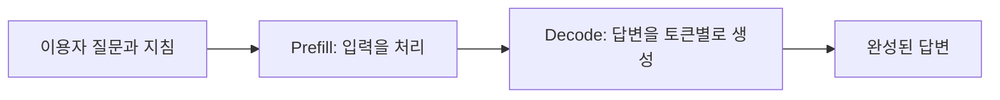
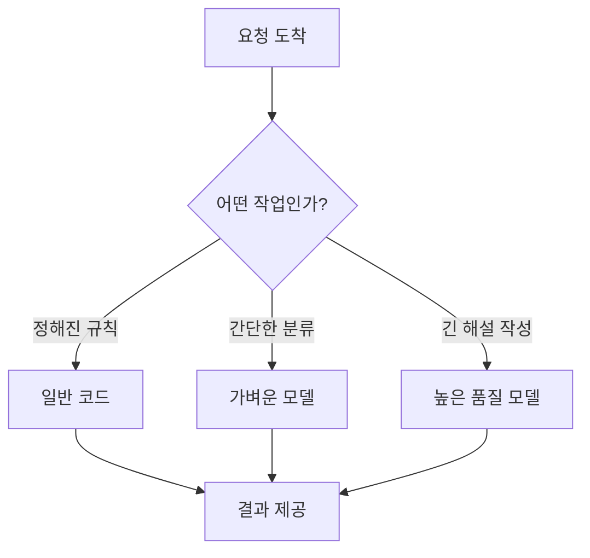
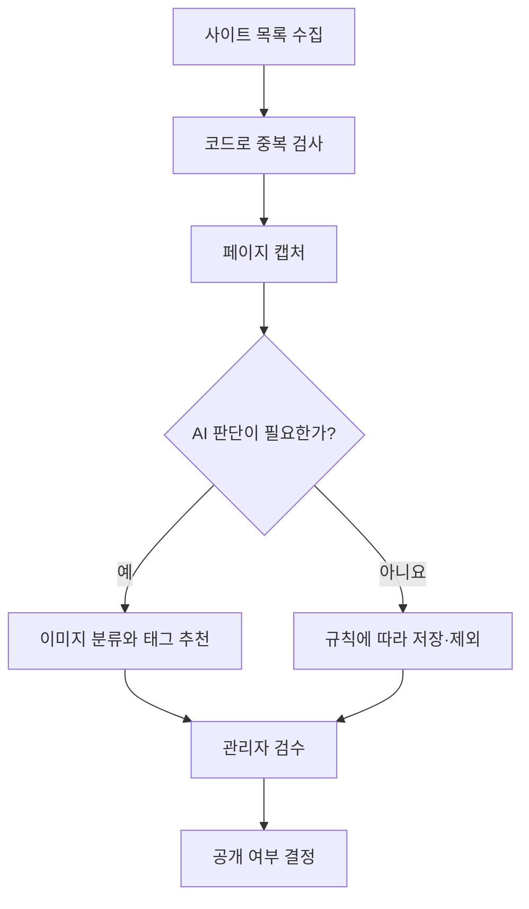

# 07. AI 서비스의 비용과 속도

> **비개발자를 위한 AI 시스템 설계 입문서 · 07**  
> 이번 장의 질문: **AI에게 한 번 질문했을 뿐인데 왜 비용이 발생하고, 어떤 답변은 왜 오래 걸릴까?**

- 난이도: ★★☆☆☆ — 계산식은 간단, 설계 습관이 중요
- 예상 학습 시간: 20~30분
- 먼저 읽기: [06. AI 서비스의 오류와 안전장치](06_AI_서비스의_오류와_안전장치.md)
- 참고 원문: [AI System Design Guide — Cost Optimization Playbook](https://github.com/ombharatiya/ai-system-design-guide/blob/main/04-inference-optimization/07-cost-optimization-playbook.md)

> 이 글은 원문을 옮긴 번역본이 아니라, 원문의 추론 최적화·시스템 설계 주제를 초보자 눈높이에 맞춰 새로 풀어 쓴 **독립 해설**이에요. 비용 예시는 설명용 가상 단가라서 특정 AI 서비스의 실제 청구액이나 현재 요금과는 관계없어요.

---

## 1. 무료로 질문하는 것 같은데, AI 서비스는 어디에 돈을 쓸까요?

AI 채팅창에 질문을 입력할 때는 검색창 쓰는 거랑 비슷하게 느껴지죠. 그런데 그 뒤에서는 꽤 많은 계산이 돌아가요.

카페를 떠올려 볼게요. 손님은 커피 한 잔 주문하고 기다리기만 하지만, 가게는 원두, 머신, 전기, 직원, 공간에 돈을 쓰잖아요.

AI도 비슷해요. 사용자는 질문하고 답을 받을 뿐이지만, 서비스 쪽에서는 계산을 돌리는 서버와 GPU, 데이터 전송, 저장소에 비용을 써요. 외부 AI API를 연결해서 만든 앱이라면 개발자가 보통 **API 사용량만큼 청구되는 요금**을 내고요.

**꼭 구별할 것**

- ChatGPT 같은 완성된 서비스의 구독료
- 개발자가 OpenAI·Google·Anthropic 등의 **API를 호출하는 비용**
- Vercel·데이터베이스·파일 저장소·이메일 같은 **AI 외의 운영비**

이 셋은 따로따로 계산돼요. ChatGPT를 구독한다고 내 웹사이트에서 쓰는 API가 공짜가 되는 건 아니에요.

### 실제 사례: 찐망고 사주풀이

방문자가 생년월일을 넣고 '결과 보기'를 누르면, 시스템은 입력값을 계산·정리해서 AI에 해설을 요청할 수 있어요.

사용자는 **버튼을 한 번** 눌렀지만, 서버에서는:

1. 입력값을 검사하고
2. 사주 계산에 필요한 데이터를 만들고
3. 해설 지침과 계산 결과를 AI API로 보내고
4. AI 응답을 받아 화면에 보여 주고
5. 필요하면 결과를 저장해요

이렇게 여러 단계가 돌아가요. 그리고 이 중 AI API 호출 비용과 데이터 저장 비용은 별개예요.

> **이 장의 첫 번째 핵심:** '버튼 클릭 횟수'와 'AI API 요청 횟수'는 다를 수 있다!

---

## 2. 토큰은 AI 사용량을 재는 단위예요

[01. 토큰화와 컨텍스트 창](01_토큰화와_컨텍스트_창.md)에서 토큰은 AI가 글을 처리하는 작은 단위라고 했죠.

대부분의 텍스트 AI API는 사용량을 **입력 토큰(Input tokens)**과 **출력 토큰(Output tokens)**으로 나눠서 계산해요. 모델이나 기능에 따라 캐시된 입력, 이미지·오디오 처리, 도구 호출이 따로 청구되기도 하고요.

| 구분 | 뜻 | 예시 |
|---|---|---|
| 입력 토큰 | AI에게 보내는 내용 | 시스템 지침, 이용자 질문, 사주 계산 결과, 이전 대화 |
| 출력 토큰 | AI가 생성하는 내용 | 사주 해설, 궁합 설명, 추천 문구 |
| 캐시 입력 | 재사용할 수 있어 제공자가 캐시로 처리한 입력 | 여러 요청에 반복해서 넣는 고정 안내문 |

### 실수하기 쉬운 부분

사용자가 "오늘 운세 알려줘" 열 글자 남짓 썼으니까 입력 비용도 작겠지? 싶잖아요. 그런데 실제로는 그렇지 않아요.

뒤에서 개발자가 이런 걸 같이 보낼 수 있거든요.

- 서비스 성격과 금지 규칙
- 사주 풀이의 상세 해석 지침
- 해설 문체와 예시
- 만세력 계산 결과
- 이전에 생성했던 대화 일부

그래서 **화면에 보이는 질문 길이 ≠ 실제 API 입력 길이**예요.

---

## 3. 비용 계산은 생각보다 간단해요

01장에서 한 번 해 본 계산을, 이번엔 실제 운영 상황으로 넓혀 볼게요. 기본 계산식은 이래요.

```text
입력 비용 = 입력 토큰 수 ÷ 1,000,000 × 입력 단가
출력 비용 = 출력 토큰 수 ÷ 1,000,000 × 출력 단가
기본 호출 비용 = 입력 비용 + 출력 비용
```

왜 백만으로 나누냐고요? API 요금표가 보통 **100만 토큰당 가격**으로 나와 있어서예요.

### 가상의 연습 문제

아래 숫자는 실제 요금이 아니라 계산 연습용 **가정**이에요.

- 입력 단가: 100만 토큰당 $1
- 출력 단가: 100만 토큰당 $4
- 한 번 요청할 때 입력 4,000토큰
- AI가 생성한 출력 1,000토큰

```text
입력 비용 = 4,000 / 1,000,000 × $1 = $0.004
출력 비용 = 1,000 / 1,000,000 × $4 = $0.004
합계 = $0.008 / 요청 1회
```

이 요청을 하루 1,000번, 30일 동안 하면:

```text
$0.008 × 1,000 × 30 = $240 / 월
```

여기엔 재시도, 이미지·검색 도구, 데이터베이스, 서버 요금, 환율과 세금이 빠져 있어요.

중요한 건 $240이라는 숫자가 아니라 **계산하는 습관**이에요. 서비스를 무료로 할지 유료로 할지 정하기 전에, '이용자 한 명이 몇 번 호출하는지'부터 알아야 하거든요.

### 단가가 달라지는 이유

모델마다 입력·출력 단가가 다르고, 같은 회사라도 처리 속도·배치 처리·컨텍스트 길이·캐시 설정에 따라 가격이 달라져요. 실제로 운영하기 전에는 꼭 공식 요금표를 확인하세요.

- [OpenAI API 요금표](https://developers.openai.com/api/docs/pricing)
- [Google Gemini API 요금표](https://ai.google.dev/gemini-api/docs/pricing)
- [Anthropic Claude API 요금표](https://platform.claude.com/docs/en/about-claude/pricing)

> 참고: 이 글은 특정 모델의 현재 단가를 적어 두지 않아요. 가격과 모델 이름은 계속 바뀌거든요.

---

## 4. AI가 답하기까지는 두 가지 시간이 있어요

AI가 느리다고 느껴질 때, 그 시간을 한 덩어리로 보면 고치기 어려워요.

크게 두 개로 나눠 볼게요.

**① 첫 글자가 나오기까지의 시간**  
**② 첫 글자가 나온 뒤 답이 다 완성될 때까지의 시간**

식당으로 비유하면 이래요.

- 첫 글자까지의 시간: 주문하고 첫 음식이 나오기까지 기다리는 시간
- 답변 완성까지의 시간: 코스 요리가 차례대로 다 나오는 데 걸리는 시간

전문 용어도 같이 알아 두면 좋아요.

| 기술 용어 | 쉬운 뜻 | 체감 예시 |
|---|---|---|
| TTFT (Time to First Token) | 첫 출력이 도착하기까지 | 화면이 언제 말하기 시작하는가 |
| TPS (Tokens per Second) | 초당 생성 토큰 수 | 말하기 시작한 다음 얼마나 빨리 적히는가 |
| Latency | 요청부터 응답까지의 지연 시간 | 실제 사용자 대기 시간 |
| Throughput | 일정 시간에 처리하는 작업량 | 같은 시간에 몇 명을 처리하는가 |

**TTFT가 짧다고 전체 응답까지 빠른 건 아니에요.** 글이 길면 첫 문장은 금방 떠도 끝까지는 한참 걸릴 수 있어요.

---

## 5. Prefill과 Decode: 읽는 시간과 쓰는 시간

AI가 처리하는 과정은 크게 두 단계예요.



**Prefill(입력 처리)**은 사용자가 보낸 질문, 지침, 자료를 먼저 읽고 처리하는 단계예요. **Decode(출력 생성)**는 그걸 바탕으로 답을 한 조각씩 만들어 내는 단계고요.

학생이 과제 푸는 거랑 비슷해요.

1. 문제와 참고자료를 읽고 이해한다
2. 답안지를 쓴다

참고자료가 너무 많으면 읽는 시간이 늘고, 답안지 분량이 너무 길면 쓰는 시간도 길어지겠죠.

다만 실제 속도는 모델 구조, 캐시, 서버 혼잡, 장비, 네트워크에 따라 달라져요. **입력이 두 배 길다고 기다리는 시간도 딱 두 배가 되는 건 아니에요.**

---

## 6. 스트리밍: 속도를 안 높여도 빨라 보일 수 있어요

사주 해설을 생성한다고 해 볼게요.

**방식 A: 다 만든 다음 한 번에 보여 주기**

```text
사용자 클릭 → 화면은 로딩 중 → 전체 답변 완성 → 결과 표시
```

**방식 B: 만들어지는 대로 보여 주기(Streaming)**

```text
사용자 클릭 → 첫 문장 표시 → 다음 문장 표시 → 결과 완성
```

스트리밍은 **AI 계산 자체를 더 빠르게 해 주는 기술이 아니라**, 사용자가 답을 더 일찍 읽기 시작하게 해 주는 방식이에요.

### 그럼 항상 스트리밍이 좋을까요?

그렇지는 않아요. 궁합 결과를 카드 여섯 개로 나눠서 정해진 구조대로 보여 줘야 한다면, 아직 만들어지는 중인 불완전한 JSON을 그대로 보여 주기가 어렵거든요.

그럴 땐 이런 방법도 있어요.

- 단계별 진행 상태 보여 주기
- 결과가 다 만들어진 뒤 카드를 하나씩 순서대로 보여 주기
- 짧은 요약을 먼저 만들고 상세 설명은 나중에 보여 주기

**사용자가 느끼는 속도와 서버가 처리하는 속도는 따로 설계하기!**

---

## 7. 같은 설명을 매번 다시 보내는 건 낭비일까요?

찐망고 사주풀이에서 모든 사용자에게 똑같이 적용하는 지침이 있다고 해 볼게요.

```text
해설은 쉬운 한국어로 설명한다.
확실하지 않은 내용은 단정하지 않는다.
두 사람의 역할을 혼동하지 않는다.
카드별 제목과 본문 구조를 유지한다.
```

이렇게 반복되는 입력을 효율적으로 처리하는 기술이 **프롬프트 캐싱(Prompt Caching)**이에요.

학생이 매 수업마다 교과서 첫 장부터 다시 공부하지 않고, 앞에서 익힌 걸 재활용하는 것과 비슷해요.

그런데 캐싱은 꼭 알아 둘 게 세 가지 있어요.

1. **제공자와 모델마다 지원 조건이 달라요.**
2. **반복되는 내용을 보낸다고 무조건 캐시가 적용되진 않아요.** 앞부분이 정확히 같아야 하거나, 최소 길이나 유지 시간 같은 조건이 있을 수 있어요.
3. **캐시에도 비용이나 유효 기간이 있을 수 있어요.** 캐시 쓰기와 읽기 요금을 따로 받는 곳도 있고요.

공식 설명: [Anthropic Prompt Caching](https://platform.claude.com/docs/en/build-with-claude/prompt-caching)

> **실무 포인트:** 반복되는 긴 지침을 고정된 앞부분에 둘 수 있는지 살펴보고, 실제 캐시 적중률과 비용을 재 본 다음 적용하기!

---

## 8. 제일 비싼 실수는 필요 없는 AI 호출이에요

예를 들어 '저장 버튼을 누르지 않았습니다'라는 오류 문구를 생각해 볼게요.

이 문장 하나 만들려고 AI에게 매번 물어볼 필요는 없잖아요.

```javascript
if (!isSaved) {
  return "아직 저장되지 않았어요. 저장 버튼을 눌러 주세요.";
}
```

이런 건 코드로 처리하는 게 더 안정적이고 빠르고, 비용도 예측하기 쉬워요.

AI에게 맡기면 좋은 일과 코드로 충분한 일을 나눠 볼게요.

| 해야 할 일 | 권장 방식 | 이유 |
|---|---|---|
| 날짜 형식 검사 | 코드 | 규칙이 명확함 |
| 사주 계산값 산출 | 검증된 계산 로직 | 일관성과 재현성이 중요함 |
| 해설을 자연스러운 문장으로 작성 | AI 활용 가능 | 다양한 표현이 필요함 |
| 필수 항목이 모두 나왔는지 확인 | 코드 검증 | 누락 여부를 명확하게 판정할 수 있음 |
| 웹사이트 카테고리 태그 추천 | 규칙 + AI 조합 | 분류 기준과 의미 판단을 함께 활용 |
| 같은 오류를 수정하려고 무한 재요청 | 피해야 함 | 비용과 장애 위험이 커짐 |

**AI를 잘 쓰는 설계는 AI를 최대한 많이 부르는 설계가 아니에요.**

---

## 9. 큰 모델이 항상 정답은 아니에요

모든 질문에 제일 비싸고 무거운 모델을 쓰는 건, 메모 한 장 쓰려고 전문 편집팀을 통째로 부르는 것과 비슷해요.

간단한 분류는 작은 모델로도 충분하고, 복잡한 추론이나 섬세한 글쓰기에는 더 강한 모델이 필요할 수 있어요.

### 모델 라우팅(Model Routing)

질문 종류에 따라 쓸 모델이나 처리 방식을 고르는 방법이에요.



다만 모델을 나누면 시스템이 복잡해지고, 나누는 기준을 잘못 잡으면 품질이 떨어질 수 있어요. 그래서 **평가 기준부터 만들고 나서** 모델을 바꾸는 게 순서예요. ([05. AI 서비스의 품질을 평가하는 방법](05_AI_서비스의_품질을_평가하는_방법.md) 참고)

---

## 10. 사용자가 많아지면 왜 갑자기 느려질까요?

손님이 한 명이면 바로 주문을 받지만, 백 명이 한꺼번에 오면 줄이 생기잖아요.

AI 서비스도 같아요. 붐비면 요청이 대기하고, API 제공자의 **요청·토큰 사용량 제한(Rate Limits)** 때문에 일부 요청이 거절되기도 해요.

그래서 '사용자 100명이면 비용도 100배'라고 단순하게 생각하면 안 돼요. **한꺼번에 몰리는지**, **한 사람이 여러 번 요청하는지**, **실패하고 다시 시도하는지**가 중요해요.

### 재시도 때문에 오히려 일이 커지는 경우

```text
사용자 클릭
  ↓
AI 호출 실패
  ↓
브라우저가 즉시 재시도
  ↓
또 실패 → 또 재시도 → 요청 폭증
```

이걸 막으려면 이런 장치가 필요해요.

- 버튼 연타·중복 요청 막기
- 재시도 횟수 제한하기
- 재시도 사이에 간격 두기 (Exponential Backoff)
- 사용자·계정별 호출량 제한하기
- 비용 상한이나 알림 설정하기
- 실패해도 사용자가 이해할 수 있게 안내하기

서버는 실제로 요청을 처리했는데 브라우저만 응답을 못 받은 경우도 있어요. 그러니까 **재시도가 공짜이거나 무해하다고 생각하면 안 돼요.**

---

## 11. 찐망고 사주풀이에 적용하면?

가상의 운영 점검 사례예요. 지금 서비스에 실제로 문제가 있다는 뜻은 아니에요.

### 상황 A: 해설이 너무 길다

- 문제: 출력 토큰이 많이 들고 완료까지 오래 걸림
- 먼저 할 일: 이용자가 실제로 어디까지 읽는지 확인하기
- 개선 실험: 요약 카드 + 펼쳐 보는 상세 설명
- 주의: 무작정 줄이다가 해설의 쓸모가 떨어지지 않는지 평가하기

### 상황 B: 모든 요청에 아주 긴 공통 지침을 넣는다

- 문제: 입력 사용량이 쓸데없이 커질 수 있음
- 개선 실험: 중복 문장 빼기, 지침 우선순위 정리, 캐싱 조건 검토
- 주의: 정확성을 지키는 필수 규칙까지 지우지 않기

### 상황 C: AI가 형식을 틀려서 다시 생성한다

- 문제: 추가 호출로 비용과 시간이 늘어남
- 개선 실험: 구조화된 출력, 스키마 검증, 재시도 횟수 제한
- 주의: 스키마 검사가 문장 내용까지 맞다고 보장하진 않음

### 상황 D: 무료 이용자가 버튼을 계속 누른다

- 문제: 실제 이용자 수보다 API 요청이 훨씬 많아짐
- 개선 실험: 요청 중 버튼 비활성화, 사용량 제한, 같은 요청 중복 막기
- 주의: 같은 생년월일이라도 개인 정보나 사용자별 설정이 섞인 결과를 다른 사람에게 재사용하면 안 됨

---

## 12. 찐망고 레퍼런스에 적용하면?

레퍼런스 수집 파이프라인은 모든 단계에 AI를 쓸 필요가 없어요.



같은 사이트가 이미 등록돼 있는지, 파일이 제대로 저장됐는지는 AI 말고 코드로 판단하면 돼요.

반대로 캡처 이미지가 히어로 섹션인지, 콘텐츠가 너무 잘리진 않았는지, 보기에 괜찮은지는 AI나 사람이 판단하는 게 도움이 되고요.

여기서 목표는 그냥 비용을 줄이는 게 아니에요. **불필요한 AI 판단은 줄이고, 꼭 필요한 판단에만 비용을 쓰는 것**이에요.

---

## 13. 운영 대시보드에서 볼 숫자 6개

처음부터 복잡한 분석 시스템을 만들 필요는 없어요. 아래 여섯 개만 기록해도 운영이 훨씬 또렷해져요.

| 지표 | 무엇을 알려 줄까? |
|---|---|
| 요청 수 | 사용자가 얼마나 호출했는가 |
| 요청당 평균 비용 | 한 번의 결과를 만드는 데 얼마가 드는가 |
| 입력·출력 토큰 수 | 비용이 늘어난 이유가 무엇인가 |
| P50·P95 응답 시간 | 보통 사용자와 느린 사용자 경험이 어떤가 |
| 실패율·재시도 횟수 | 장애나 불필요한 반복이 있는가 |
| 모델별 품질 평가 | 싼 모델로 바꿔도 괜찮은가 |

**P95 응답 시간**은 요청 100개 중 약 95개가 그 시간 안에 끝난다는 뜻이에요. 평균만 보면 아주 오래 기다린 사람들의 경험이 가려지거든요.

예를 들어 평균 응답이 5초여도 누군가는 20초 넘게 기다릴 수 있어요. 그런 불편을 찾아내려면 P95를 같이 보는 게 좋아요.

> 로그를 남길 때는 개인정보가 담긴 프롬프트나 결과 전체를 무작정 저장하지 말고, 토큰 수·시간·오류 코드처럼 꼭 필요한 운영 정보만 남기기!

---

## 14. 수업에서 바로 해 보는 20분 실습

### 과제: 'AI 웹사이트 소개 문구 생성기' 설계하기

학생들에게 세 가지 방식을 보여 주세요.

**A안: 매번 긴 요청 보내기**

```text
우리 회사 소개, 타깃, 브랜드 문체, 금지 표현, 예시 5개를 모두 읽고
메인 Hero 제목 20개와 설명 문구 20개를 작성해 줘.
```

**B안: 필요한 정보만 정리해서 보내기**

```text
대상: 20대 대학생
목표: 전시 예매 유도
문체: 친근하고 명확하게
요청: Hero 제목 3개와 보조 문구 3개
```

**C안: 코드와 AI 역할 나누기**

```text
코드: 글자 수, 필수 단어 포함 여부 검사
AI: 제목 3개 작성
사람: 브랜드에 적절한 제목 선택
```

### 학생에게 물어볼 질문

1. 출력 토큰을 가장 많이 쓸 것 같은 방식은?
2. 제일 싸 보이는 방식이 항상 제일 좋은 결과를 줄까?
3. 문구를 20개 대신 3개만 만들면 UX는 어떻게 달라질까?
4. 다시 만들어 달라는 횟수까지 따지면 어느 쪽이 효율적일까?

### 평가할 때 볼 것

- **정확성:** 브랜드 정보와 맞나?
- **유용성:** 실제로 골라 쓸 만한 문구인가?
- **비용:** 토큰·호출 횟수가 적당한가?
- **속도:** 실제로 얼마나 기다리나?

가능하면 같은 모델로 여러 번 테스트해 보세요. 생성형 AI는 매번 똑같은 답을 주지 않을 수 있어서, 한 번 결과로 단정하지 않는 게 좋아요.

---

## 15. 내가 어디까지 알아야 할까요?

| 수준 | 알아야 하는 내용 | 지금 필요한가? |
|---|---|---|
| 기본 | 입력/출력 토큰과 API 비용 차이 | **필수** |
| 기본 | 첫 출력 시간과 전체 응답 시간 구분 | **필수** |
| 실무 | 중복 요청·재시도·사용량 제한 | **필수** |
| 실무 | 모델 선택과 결과 품질 평가 | **필수** |
| 선택 | 프롬프트 캐시 조건과 캐시 적중률 | 서비스 규모에 따라 |
| 심화 | GPU 메모리 대역폭, KV Cache 계산 | 직접 모델을 호스팅할 때 |
| 심화 | PagedAttention, 연속 배치, 양자화 | 추론 서버를 운영할 때 |

지금 당장 GPU 메모리 계산식을 외울 필요는 없어요. 대신 **'버튼 한 번이 API 몇 번으로 이어지는지'**는 꼭 알고 있어야 해요.

---

## 16. 이 장 핵심 정리

- 빠르고 경제적인 서비스 = 무조건 작은 모델이 아니라, **AI가 꼭 필요한 곳에만 쓰이게 설계한 서비스**
- 버튼 클릭 수 ≠ API 호출 수 → 한 번 누를 때 몇 번 호출되는지 세어 보기
- 숫자는 고정하지 않기! 모델 이름과 요금은 계속 바뀌니까 가상 단가로 계산 습관만 익히고, 실제 값은 공식 문서에서 확인하기
- 체감 속도(스트리밍)와 실제 처리 속도는 따로 보기
- 재시도는 횟수 제한 + 간격 두기 + 중복 방지

처음부터 성능을 무작정 최적화하지 말고, 이 순서로 가 보세요.

**측정하기 → 가장 큰 낭비 찾기 → 한 가지만 바꾸기 → 품질과 비용 다시 재기**

---

## 확인 문제

1. ChatGPT 구독료와 개발자 API 비용은 왜 다를까?
2. 사용자 질문은 짧은데 API 입력 토큰은 많을 수 있는 이유는?
3. 스트리밍은 서버 계산 속도를 반드시 올리는 기술일까?
4. API 재시도 횟수를 제한해야 하는 이유는?
5. 내 서비스에서 AI 없이 코드로 처리할 수 있는 작업은 뭘까?

<details>
<summary>정답 방향 보기</summary>

1. 완성된 서비스 이용료와, 프로그램에서 모델을 호출하는 사용량 요금은 별개예요.
2. 화면에 안 보이는 시스템 지침·예시·데이터·대화 기록이 같이 전송될 수 있어요.
3. 아니에요. 결과를 더 일찍 보여 줘서 체감 대기 시간을 줄여 주는 거예요.
4. 실패가 반복 호출과 비용 폭증으로 이어질 수 있어서예요.
5. 형식 검사, 중복 확인, 고정 안내문, 권한 검사처럼 규칙이 분명한 작업이요.

</details>

---

## 다음 장 예고

**[08. AI가 대화를 기억하는 방법](08_AI가_대화를_기억하는_방법.md)**  
매번 처음 만난 것 같은 AI, 어떻게 바꿀 수 있을까요? 대화 기록과 기억이 어떻게 설계되는지 살펴볼게요.

## 참고 자료

- [Om Bharatiya, *AI System Design Guide — Cost Optimization Playbook*](https://github.com/ombharatiya/ai-system-design-guide/blob/main/04-inference-optimization/07-cost-optimization-playbook.md)
- [OpenAI API Pricing](https://developers.openai.com/api/docs/pricing)
- [Gemini API Pricing](https://ai.google.dev/gemini-api/docs/pricing)
- [Anthropic Claude API Pricing](https://platform.claude.com/docs/en/about-claude/pricing)
- [Anthropic Prompt Caching](https://platform.claude.com/docs/en/build-with-claude/prompt-caching)
