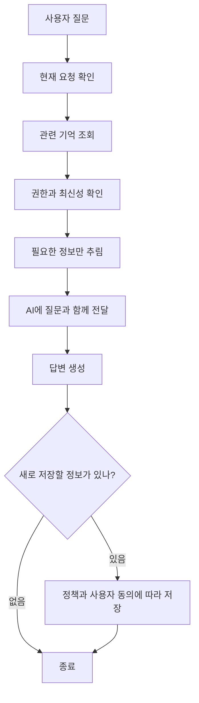

# 08. AI가 대화를 기억하는 방법

> **비개발자를 위한 AI 시스템 설계 입문서 · 08**  
> 이번 장의 질문: **AI는 나를 기억하는 걸까, 아니면 이전 대화를 다시 읽고 있는 걸까?**

- 난이도: ★★☆☆☆ — 개념만 이해해도 충분
- 예상 학습 시간: 20~30분
- 먼저 읽기: [07. AI 서비스의 비용과 속도](07_AI_서비스의_비용과_속도.md)
- 참고 원문: [AI System Design Guide — Memory Architectures](https://github.com/ombharatiya/ai-system-design-guide/blob/main/08-memory-and-state/01-memory-architectures.md)

> 이 글은 원문을 옮긴 번역본이 아니라, 원문의 핵심 개념을 초보자 눈높이에 맞춰 새로 풀어 쓴 **독립 해설**이에요. 제품마다 기억 기능과 보존 정책은 다를 수 있어요.

---

## 1. 분명 전에 얘기했는데, 왜 또 물어볼까요?

AI에게 이렇게 말했다고 해 볼게요.

> "나는 웹디자인 강사야. 초보 학생들에게 설명할 때는 어려운 용어를 풀어서 알려줘."

그런데 며칠 뒤 새 대화를 열었더니 AI가 처음 보는 사람처럼 대답해요. 반대로 어떤 AI 서비스는 새 대화를 열어도 내 직업이랑 좋아하는 설명 방식을 알고 있고요.

둘 다 가능한 이유는 간단해요. **AI 모델이 대화할 때마다 새 지식을 영구적으로 배우는 건 아니거든요.** 서비스가 이전 정보를 **어디에 저장해 두고, 언제 다시 꺼내서 모델에 넘겨주느냐**에 따라 달라지는 거예요.

이 차이를 알면 'AI가 기억한다'는 말을 훨씬 정확하게 쓸 수 있어요.

## 2. 세 가지 기억부터 구분해 볼게요

사람의 기억에 빗대면 이렇게 생각할 수 있어요.

| 구분 | 쉬운 비유 | 실제 시스템에서는 |
|---|---|---|
| 현재 대화의 문맥 | 책상 위에 펼쳐 놓은 메모 | 이번 요청에 포함된 대화 내용과 자료 |
| 저장된 사용자 정보 | 서랍 속 사용자 카드 | 데이터베이스에 저장한 선호·설정·요약 |
| 필요한 자료 검색 | 도서관에서 찾아온 책 | 검색, RAG, 파일·DB 조회 |

세 가지 모두 모델이 답할 때 참고할 수 있지만, **저장되는 곳과 유지되는 기간이 달라요.**

### 현재 대화의 문맥 — 작업 중인 책상

AI에게 질문을 보내면, 서비스는 지금 질문뿐 아니라 이전 대화 일부, 시스템 지침, 첨부 자료를 같이 넘길 수 있어요. 이게 **컨텍스트(context)**예요.

모델은 그 안의 정보를 보고 답해요. 그런데 대화가 길어지면 전부 다 넣을 수는 없어요. 길이 제한과 비용 때문에 일부만 고르거나 요약하기도 하죠.

[01. 토큰화와 컨텍스트 창](01_토큰화와_컨텍스트_창.md)에서 본 **컨텍스트 창**과 바로 이어지는 얘기예요.

### 저장된 기억 — 다음에도 꺼내 쓰는 사용자 카드

서비스가 "이 사용자는 짧고 쉬운 설명을 좋아한다"는 정보를 데이터베이스에 저장해 둘 수 있어요. 그리고 다음 요청 때 그걸 다시 읽어서 AI에게 넘겨주는 거죠.

모델을 다시 학습시키지 않아도, 사용자는 AI가 나를 기억한다고 느끼게 돼요.

다만 제품마다 저장 기준, 동의 방식, 보존 기간, 삭제 기능은 달라요. 모든 AI 서비스에 같은 메모리 기능이 있는 건 아니에요.

### 검색형 기억 — 필요할 때 찾아오는 자료

예전에 만든 기획서 100개를 매번 통째로 AI에게 보낼 필요는 없잖아요. 질문과 관련된 문서만 찾아서 넘기면 돼요.

이건 앞에서 배운 **RAG**와 연결돼요. RAG가 '사용자 기억'만을 위한 기술은 아니고, 제품 설명서나 내부 문서 같은 다양한 외부 지식에도 쓰여요.

---

## 3. 예제로 이해하기: 학생 포트폴리오 피드백 AI

학생 26명의 포트폴리오를 평가하는 AI 도우미를 만든다고 해 볼게요.

- **현재 문맥:** 이번에 낸 학생 A의 화면과 코드
- **저장된 설정:** 평가 항목, 배점, 강사가 선호하는 피드백 문체
- **검색한 자료:** 그 학생의 이전 피드백과 현재 과제 안내서

이 세 가지를 구분하지 않으면 사고가 나요.

예를 들어 학생 A의 지난 평가를 학생 B에게 적용해 버리면요? AI 문장이 아무리 자연스러워도 잘못된 평가가 되죠.

그래서 기억 기능을 설계할 때는 **무엇을 기억할까**보다 먼저 **누구 정보인지, 언제 정보인지, 이번 작업에 필요한지**를 확인해야 해요.

## 4. 기억 기능을 만들려면 어떤 과정이 필요할까요?

여기서 AI가 맡을 수 있는 건 정보 요약이나 관련성 판단 정도예요. **누가 어떤 기록을 볼 수 있는지** 같은 권한 규칙은 반드시 서비스 코드와 데이터베이스에서 지켜야 해요.

## 5. 대화를 통째로 저장할까, 요약해서 저장할까?

사용자와 100번 대화했다고 해 볼게요.

**방법 A: 모든 메시지를 그대로 저장**

- 장점: 세부 맥락과 원래 표현을 확인하기 쉬움
- 단점: 검색·전달 비용이 커지고, 필요 없거나 민감한 정보가 오래 남을 수 있음

**방법 B: 중요한 정보만 요약해서 저장**

- 장점: 적은 양으로 빠르게 참고할 수 있음
- 단점: 잘못 요약하면 중요한 조건이 빠지거나 해석이 굳어질 수 있음

**방법 C: 원문은 보관하고, 요약·검색 색인을 따로 관리**

- 장점: 빨리 찾으면서도 필요하면 원문을 확인할 수 있음
- 단점: 저장 구조와 수정·삭제 처리가 복잡해짐

서비스 규모와 개인정보 정책에 따라 고르면 돼요. **많이 저장한다고 무조건 좋은 설계는 아니에요.**

## 6. 장기 기억을 만들 때 자주 나오는 세 가지 기술

### 데이터베이스(DB)

사용자 ID, 선택한 옵션, 저장 날짜처럼 **딱 맞아떨어져야 하는 정보**를 관리할 때 잘 맞아요. 예를 들어 Supabase에 '사용자가 저장한 결과 목록'을 보관하는 식이에요.

### 임베딩과 벡터 검색

문장이 똑같지 않아도 **뜻이 비슷한 기록**을 찾을 때 써요.

"학생 피드백 문장이 너무 딱딱해"라는 질문과 "평가 총평을 자연스럽게 쓰는 방법"이라는 메모는 단어는 달라도 꽤 관련이 있잖아요.

다만 뜻이 비슷하다고 그게 *정확한* 답이라는 보장은 없어요. 검색 결과의 출처와 사용자 권한을 같이 확인해야 해요.

### 요약 메모리

대화에서 중요한 결정만 남겨 두는 방식이에요.

> "피드백은 반말 서술형으로 작성하고, 학생별로 문장을 반복하지 않는다."

이렇게 저장해 두면 다음번에 대화를 전부 다시 보내지 않아도 같은 기준을 적용하기 쉬워요. 단, 정책이 바뀌거나 사용자가 정정하면 **기존 요약도 같이 고쳐야** 해요.

## 7. KV Cache도 기억일까요?

이름에 Cache가 들어가서 헷갈리기 쉬운데요, **KV Cache는 장기 기억 데이터베이스가 아니에요.**

KV Cache는 모델이 토큰을 만들 때 이미 계산한 Attention용 Key·Value를 재사용하게 해 주는 **추론 중 계산 캐시**예요. 서비스가 대화를 오래 보관하는 것과는 목적이 완전히 달라요.

| 질문 | KV Cache | 장기 기억 DB |
|---|---|---|
| 왜 만들까? | 같은 계산을 줄여 생성 효율 개선 | 나중에 정보를 다시 사용 |
| 무엇을 보관할까? | Attention 계산용 중간 값 | 메시지·선호·요약·기록 |
| 다음 주에도 남을까? | 일반적으로 그렇게 쓰지 않음 | 보존 정책에 따라 가능 |
| 사용자가 직접 내용을 수정할까? | 보통 아님 | 서비스 설계에 따라 가능 |

**오늘 꼭 구분할 한 줄:** *KV Cache는 계산을 재사용하려고, 장기 기억은 정보를 다시 불러오려고 쓰는 것!*

---

## 8. 찐망고 사주풀이에 적용한다면?

사주풀이 서비스에서 사용자가 이전 결과를 다시 보고, 다음 질문 때 그 내용을 참고하게 한다고 해 볼게요.

이때 세 단계가 필요해요.

1. **저장:** 사용자에게 저장할지 물어보고, 결과와 필요한 메타데이터를 보관하기
2. **조회:** 로그인 사용자나 제대로 검증된 저장 토큰이 그 기록에 접근할 권한이 있는지 확인하기
3. **전달:** 기록 전체를 넣지 말고 이번 질문과 관련된 정보만 AI에 넘기기

예를 들어 "지난번 궁합 해설에서 갈등 해결 방식만 다시 설명해 줘"라고 하면, 그 결과의 해당 부분만 불러오면 되겠죠.

여기서 특히 조심할 건 **다른 사람 결과가 섞이지 않게 하는 것**이에요. AI에게 "다른 사람 기록은 보지 마"라고 지시하는 것만으로는 부족해요. 서버 쪽 인증·인가와 데이터 접근 정책이 먼저예요.

## 9. 찐망고 레퍼런스에 적용한다면?

웹디자인 레퍼런스 서비스에서는 '대화 기억'보다 **사용자의 선택과 작업 상태를 이어 주는 기능**이 먼저일 수 있어요.

예를 들면:

- 사용자가 찜한 Hero 섹션
- 직접 만든 무드보드의 이미지 조합과 순서
- 최근에 본 카테고리
- 저장한 태그와 메모

이런 데이터는 **기존 DB에 정확하게 저장하는 게** 우선이에요. 그다음에 "내가 모아 둔 레퍼런스 중 차분한 분위기만 찾아줘" 같은 기능을 붙일 때 AI 검색이나 임베딩을 고려하면 돼요.

즉, **저장 기능에 꼭 AI 메모리 기술이 필요한 건 아니에요.**

## 10. 많이 기억하는 AI가 위험할 수도 있을까요?

네, 그럴 수 있어요. 편리한 만큼 이런 문제도 생기거든요.

| 문제 | 예시 | 기본 대응 |
|---|---|---|
| 오래된 정보 | 예전 직업이나 선호를 계속 사용 | 수정·갱신 기능 |
| 잘못된 추측 | 한 번 한 말을 고정된 성향으로 저장 | 사실과 추론 구분 |
| 타인 정보 노출 | 학생 A 기록을 B에게 보여 줌 | 권한 검사·사용자별 분리 |
| 과잉 저장 | 불필요한 개인정보까지 수집 | 최소 수집·보존 기간 설정 |
| 삭제 불일치 | 원문은 삭제했는데 요약과 검색 색인이 남음 | 관련 저장소의 삭제 흐름 설계 |

AI에 기억을 붙일 때는 **잘 기억하는 능력**만큼 **고치고, 잊고, 접근을 막는 능력**이 중요해요.

---

## 11. 직접 해 보는 15분 실습

### 실습 A — 기억 없는 AI와 기억 있는 AI 비교

같은 요청을 두 가지로 준비해 보세요.

**요청 1: 정보 없이 질문**

> "학생 웹사이트 리뉴얼 결과물에 대한 총평을 작성해 줘."

**요청 2: 저장된 설정을 같이 전달**

> "대상은 웹디자인 초보 학생이야. 강점과 우선 수정할 점을 나눠서, 어려운 용어 없이 반말 서술형으로 써 줘. 확인되지 않은 구현 사실은 추측하지 마. 아래 제출 자료만 근거로 평가해 줘."

둘을 비교해 보세요. 포인트는 두 번째가 더 정확한 사실을 만들어 준다는 게 아니라, **기대하는 작업 기준을 더 분명하게 전달한다는 것**이에요.

### 실습 B — 뭘 기억해야 할까?

아래 정보 중 오래 저장할 만한 걸 골라 보세요.

1. 사용자가 선호하는 교재 설명 난이도
2. 오늘 한 번 물어본 점심 메뉴
3. 학생 A의 개인 연락처
4. 교재에 적용하는 용어 표기 규칙
5. 2년 전 가격표

**예시 판단:** 1과 4는 다시 쓸 가치가 높아요. 2는 대부분 필요 없고, 3은 개인정보 처리 근거와 목적이 분명하지 않으면 저장하면 안 돼요. 5는 최신인지 확인 없이 기억으로 쓰면 위험해요.

## 12. 내가 어디까지 알아야 할까요?

| 단계 | 알아야 할 내용 | 추천 수준 |
|---|---|---|
| AI 사용자 | 현재 대화와 저장된 기억의 차이 | 필수 |
| 웹 기획·디자인 | 저장·조회·수정·삭제의 사용자 경험 | 필수 |
| AI API 활용 개발 | 사용자 식별, 문맥 조립, 저장 구조 | 중요 |
| AI 서비스 운영 | 권한, 개인정보, 보존 기간, 비용 | 중요 |
| 모델 연구 | Attention 캐시 구현과 학습 아키텍처 | 지금은 선택 |

## 13. 오늘의 정리

- AI가 과거를 안다 = 보통 **서비스가 관련 정보를 저장·검색·전달하도록 만들어 둔 것**
- **컨텍스트**는 지금 답하려고 건넨 정보, **장기 기억**은 다음에도 쓰려고 저장한 정보
- **RAG**는 자료를 찾아오는 방법, **KV Cache**는 생성 중 계산을 재사용하는 기술 → 헷갈리지 않기!
- 기억 기능의 핵심은 **사용자별 권한, 최신성, 수정·삭제**
- 제일 좋은 시스템은 다 기억하는 AI가 아니라 **필요한 정보를 정확하고 안전하게 꺼내 쓰는 AI**

### 스스로 답해 보기

1. AI가 어제 대화를 기억하는 것처럼 보이는 이유는 뭘까?
2. 학생 피드백 기준은 어떤 방식으로 저장하는 게 좋을까?
3. 사용자별 기록이 섞이지 않게 하는 건 누구 책임일까?
4. KV Cache와 장기 기억은 어떻게 다를까?

---

## 다음 장 예고

**[09. AI에게 도구와 권한을 연결하는 방법 — MCP](09_AI에게_도구와_권한을_연결하는_방법_MCP.md)**  
AI에게 어떤 도구와 권한을 줘야 할까요? MCP와 도구 연결을 이해해 볼게요.

## 참고 자료

- [Om Bharatiya, *AI System Design Guide — Memory Architectures*](https://github.com/ombharatiya/ai-system-design-guide/blob/main/08-memory-and-state/01-memory-architectures.md)
- [Microsoft Learn — Retrieval-Augmented Generation](https://learn.microsoft.com/en-us/azure/search/retrieval-augmented-generation-overview)
- [OWASP Top 10 for LLM Applications](https://genai.owasp.org/llm-top-10/)
