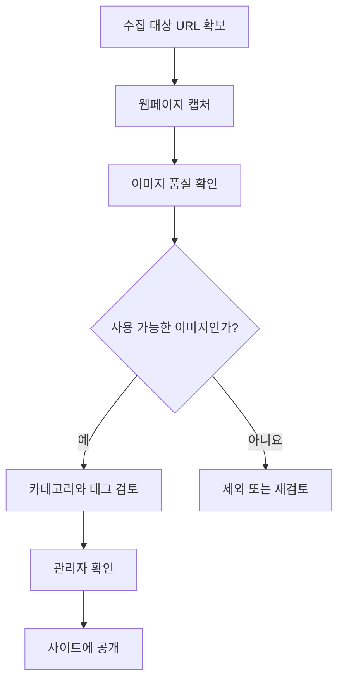
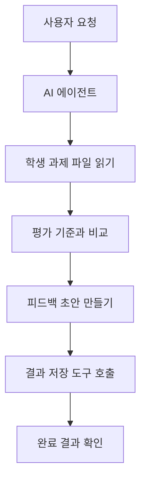
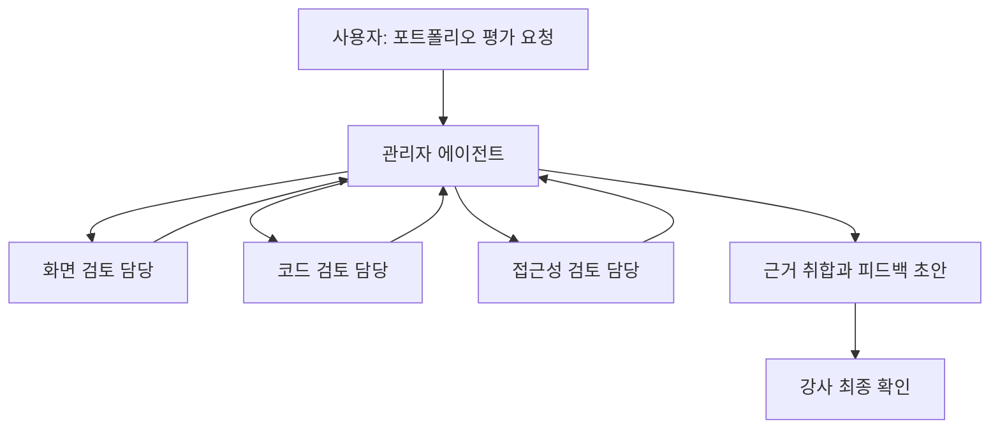
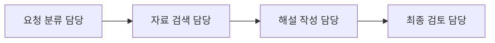

# 10. 여러 AI가 함께 일하면 더 좋을까? — 멀티 에이전트와 워크플로

> **비개발자를 위한 AI 시스템 설계 입문서 · 10**  
> 이번 장의 질문: **AI 한 명에게 다 시키는 것과 여러 AI에게 일을 나누는 것, 어떤 방식이 더 좋을까요?**

- 난이도: ★★☆☆☆ — 역할과 작업 흐름을 이해하면 충분
- 예상 학습 시간: 25~35분
- 먼저 읽기: [04. AI 에이전트 — 대답을 넘어 일을 처리하는 AI](04_AI_에이전트_대답을_넘어_일을_처리하는_AI.md) · [09. AI에게 도구와 권한을 연결하는 방법 — MCP](09_AI에게_도구와_권한을_연결하는_방법_MCP.md)
- 참고 자료: [OpenAI, *A Practical Guide to Building AI Agents*](https://openai.com/business/guides-and-resources/a-practical-guide-to-building-ai-agents/) · [OpenAI, *Multi-agent*](https://developers.openai.com/api/docs/guides/responses-multi-agent)

> 이 글은 원문을 그대로 옮긴 번역본이 아니라, AI 시스템 설계의 핵심 개념을 비전공자 눈높이에 맞춰 새로 풀어 쓴 **독립 해설**이에요. 여기 나온 도구 구성과 비용은 설명용 사례이며, 실제 서비스에서 지원하는 기능과 권한은 사용하는 제품에 따라 달라져요.

---

## 1. 먼저 상황 하나: AI에게 학생 과제 26개를 평가해 달라고 했어요

학생들의 웹사이트 결과물 26개가 있어요. 각 결과물을 보고 이런 작업을 해야 해요.

1. 사이트를 열어 오류가 있는지 확인하기
2. Figma 시안과 화면이 비슷한지 비교하기
3. HTML·CSS 구조와 반응형 동작 확인하기
4. 평가표 기준에 따라 점수와 피드백 작성하기
5. 학생별 보고서 저장하기

AI 한 명에게 이렇게 말할 수도 있겠죠.

> "26명 과제를 모두 확인해서 점수와 피드백을 작성하고 저장해 줘."

그런데 이 요청에는 **서로 다른 종류의 일**이 한꺼번에 들어 있어요. 게다가 어떤 작업은 먼저 끝나야 다음 작업이 가능하고, 어떤 작업은 동시에 진행해도 돼요.

여기서 두 가지 질문이 생겨요.

- **AI를 여러 명으로 나누면 더 정확할까요?**
- **여러 명으로 나눴다고 실제 처리도 더 빠를까요?**

답은 둘 다 **상황에 따라 달라요.** 오늘은 그 차이를 이해해 볼게요.

## 이 장을 읽고 나면

- 워크플로, 단일 에이전트, 멀티 에이전트를 구분하기
- 작업을 순서대로 처리할지, 동시에 처리할지 판단하기
- 관리자형(Manager)과 인계형(Handoff) 구조 이해하기
- 여러 AI를 붙였을 때 비용과 오류가 왜 늘어날 수 있는지 알기
- 실제 서비스에 필요한 최소 구조부터 설계하기

---

## 2. 워크플로(Workflow): 일이 진행되는 순서

워크플로는 거창한 AI 용어가 아니에요. **업무를 어떤 순서와 조건으로 처리할지 정해 둔 흐름**이에요.

예를 들어 레퍼런스 수집 시스템이 이렇게 움직인다고 해 볼게요.



중요한 건 이 흐름의 **모든 단계에 AI가 필요한 건 아니라는 점**이에요.

- URL 목록을 받아오는 일 → 일반 코드로 가능
- 페이지를 캡처하는 일 → 브라우저 자동화 도구로 가능
- 이미지가 깨졌는지 판단하는 일 → 일부는 규칙, 일부는 AI로 처리 가능
- 공개 여부 최종 결정 → 관리자 확인이 더 적합할 수 있음

그래서 **워크플로가 곧 멀티 에이전트는 아니에요.** 일반 코드, 하나의 AI, 여러 AI, 사람의 승인이 함께 들어갈 수 있는 전체 작업 흐름을 말해요.

### 한 줄로 기억하기

> 워크플로는 **일의 순서**이고, 에이전트는 그 안에서 **판단하고 도구를 사용하는 담당자**예요.

---

## 3. AI 한 명으로 충분한 경우도 많아요

AI 한 명이 여러 도구를 쓰면서 순서대로 작업할 수 있어요. 이게 **단일 에이전트(Single Agent)** 방식이에요.

예를 들어 하나의 에이전트가 이런 순서로 일할 수 있죠.



AI가 한 명이라고 해서 도구도 하나만 쓸 수 있는 건 아니에요. 파일 읽기, 웹페이지 확인, 보고서 저장 같은 다양한 도구를 연결할 수 있어요.

**단일 에이전트가 유리한 상황**은 이런 때예요.

- 작업 규모가 작고, 순서가 비교적 단순할 때
- 바로 앞 작업 결과를 보고 다음 일을 해야 할 때
- 쓰는 도구의 역할이 서로 명확할 때
- 어디서 오류가 났는지 쉽게 추적해야 할 때
- API 호출과 운영비를 최소화하고 싶을 때

AI를 여러 개 연결할 수 있다는 이유만으로 꼭 나눌 필요는 없어요.

---

## 4. 멀티 에이전트(Multi-Agent): 담당자를 나누는 방식

이제 학생 포트폴리오를 평가하는 일을 역할별로 나눠 볼게요.

| 담당 AI | 맡은 작업 | 결과물 |
|---|---|---|
| 화면 검토 담당 | 시안 대비 화면 구성·반응형 확인 | 화면 검토 기록 |
| 코드 검토 담당 | HTML·CSS 구조와 오류 확인 | 코드 검토 기록 |
| 평가 담당 | 두 기록과 평가표를 비교 | 점수·근거 초안 |
| 통합 담당 | 결과를 합치고 빠진 항목 확인 | 학생별 최종 피드백 초안 |

이렇게 **둘 이상의 에이전트가 역할을 나눠 작업하고 결과를 교환하는 구조**가 멀티 에이전트예요.

회사에서 디자이너, 개발자, QA 담당자가 각자 일을 하는 것과 비슷해요. 하지만 실제 AI 에이전트가 사람처럼 완벽한 전문성을 가진다는 뜻은 아니에요. 역할을 나눈 **프롬프트·도구·접근 가능한 자료**가 서로 다른 거예요.

### 왜 나눌까요?

한 번에 너무 많은 일을 맡기면 AI가 평가 기준을 빠뜨리거나, 도구를 잘못 고르거나, 다른 학생의 내용을 섞을 수 있어요.

역할을 나누면 각 담당자가 **좁고 분명한 임무**에 집중하게 만들 수 있죠. 다만 나눴다고 정확도가 자동으로 높아지는 건 아니에요. 분담 규칙과 최종 검증이 잘되어 있어야 해요.

---

## 5. 방법 A: 관리자형 — 한 명이 나눠 주고 결과를 모아요

관리자 역할의 AI가 여러 담당자에게 작업을 나눠 주는 구조예요.



이 구조를 **Manager 패턴**이라고 부르기도 해요.

관리자 AI는 직접 모든 것을 판단하기보다, 누가 무슨 일을 맡을지 정하고 결과를 모아요.

**좋은 점**

- 화면·코드·접근성처럼 독립적으로 확인할 수 있는 항목을 나누기 좋아요.
- 각각 다른 점검 기준을 적용할 수 있어요.
- 항목별 오류가 어디서 생겼는지 기록하기 쉬워져요.

**조심할 점**

- 담당 AI들의 결과가 충돌할 수 있어요.
- 관리자 AI가 최종 취합하면서 틀리게 요약할 수도 있어요.
- 각 담당자의 호출 비용과 결과 전달 비용이 추가돼요.

특히 **점수 계산은 AI의 감으로 다시 계산하게 하지 말고**, 확정된 항목별 점수를 일반 코드로 합산하는 편이 안전해요.

---

## 6. 방법 B: 인계형 — 앞의 담당자가 다음 담당자에게 넘겨요

이번에는 작업 흐름이 이렇게 정해져 있다고 해 볼게요.



각 담당자가 자신의 일을 끝내고 **다음 담당자에게 작업을 넘기는 구조**예요. 이를 *Handoff(인계)* 방식이라고 불러요.

예를 들어 사용자가 "지난번 사주풀이 결과를 보고 다시 설명해 줘"라고 요청했다고 해 볼게요.

1. 첫 담당자가 요청 종류를 분류해요.
2. 조회 담당자가 **권한이 확인된 사용자의 결과만** 가져와요.
3. 해설 담당자가 자료를 바탕으로 문장을 작성해요.
4. 검토 담당자가 이름이나 명식이 섞이지 않았는지 확인해요.

그렇지만 이런 작업을 반드시 네 개의 AI로 만들어야 하는 건 아니에요. **사용자 확인·데이터 조회·점수 계산은 코드**, 해설 작성만 AI가 하는 편이 더 단순하고 안전할 수도 있어요.

### 관리자형과 인계형 비교

| 구분 | 관리자형 | 인계형 |
|---|---|---|
| 중심 역할 | 관리자 에이전트가 작업 배분·취합 | 에이전트가 다음 담당자로 넘김 |
| 잘 맞는 작업 | 여러 영역의 독립 조사·검토 | 단계별 전문 처리·요청 분기 |
| 주의할 점 | 결과 취합의 누락·중복 | 인계 과정의 정보 누락 |

---

## 7. 동시에 할 수 있는 일과 반드시 순서가 필요한 일

여러 AI를 쓰는 가장 큰 이유 중 하나가 **병렬 처리(Parallel Processing)**예요. 하지만 모든 일이 동시에 가능한 건 아니에요.

### 동시에 할 수 있는 일

서로의 결과가 없어도 시작할 수 있는 일이에요.

- 학생 A, B, C의 **서로 다른 과제** 검토하기
- 같은 사이트의 화면과 코드에서 **독립적인 항목** 검토하기
- 서로 다른 세 개의 자료 출처 조사하기

### 순서대로 해야 하는 일

앞의 결과가 나와야 다음 일을 할 수 있어요.

- 파일을 읽은 뒤 그 내용에 대해 평가하기
- 평가 결과를 확인한 뒤 최종 점수 확정하기
- 승인받은 뒤 공개 저장소에 업로드하기

### 병렬이 늘 빠른 건 아니에요

AI 세 명이 동시에 작업해도, 마지막에 합치는 과정이 오래 걸리거나 외부 서버가 느리면 전체 시간이 별로 줄지 않을 수 있어요.

**실무 기준:** 작업을 나누기 전에 *"서로 결과를 기다리지 않고 시작할 수 있는가?"*를 먼저 물어보세요.

---

## 8. 여러 AI를 쓰면 돈도 여러 번 들어요

멀티 에이전트에서는 각 담당자가 입력을 받고 출력을 만들어요. 관리자 AI가 취합할 때도 토큰을 사용할 수 있죠.

아래는 실제 API 요금이 아닌 **가상의 연습용 숫자**예요.

| 구성 | 가정한 호출 수 | 호출당 평균 비용 | 총비용 |
|---|---:|---:|---:|
| 단일 에이전트 | 1회 | 10원 | 10원 |
| 담당 3개 + 취합 1개 | 4회 | 10원 | 40원 |

이 표만 보면 4배 비싸 보이죠. 다만 실제로는 각 담당자마다 다른 모델·토큰 수를 쓸 수 있어서 정확히 4배라고 단정할 수 없어요. 일부 병렬 작업은 빨리 끝날 수도 있고요.

중요한 건 **AI 수가 늘면 비용이 자동으로 절약되는 게 아니라는 점**이에요.

멀티 에이전트가 경제적이려면 추가 호출 비용보다 오류 감소, 시간 절약, 품질 개선의 가치가 더 커야 해요.

### 운영할 때 같이 측정할 네 가지

1. 최종 결과가 기준을 얼마나 잘 만족하는가? (**품질**)
2. 전체 작업이 끝나기까지 얼마나 걸리는가? (**시간**)
3. 요청 한 건에 얼마가 드는가? (**비용**)
4. 실패했을 때 왜 실패했는지 알 수 있는가? (**추적 가능성**)

---

## 9. 여러 AI가 서로 확인하면 완벽해질까요?

아니에요. 세 명이 같은 실수를 할 수도 있어요.

특히 세 담당자가 **같은 잘못된 자료**를 보고 있다면, 모두 자신 있게 틀릴 수 있어요. 서로 결과를 확인한다고 해서 자동으로 진실을 찾아내는 건 아니죠.

그렇기 때문에 **다른 AI가 검토했다**는 사실보다 다음 조건이 중요해요.

- 검토할 수 있는 **실제 원본 자료**가 있는가?
- 합격·불합격을 가르는 **명확한 평가 기준**이 있는가?
- 같은 자료에서 재현되는 **테스트 사례**가 있는가?
- 검토 결과가 서로 다른 경우 **누가 최종 판단**하는가?

학생 성적처럼 중요한 결과는 AI가 만든 초안과 강사가 확정한 점수를 구분해서 기록하는 게 좋아요.

---

## 10. 찐망고 레퍼런스라면 어떻게 설계할까요?

자동 수집 파이프라인을 예로 들어 볼게요.

### 처음부터 AI를 네 명 붙이는 설계

1. AI가 수집할 사이트 선택
2. 다른 AI가 화면 캡처
3. 또 다른 AI가 이미지 분류
4. 마지막 AI가 공개 여부 결정

그럴듯해 보이지만 **캡처는 브라우저 자동화 도구가 하는 일**이고, 공개는 관리자가 확인해야 할 수 있어요.

### 더 단순한 설계

| 단계 | 담당 | 이유 |
|---|---|---|
| 수집 대상 중복 확인 | 코드·데이터베이스 | 규칙이 명확함 |
| 페이지 캡처 | Playwright 등 도구 | 브라우저 조작 작업 |
| 이미지가 의미 있는 섹션인지 검토 | 필요할 때 AI | 판단이 필요한 작업 |
| 태그 추천 | 필요할 때 AI | 유연한 언어 분류 작업 |
| 공개·삭제 결정 | 관리자 | 책임과 권한이 필요한 작업 |

이미 이런 흐름이 잘 작동한다면 **멀티 에이전트는 없어도 돼요.** AI 검수가 자주 틀리는 지점이 발견되면, 그 부분만 별도 검토 단계로 나누면 되고요.

**한 줄로 기억하기:** *에이전트를 많이 만드는 것보다, AI가 꼭 필요한 판단만 맡기도록 나누는 게 먼저예요.*

---

## 11. 학생 포트폴리오 평가라면 이렇게 시작해 보세요

이전 교재의 평가표를 다시 가져와 볼게요. 최종 점수는 100점이고, 항목에는 UI 구조, Figma, HTML·CSS, 반응형, 접근성 등이 있어요.

여기서 중요한 건 **평가 기준을 하나의 문서로 고정하는 것**이에요. AI마다 제멋대로 배점을 바꾸면 결과를 비교할 수 없거든요.

### 1단계: 먼저 단일 에이전트로 실행하기

- 학생 과제 하나와 평가표를 주고 피드백 초안 만들기
- 누락된 평가 항목이 있는지 기록하기
- 실제로 오류가 반복되는 항목을 확인하기

### 2단계: 반복되는 오류만 나누기

- Figma 시안과의 비교가 자꾸 빠진다면 → 화면 검토 단계를 독립시키기
- HTML·CSS 오류와 시각적 문제를 혼동한다면 → 코드 검토를 분리하기
- 최종 점수가 틀린다면 → 계산은 코드로 옮기기

### 3단계: 결과 형식을 통일하기

```json
{
  "student_id": "example-01",
  "ui_review": { "score": 12, "evidence": "화면 구조는 양호하나 모바일 간격 오류" },
  "code_review": { "score": 16, "evidence": "시멘틱 구조는 대체로 적절함" },
  "needs_teacher_review": true
}
```

> 위 JSON은 **데이터 형태를 이해하기 위한 축약 예시**예요. 전체 평가표의 배점이나 실제 학생 성적을 뜻하지 않아요.

### 4단계: 사람이 마지막으로 확인하기

- AI가 확인하지 못한 페이지가 없는가?
- 평가 근거가 실제 결과물에서 확인되는가?
- 학생별 정보가 서로 섞이지 않았는가?
- 평가표와 배점이 정확히 일치하는가?

---

## 12. 실패했을 때를 먼저 설계해야 해요

AI가 여러 개면 실패 지점도 늘어나요.

| 문제 상황 | 안전한 대응 |
|---|---|
| 화면 담당이 결과를 내지 못함 | 해당 항목은 미확인으로 표시, 전체 완료로 처리하지 않기 |
| 코드 담당과 화면 담당 의견 충돌 | 근거를 함께 보여 주고 검토 대상 표시 |
| 같은 파일을 두 에이전트가 동시에 수정 | 담당 파일을 분리하거나 단일 작성자로 제한 |
| 재시도가 무한 반복됨 | 최대 시도 횟수·시간·비용 제한 |
| 검토 없이 자동 공개됨 | 공개·삭제·발송 전 승인 단계 추가 |
| 에이전트가 다른 학생 자료를 조회함 | 서버에서 사용자·자료별 접근 권한 검사 |

특히 **프롬프트에 "다른 사람 자료를 보지 마"라고 적는 것만으로 권한이 막히지는 않아요.** 파일·DB·API 수준에서도 접근을 제한해야 해요.

그리고 여러 에이전트를 연결할수록 다음 세 가지를 로그로 남기는 게 좋아요.

- 누가 어떤 입력 자료를 받았는가?
- 어떤 도구를 실행했는가?
- 어떤 결과를 근거로 최종 판단했는가?

---

## 13. 내가 멀티 에이전트를 써야 할지 판단하는 방법

아래 질문을 차례대로 해 보세요.

| 질문 | 그렇다면 |
|---|---|
| 일이 단순하고 짧은가? | 일단 하나의 에이전트 또는 일반 코드로 시작 |
| 독립적인 조사·검토가 여러 개 필요한가? | 병렬 담당자 분리 검토 |
| AI가 서로 비슷한 도구를 잘못 고르는가? | 도구 설명 개선 후 역할 분리 검토 |
| 결과를 합칠 때 오류가 많아지는가? | 통합 규칙·검증 기준부터 정리 |
| 사람이 확인해야 할 중요한 결정인가? | 승인 단계를 유지 |
| 비용·응답 시간이 이미 큰 문제인가? | 추가 에이전트가 실제로 개선하는지 실험 |

**결론은 하나예요. 처음부터 멀티 에이전트를 목표로 삼지 마세요.** 필요한 작업부터 설계하고, 한 명으로 해결하기 어렵다는 근거가 생겼을 때 나누면 돼요.

---

## 14. 수업에 적용한다면: 20분 설계 실습

**실습 주제: 웹사이트 리뉴얼 피드백을 자동화한다면?**

### ① 작업 카드 만들기 (5분)

학생들에게 다음 작업을 카드처럼 나눠 보게 해요.

- 사이트 열기
- 화면 캡처
- CTA 위치 확인
- Figma 시안 비교
- HTML·CSS 오류 확인
- 평가표로 피드백 작성
- 최종 보고서 저장

### ② 담당자 고르기 (5분)

각 작업에 **코드 / AI / 사람** 중 하나를 붙여 보게 해요.

예를 들어 화면 캡처는 도구, 피드백 초안은 AI, 최종 점수 확정은 사람으로 정할 수 있겠죠.

### ③ 연결 순서 그리기 (5분)

서로 독립적인 작업에는 병렬 표시를 하고, 앞 작업이 필요한 단계에는 화살표로 순서를 표시해요.

### ④ 왜 그렇게 나눴는지 발표하기 (5분)

- AI가 필요 없는 작업이 하나라도 있었는가?
- 두 AI가 같은 파일을 수정해도 괜찮은가?
- 어떤 단계에서 사람의 승인이 필요한가?

**수업의 핵심:** AI를 많이 사용하는 설계가 아니라, **업무를 정확하게 분해하는 설계**가 좋은 설계라는 걸 이해하는 거예요.

---

## 15. 오늘 배운 내용 한 장 정리

| 개념 | 기억할 문장 |
|---|---|
| 워크플로 | 일이 진행되는 순서와 조건 |
| 단일 에이전트 | AI 한 명이 여러 도구를 활용해 작업 |
| 멀티 에이전트 | 역할을 나눈 여러 에이전트가 협업 |
| Manager | 관리자가 나눠 주고 결과 취합 |
| Handoff | 다음 담당자에게 작업을 넘김 |
| 병렬 처리 | 서로 독립적인 일을 동시에 진행 |
| 오케스트레이션 | 작업을 배분하고 실행·결과를 조율하는 일 |
| HITL | 중요한 판단은 사람이 확인·승인 |

- 여러 AI를 연결한다고 자동으로 더 정확하거나 빠른 건 아니에요.
- 가능하면 **일반 코드 → 단일 에이전트 → 필요한 부분만 멀티 에이전트** 순으로 판단해요.
- 역할을 나눴다면 각자의 입력·출력·권한·실패 조건도 정해야 해요.
- **품질·시간·비용·추적 가능성**을 함께 비교해야 좋은 선택인지 알 수 있어요.

---

## 확인 문제

1. 워크플로와 멀티 에이전트는 같은 뜻일까요?
2. 화면 확인과 코드 검토를 병렬로 해도 되는 조건은 뭘까요?
3. AI를 세 명 붙였을 때 결과가 반드시 세 배 빨라질까요?
4. 학생 최종 점수 계산을 일반 코드에 맡기는 이유는 뭘까요?
5. 멀티 에이전트를 도입하기 전에 어떤 문제부터 확인해야 할까요?

<details>
<summary>정답 방향 보기</summary>

1. 아니에요. 워크플로는 전체 작업 흐름이고, 멀티 에이전트는 여러 AI가 역할을 나누는 구현 방식 중 하나예요.
2. 서로의 결과를 기다리지 않고 별도 기준으로 검토할 수 있을 때예요.
3. 아니에요. 결과 취합·대기 시간·외부 도구의 속도에 영향을 받아요.
4. 배점과 계산 규칙이 정해져 있기 때문에, 재현 가능하고 검증하기 쉬운 코드가 적합해요.
5. 단일 에이전트의 실패 유형, 필요한 품질 향상, 추가 비용과 오류 가능성을 먼저 확인해요.

</details>

---

## 다음 장 예고

**11. AI 서비스는 어떻게 관찰하고 개선할까? — 로그·모니터링·운영** (준비 중)  
서비스를 공개한 뒤에 중요한 건 "AI가 답을 만들었다"가 아니라, **언제 실패하고 무엇을 바꿔야 하는지 알아차리는 것**이에요. 실제 서비스를 운영할 때 기록해야 할 정보를 살펴볼게요.

## 참고 자료

- [Om Bharatiya, *AI System Design Guide*](https://github.com/ombharatiya/ai-system-design-guide)
- [OpenAI, *A Practical Guide to Building AI Agents*](https://openai.com/business/guides-and-resources/a-practical-guide-to-building-ai-agents/)
- [OpenAI, *Multi-agent*](https://developers.openai.com/api/docs/guides/responses-multi-agent)
- [OpenAI, *Building Agents*](https://developers.openai.com/tracks/building-agents)

> **자료 성격:** 이 문서는 원문 전체 번역이 아니라, 참고 자료의 개념과 실무 설계 원칙을 바탕으로 새로 작성한 한국어 학습 교재예요.