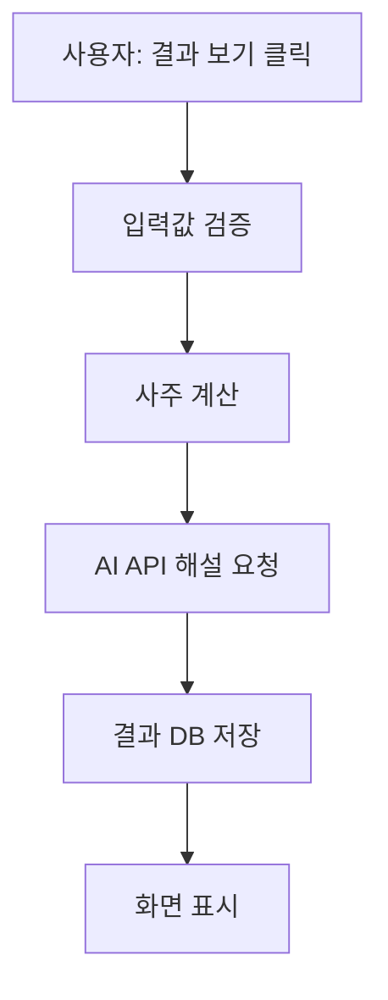

# 11. AI 서비스는 어떻게 관찰하고 개선할까? — 로그·모니터링·운영

> **비개발자를 위한 AI 시스템 설계 입문서 · 11**  
> 이번 장의 질문: **AI 서비스가 잘 작동하는 것처럼 보여도, 어디서 실패하는지 어떻게 알아낼까요?**

- 난이도: ★★☆☆☆ — 용어보다 상황과 판단에 집중해요
- 예상 학습 시간: 25~35분
- 먼저 읽기: [05. AI 서비스의 품질을 평가하는 방법](05_AI_서비스의_품질을_평가하는_방법.md) · [07. AI 서비스의 비용과 속도](07_AI_서비스의_비용과_속도.md) · [10. 멀티 에이전트와 워크플로](10_여러_AI가_함께_일하면_더_좋을까_멀티_에이전트와_워크플로.md)
- 참고 자료: [OpenAI API 운영 가이드](https://developers.openai.com/api/docs/guides/production-best-practices) · [OpenTelemetry GenAI 관측 규약](https://opentelemetry.io/docs/specs/semconv/gen-ai/)

> 이 글은 기술 문서의 직역본이 아니라, 운영 개념을 초보자 눈높이로 다시 구성한 **독립 해설**이에요. 화면 이름·제품 기능·수집 가능한 지표는 서비스마다 다르므로 실제 운영 환경에서 확인해야 해요.

---

## 1. 사이트는 열리는데 사용자는 불편하다고 해요

찐망고 사주풀이에 누군가 접속했어요. 생년월일을 입력하고 **결과 보기** 버튼까지 눌렀죠.

그런데 결과가 나오지 않아요. 사용자는 다시 눌러 보고, 또 눌러 봐요. 결국 사이트를 떠났어요.

관리자 입장에선 이렇게 생각할 수 있어요.

> "사이트는 멀쩡하게 열리는데? 서버도 살아 있고, 배포도 성공했는데?"

여기서 중요한 사실 하나! **사이트가 열리는 것과 사용자가 원하는 작업을 완료하는 건 다른 문제예요.**

서비스를 운영하려면 '켜져 있느냐'만 보지 말고 '실제로 잘 쓰이고 있느냐'도 봐야 해요.

이번 장에서 배울 건 세 가지예요.

- **로그(Logs):** 무슨 일이 있었는지 남긴 기록
- **메트릭(Metrics):** 일이 얼마나 자주, 얼마나 오래, 얼마나 성공적으로 일어나는지 나타내는 숫자
- **트레이스(Traces):** 한 번의 요청이 어떤 단계를 거쳐 처리됐는지 이어서 보는 흐름

이 세 가지를 합쳐 서비스를 **관찰할 수 있게 만드는 일**을 *Observability(관측 가능성)*라고 불러요.

**한 줄로 기억하기:** 문제가 생겼을 때 감으로 짐작하지 않고, **어디에서 왜 실패했는지 찾아갈 수 있게 만드는 것!**

---

## 이 장을 읽고 나면

- 로그·메트릭·트레이스의 차이를 일상적인 예시로 설명하기
- 서버 오류와 AI 답변 품질 문제를 구분하기
- 성공률·지연 시간·토큰 사용량·비용을 함께 보는 이유 이해하기
- 개인정보를 남기지 않으면서 문제를 추적할 방법 생각하기
- 운영 지표를 보고 어떤 문제부터 고쳐야 할지 결정하기

## 2. 로그는 서비스의 일기장이에요

우리가 수업 중 학생 작업을 관찰하면서 이런 메모를 남긴다고 해 볼게요.

> 10:02 학생이 로그인 버튼을 누름  
> 10:02 서버가 로그인 요청을 받음  
> 10:02 인증 결과가 실패로 돌아옴

이런 기록이 **로그**예요.

AI 서비스에서는 이런 기록을 남길 수 있어요.

```text
2026-10-29 10:02:11 | request_started | request_id=req_7a2
2026-10-29 10:02:12 | ai_call_started | provider=example-ai
2026-10-29 10:02:43 | ai_call_failed  | error=timeout
2026-10-29 10:02:43 | request_failed  | request_id=req_7a2
```

위 로그는 **설명용 가상 예시**예요. 요청을 구별하는 `request_id`가 공통으로 들어 있어서 같은 요청의 기록을 묶을 수 있어요.

### 로그를 무조건 많이 남기면 좋을까요?

그렇지 않아요. 사용자가 입력한 생년월일, 이름, 개인적인 질문, 인증 토큰을 전부 저장하면 문제가 생겼을 때 더 큰 위험이 되겠죠.

**좋은 로그는 필요한 정보만 남겨요.** 예를 들어 요청 ID, 처리 단계, 걸린 시간, 오류 종류, 사용하는 모델 버전은 유용하지만, 원문 프롬프트와 민감정보는 기본적으로 저장하지 않는 쪽에서 설계하는 게 안전해요.

## 3. 메트릭은 서비스의 건강검진표예요

로그가 한 건 한 건의 기록이라면, 메트릭은 전체 상태를 숫자로 보여 줘요.

| 메트릭 | 쉽게 말하면 | 왜 중요할까요? |
|---|---|---|
| 요청 수 | 사람들이 몇 번 기능을 썼나? | 이용량과 비용을 예측해요 |
| 성공률 | 요청 중 몇 건이 정상 완료됐나? | 실제 기능의 안정성을 봐요 |
| 오류율 | 실패가 얼마나 자주 발생하나? | 문제가 커지는지 알아봐요 |
| 응답 시간 | 기다리는 시간이 얼마나 되나? | 사용자 불편과 직결돼요 |
| 토큰 사용량 | AI에 얼마나 많이 입력하고 출력했나? | 비용 증가 원인을 찾아요 |
| 요청당 비용 | 기능 한 번 쓰는 데 얼마가 드나? | 무료·유료 운영 판단에 써요 |
| 품질 평가 점수 | 결과가 기준에 맞게 나왔나? | 오류 없이 틀린 답변을 찾는 데 써요 |

**성공률이 99%면 무조건 괜찮을까요?** 반드시 그렇지는 않아요.

하루에 100건이라면 1건 실패하지만, 하루에 100,000건이면 1,000건이 실패해요. 또 결제가 실패하는 1%와 장식 이미지가 늦게 뜨는 1%는 영향이 다르죠.

숫자는 항상 **사용자에게 어떤 일이 생기는지**와 연결해서 봐야 해요.

## 4. 평균 2초인데 누군가는 20초를 기다려요

학생 10명이 AI 평가 결과를 받는데 9명은 1초, 1명은 20초를 기다렸다고 해 볼게요.

평균은 2.9초예요. 숫자만 보면 아주 심각해 보이지 않을 수 있어요.

하지만 20초를 기다린 학생 입장에서는 전혀 다른 경험이죠.

그래서 응답 시간을 볼 때는 **평균뿐 아니라 백분위수**도 확인해요.

- **P50:** 요청의 절반은 이 시간 안에 끝나요
- **P95:** 요청의 약 95%는 이 시간 안에 끝나요. 나머지 약 5%는 더 오래 걸릴 수 있어요
- **P99:** 특히 느린 일부 요청을 살펴볼 때 써요

P95가 갑자기 나빠졌다면, 평균이 거의 같아도 일부 이용자의 체감 성능이 악화된 걸 수 있어요.

**주의:** 표본이 너무 적을 때는 백분위수가 크게 흔들려요. 하루 요청이 8건이라면 숫자만 보고 원인을 단정하지 마세요.

## 5. 트레이스는 문제 발생 지점을 찾아가는 지도예요

버튼 한 번으로 여러 작업이 실행된다면 어떻게 될까요?



어느 날 결과가 30초 넘게 걸렸어요. 이때 'AI가 느리네!'라고 생각하기 쉽죠.

그런데 실제 시간은 이럴 수 있어요.

| 단계 | 걸린 시간 |
|---|---:|
| 입력 검증 | 0.1초 |
| 사주 계산 | 0.1초 |
| AI 요청 | 4초 |
| 데이터베이스 재시도 | 25초 |
| 화면 처리 | 0.2초 |

문제는 AI가 아니라 **DB 재시도**였네요.

트레이스는 이런 단계들을 같은 요청 안에서 연결해 보여 줘요. 각 단계의 기록을 **스팬(Span)**이라고 부르기도 해요.

다만 단순한 사이트에 처음부터 거대한 추적 시스템을 도입할 필요는 없어요. 요청 ID와 단계별 처리 시간만 있어도 시작할 수 있어요.

## 6. AI 서비스에는 '두 가지 성공'이 있어요

일반 서비스에서는 요청이 성공했다고 하면, 서버가 정상 응답을 반환한 경우를 뜻할 때가 많아요.

하지만 AI는 조금 달라요.

> 서버: "정상적으로 답변을 만들었습니다."  
> 사용자: "그런데 이 답변은 틀렸는데요?"

AI는 오류 코드 없이도 **틀린 답**, **형식이 깨진 답**, **엉뚱한 인물의 답**을 만들 수 있어요.

| 구분 | 확인할 질문 | 예시 |
|---|---|---|
| 기술적 성공 | API가 끝까지 정상 처리됐나? | HTTP 성공, 시간 초과 없음 |
| 기능적 성공 | 필요한 형태로 결과가 만들어졌나? | 필수 JSON 필드와 화면 표시 정상 |
| 내용의 품질 | 내용이 정확하고 유용한가? | 인물 혼동 없음, 근거 및 기준 준수 |

**기술적으로 성공했는데 품질은 실패할 수 있어요.** 그래서 모니터링과 [05편의 평가(Evaluation)](05_AI_서비스의_품질을_평가하는_방법.md)를 연결해야 해요.

## 7. 지표를 모으기 전에 '완료'를 정의해요

찐망고 사주풀이에서 '성공'은 무엇일까요?

- 버튼을 눌렀다?
- AI가 답을 만들었다?
- 결과가 화면에 보인다?
- 결과 저장까지 완료했다?

서비스가 어떤 동작을 약속했는지에 따라 정답이 달라요. 예를 들어 사용자가 저장 버튼을 누른 경우라면 **저장 완료가 확인되어야** 성공이라고 보는 게 자연스럽겠죠.

다음처럼 사용자 행동을 기준으로 표시해 볼 수 있어요.

```text
result_view_clicked
result_generation_started
result_generation_succeeded
result_displayed
save_clicked
save_succeeded
```

이름은 예시예요. 실제 이벤트는 개인정보 없이 필요한 단계만 추려서 정의하면 돼요.

**중요:** 이 이벤트를 작성했다고 자동으로 수집되는 건 아니에요. 실제 서비스 코드와 분석 도구에서 수집하도록 연결해야 해요.

---

## 8. 운영 대시보드, 처음엔 다섯 개만 봐도 돼요

서비스를 막 공개한 단계라면 복잡한 대시보드보다 아래 다섯 가지부터 확인해 보세요.

1. **실제 완료율:** 사용자가 요청한 핵심 작업을 끝냈나요?
2. **오류율:** 오늘 요청 중 실패 비율은 얼마나 되나요?
3. **P95 응답 시간:** 유독 오래 기다린 요청이 늘었나요?
4. **요청당 API 비용:** 기능 한 번에 드는 비용이 올라갔나요?
5. **품질 문제 건수:** 근거 없는 답이나 형식 오류가 발견됐나요?

어떤 서비스냐에 따라 중요도가 달라요. 사주풀이처럼 긴 글을 만드는 서비스는 AI 호출이 크고, 레퍼런스 수집처럼 예약된 작업은 **수집 성공률과 검수 대기 건수**가 더 중요할 수 있어요.

## 9. 알림은 '숫자가 바뀔 때마다' 보내지 않아요

알림이 너무 많으면 결국 아무도 보지 않게 돼요.

이럴 때는 **영향이 있고, 행동이 필요한 상황**만 골라요.

| 상황 | 알림이 필요할까요? | 이유 |
|---|---|---|
| 방문자 수가 평소보다 조금 많음 | 보통 아니요 | 정상적인 변동일 수 있어요 |
| 결과 생성 오류율이 갑자기 급등 | 예 | 사용자 작업이 실패하고 있어요 |
| 외부 AI 제공업체가 일시 장애 공지 | 서비스 영향 확인 후 | 영향이 없으면 불필요한 알림일 수 있어요 |
| API 요금이 예산 기준을 빠르게 초과 | 예 | 비용 관리가 필요해요 |
| 레퍼런스 자동 수집이 1건 실패 | 상황에 따라 | 재시도로 복구 가능할 수 있어요 |
| 자동 수집이 3일 연속 전부 실패 | 예 | 콘텐츠 갱신이 중단됐을 수 있어요 |

알림 메시지에는 **무슨 문제인지, 누구에게 영향이 있는지, 무엇을 먼저 확인할지**가 담겨야 해요.

예를 들어:

> 결과 생성 완료율이 평소보다 낮아졌어요. 최근 30분의 요청 ID와 AI 호출 오류, DB 저장 오류를 구분해서 확인해 보세요.

이 예시는 운영 문구를 보여 주기 위한 것이고, 임계값은 서비스 사용량과 실패 비용을 기준으로 정해야 해요.

## 10. AI의 답변 내용을 전부 저장해야 할까요?

디버깅을 위해 모든 프롬프트와 답변을 모으고 싶을 수 있어요. 하지만 질문에는 개인정보나 비공개 문서가 들어갈 수 있어요.

그래서 먼저 이런 순서로 생각해 봐요.

1. 원문 없이도 문제를 파악할 수 있나요? → 요청 ID, 오류 코드, 토큰 수, 소요 시간부터 수집해요.
2. 내용 확인이 꼭 필요한가요? → 접근 권한을 제한하고 필요한 부분만 가리거나 별도 동의를 검토해요.
3. 언제 지울 건가요? → 보관 기간과 삭제 정책을 정해요.
4. 누가 볼 수 있나요? → 운영자 권한과 조회 기록을 관리해요.

학생 과제나 사주 결과처럼 개인적인 정보가 포함될 수 있는 데이터는 특히 조심해야 해요. **서비스가 공개되어 있다고 이용자 입력까지 공개해도 된다는 뜻은 아니에요.**

실제 개인정보 처리는 적용되는 법률과 서비스 정책도 함께 확인해야 해요.

## 11. 오류가 났을 때 무작정 재시도하면 안 돼요

API 요청이 실패했을 때 재시도는 도움이 될 수 있어요. 하지만 모든 실패를 반복하면 오히려 문제가 커져요.

- **일시적인 네트워크 오류:** 제한된 횟수로 재시도할 수 있어요
- **호출 제한(429):** 제공업체 지침에 맞춰 기다렸다 재시도해요
- **잘못된 입력(400 계열):** 입력을 고치지 않고 반복해도 해결되지 않을 수 있어요
- **권한 오류(401·403):** 키와 설정을 확인해야 해요
- **데이터 저장 오류:** 중복 저장이 생기지 않도록 요청의 고유 ID와 중복 방지 설계를 고려해요

**재시도 = 무조건 다시 누르기**가 아니에요. 실패의 성격에 따라 다르게 처리하는 게 운영 설계예요.

## 12. 변경 후 더 나빠졌는지는 어떻게 알까요?

프롬프트를 고쳤더니 답변이 더 자연스러워졌다고 해 볼게요. 그런데 출력 길이가 두 배가 되고, 결과가 나오기까지 시간이 늘었어요.

그래서 업데이트 전후에는 이런 걸 함께 비교해요.

| 비교 대상 | 변경 전 | 변경 후 |
|---|---|---|
| 동일 테스트셋 품질 점수 | 측정 | 다시 측정 |
| 필수 출력 형식 준수율 | 측정 | 다시 측정 |
| 평균·P95 응답 시간 | 측정 | 다시 측정 |
| 요청당 입력·출력 토큰 | 측정 | 다시 측정 |
| 요청당 비용 | 측정 | 다시 측정 |

이 표에는 일부러 숫자를 넣지 않았어요. 실제 데이터 없이 '개선됐다'고 결론 내릴 수는 없으니까요.

변경이 생긴 시점도 기록해 두세요. **모델 변경, 프롬프트 버전 변경, DB 구조 변경, 배포 시간**을 함께 보면 원인을 훨씬 쉽게 좁힐 수 있어요.

## 13. 사례 A — 찐망고 사주풀이 운영 점검

*실제 운영 데이터가 아닌 설계 연습 예시예요.*

어느 날 사주 결과 페이지에서 문의가 늘었다고 해 볼게요.

**1단계: 사용자의 작업을 정의해요.**  
생년월일 입력 → 해설 생성 → 결과 표시 → 원하는 경우 저장

**2단계: 어디에서 막혔는지 구분해요.**  
입력 검증 실패인가요? AI 호출 실패인가요? 결과 화면 오류인가요? 저장 권한 오류인가요?

**3단계: 품질 문제는 따로 검사해요.**  
결과가 떴지만 인물 정보가 섞였거나 설명이 모호하다면 서버 모니터링만으로는 잡히지 않아요.

**4단계: 개선할 것을 하나 고르고 다시 재요.**  
프롬프트를 바꿨다면 품질 평가, 토큰, 시간, 비용을 같이 비교해요.

여기서 기억할 건 **한 번에 여러 설정을 바꾸면 무엇이 효과 있었는지 알기 어렵다**는 점이에요.

## 14. 사례 B — 찐망고 레퍼런스 자동 수집

웹사이트 섹션을 자동 캡처하는 작업을 생각해 봐요.

```
수집 목록 준비 → 페이지 접속 → 캡처 → 섹션 분류 → AI 검수 → 관리자 확인 → 공개
```

모니터링은 단순히 '스크립트가 종료됐는가?'만 보면 부족해요.

- 전체 수집 대상 수
- 접속 성공/실패 건수
- 이미지 캡처 성공 건수
- AI 검수 실패 또는 보류 건수
- 중복으로 판정된 건수
- 관리자 등록 항목이 변경되지 않았는지
- 마지막으로 정상 갱신된 날짜

특히 **작업이 성공 종료됐는데 신규 콘텐츠가 0건**이라면 정상적인 날일 수도 있고, 수집 대상 페이지의 구조가 바뀐 것일 수도 있어요. 숫자 하나만 보고 결론을 내리지 말고 근거를 확인해야 해요.

## 15. 실제 수업에 적용한다면

**20분 활동: "사이트는 살아 있는데 왜 실패했다고 할까?"**

학생들에게 다음 사례를 나눠 줘요.

- A: 사용자가 버튼을 눌렀는데 아무 반응이 없음
- B: 로딩은 끝났지만 AI 답이 사실과 다름
- C: 화면에는 저장 완료라고 뜨는데 새로고침하면 내용이 없음
- D: 대부분 빠르지만 일부 학생은 30초 이상 기다림

각 사례에서 학생이 답해 볼 질문은 세 개예요.

1. 어떤 단계의 문제일까요? (화면 / 서버 / AI / 데이터 저장)
2. 무엇을 기록하면 원인을 찾을 수 있을까요? (로그 / 메트릭 / 트레이스 / 품질 평가)
3. 사용자의 불편을 줄이려면 어떤 화면 안내나 복구 동작이 필요할까요?

**수업의 핵심:** 예쁜 에러 화면을 만드는 것만이 UX가 아니에요. **실패를 정확히 알아차리고 회복할 수 있게 설계하는 것**도 UX예요.

## 16. 내가 지금 알아야 할 수준

| 수준 | 알아야 할 것 | 지금 필요한가요? |
|---|---|---|
| 기본 | 요청 완료와 사용자 작업 완료의 차이 | **필수** |
| 기본 | 로그·메트릭·트레이스의 역할 | **필수** |
| 기본 | 오류율과 응답 시간 측정 | **필수** |
| 실무 | P95, 요청 ID, 작업 단계 구분 | **권장** |
| 실무 | 토큰·비용·품질을 함께 비교 | **권장** |
| 실무 | 개인 정보 최소 수집과 접근 통제 | **필수** |
| 심화 | 분산 트레이싱·OpenTelemetry 도입 | 규모가 커질 때 |
| 심화 | SLO·알림 임계값·사고 대응 자동화 | 운영 규모에 따라 |

처음부터 관측 도구를 모두 도입할 필요는 없어요. **서비스에서 가장 중요한 사용자 작업 하나를 골라 완료 여부와 실패 원인을 기록하는 것**부터 시작해 보세요.

---

## 17. 오늘 배운 내용 한 장 정리

- 사이트가 열리는 것과 **사용자가 목표를 달성하는 것**은 달라요.
- 로그는 사건 기록, 메트릭은 전체 숫자, 트레이스는 요청이 지나간 경로예요.
- 오류 코드가 없더라도 AI 답변의 내용이 틀릴 수 있어요. **기술적 성공과 품질 성공을 구분**해야 해요.
- 평균 응답 시간뿐 아니라 느린 요청도 함께 살펴봐요.
- 개인정보를 무작정 모으지 말고, 필요한 정보만 남겨요.
- 변경 후에는 품질·속도·비용을 같이 다시 측정해요.

**기록하기 → 문제 지점 찾기 → 하나만 수정하기 → 다시 측정하기.** 이 반복이 AI 서비스를 운영하며 개선하는 기본 습관이에요.

---

## 확인 문제

1. 서버가 200 OK를 돌려주면 AI 서비스 품질도 성공이라고 봐도 될까요?
2. 로그와 트레이스는 어떤 점이 다를까요?
3. 평균 응답 시간이 비슷한데 일부 사용자가 불편하다고 한다면 어떤 지표를 확인할까요?
4. 사용자 질문 원문을 모두 저장하면 디버깅에 무조건 유리할까요?
5. 프롬프트 변경 후 품질이 좋아져도 비용과 응답 시간을 다시 봐야 하는 이유는 뭘까요?

<details>
<summary>정답 방향 보기</summary>

1. 아니에요. 기술적으로 완료돼도 내용은 틀릴 수 있어요.
2. 로그는 사건 하나하나의 기록, 트레이스는 한 요청의 여러 단계를 연결해 보는 거예요.
3. P95 등 느린 요청을 나타내는 백분위 지표를 함께 봐요.
4. 아니에요. 개인정보 노출 위험이 커질 수 있어서 필요한 기록만 남기는 게 원칙이에요.
5. 결과 품질을 개선하면서도 토큰 사용과 운영 부담이 커질 수 있기 때문이에요.

</details>

---

## 다음 장 예고

**12. AI 서비스를 실제로 공개하려면 무엇을 준비해야 할까? — 배포·확장·장애 대응**  
혼자 만든 AI 서비스를 여러 사람이 쓰기 시작하면 무엇이 달라질까요? 출시 전 점검과 장애 대응을 쉬운 사례로 살펴볼게요.

## 참고 자료

- [OpenAI, Production Best Practices](https://developers.openai.com/api/docs/guides/production-best-practices)
- [OpenAI, Troubleshooting API Errors and Latency](https://help.openai.com/en/articles/1000499-troubleshooting-api-errors-and-latency)
- [OpenAI, API Deployment Checklist](https://developers.openai.com/api/docs/guides/deployment-checklist)
- [OpenTelemetry, Semantic Conventions for Generative AI](https://opentelemetry.io/docs/specs/semconv/gen-ai/)
- [Google, Site Reliability Engineering](https://sre.google/sre-book/monitoring-distributed-systems/)

> 이 자료는 교육용 해설이에요. 특정 도구의 현재 기능이나 서비스의 실제 장애 상태를 확인한 진단 보고서는 아니에요.