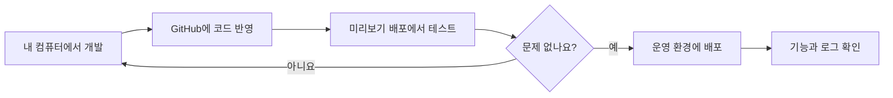
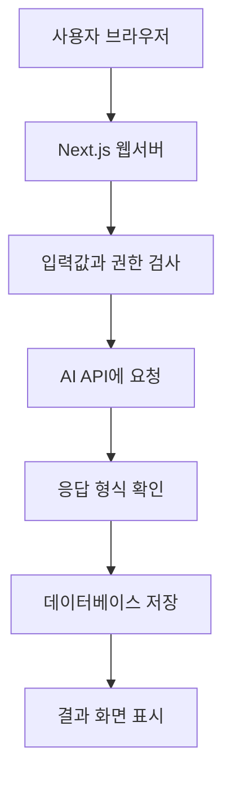
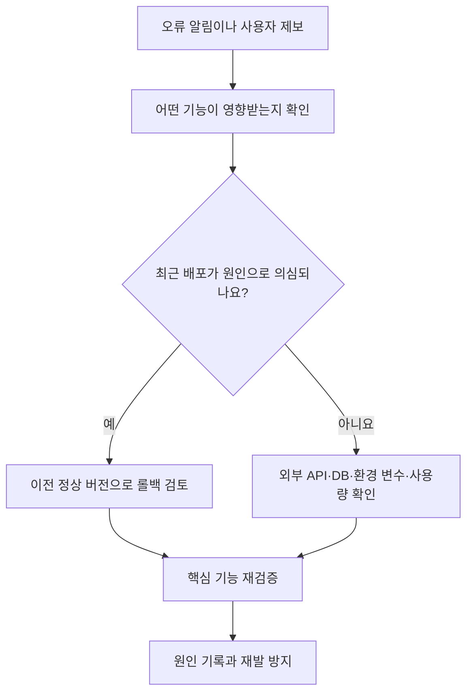

# 12. AI 서비스를 실제로 공개하려면 무엇을 준비해야 할까? — 배포·확장·장애 대응

> **비개발자를 위한 AI 시스템 설계 입문서 · 12**  
> 이번 장의 질문: **내 컴퓨터에서는 잘 되던 AI 서비스가 공개 후 갑자기 멈추면, 어디부터 살펴봐야 할까요?**

- 난이도: ★★☆☆☆ — 운영 개념과 점검 순서를 이해하면 충분해요.
- 예상 학습 시간: 25~35분
- 먼저 읽기: [11. AI 서비스는 어떻게 관찰하고 개선할까?](11_AI_서비스는_어떻게_관찰하고_개선할까_로그_모니터링_운영.md)
- 참고 자료: 문서 마지막의 Vercel·Supabase 공식 운영 가이드

> 이 글은 특정 자료를 그대로 번역한 문서가 아니라, AI 시스템 설계의 핵심 개념을 실제 웹서비스 운영 상황에 맞춰 풀어 쓴 **독립 해설**이에요. 사용 중인 플랫폼의 기능과 요금제는 달라질 수 있어요.

---

## 1. 사이트가 열리면 배포가 끝난 걸까요?

주말에 만든 AI 서비스가 드디어 완성됐어요. GitHub에 코드를 올리고 Vercel로 배포했더니 주소도 생겼죠. 직접 접속해서 버튼을 눌러 보니 AI가 답변까지 잘 만들어 줘요.

그런데 다음 날 연락이 와요.

> "첫 질문은 잘 됐는데, 다시 누르니까 오류가 나요."  
> "로그인은 되는데 결과가 저장되지 않아요."  
> "친구들과 동시에 접속했더니 답변이 너무 늦어요."

이때 **사이트가 열리는 것**과 **서비스가 정상 운영되는 것**은 다르다는 걸 알게 돼요. 배포는 시작이고, 공개 이후에는 장애가 생겼을 때 알아차리고 복구할 방법까지 필요해요.

**이번 장의 핵심 한 줄:** 공개 준비란 **올리는 방법뿐 아니라, 문제가 났을 때 되돌아올 길을 마련하는 것**이에요.

## 이 장을 읽고 나면

- 개발·미리보기·운영 환경을 구분할 수 있어요.
- AI API, 웹서버, 데이터베이스 중 어디에서 오류가 났는지 추적하는 기본 흐름을 알아요.
- 트래픽이 늘어날 때 무조건 서버부터 키우지 않는 이유를 설명할 수 있어요.
- 롤백, 백업, 사용량 제한, 장애 안내가 각각 무슨 역할을 하는지 구분할 수 있어요.
- 내가 운영하는 서비스에 맞는 **공개 전 점검표**를 만들 수 있어요.

---

## 2. 배포(Deployment)는 완성된 파일을 인터넷에 올리는 것보다 넓은 개념이에요

웹사이트에서 바뀐 코드를 사용자가 실제로 이용할 수 있게 반영하는 과정이 배포예요.

일반적인 흐름은 이래요.



여기서 **미리보기 배포(Preview)**가 중요해요. 수정한 코드를 실제 사용자에게 바로 보여 주기 전에 별도 주소에서 시험하는 거예요.

### 왜 바로 운영 사이트에 반영하면 안 될까요?

로그인 버튼의 문구만 바꾼 줄 알았는데, 로그인 이후 이동하는 주소도 함께 바뀌었다고 해 볼게요. 개발 화면에서는 잘 보였지만 운영 환경에서만 로그인 콜백 주소가 달라 오류가 날 수 있어요.

그래서 기능을 바꿀 때는 최소한 이 세 가지를 확인해요.

1. **화면:** 필요한 버튼과 안내가 보이나요?
2. **기능:** 실제로 입력 → 결과 생성 → 저장까지 되나요?
3. **운영:** API 키·로그인 주소·데이터베이스 연결이 운영 설정과 맞나요?

> **알아둘 점:** 미리보기 환경이 운영 데이터베이스와 연결되어 있으면 테스트 자체가 실제 데이터를 바꿀 수 있어요. 가능한 한 테스트용 데이터를 따로 쓰고, 운영 데이터에 접근하는 권한은 제한하는 게 좋아요.

---

## 3. 개발·미리보기·운영 환경은 무엇이 다를까요?

수업에 비유해 볼게요.

- **개발(Local):** 선생님이 혼자 수업 자료를 만드는 작업실
- **미리보기(Preview):** 몇 명에게 보여 주며 오류를 찾는 시범 수업
- **운영(Production):** 실제 학생들이 참여하는 정규 수업

| 환경 | 주요 목적 | 주의할 점 |
|---|---|---|
| Local | 기능 개발과 오류 수정 | 내 컴퓨터에만 있는 설정을 놓치기 쉬움 |
| Preview | 배포된 상태에서 테스트 | 운영 DB·메일·결제와 섞이지 않도록 주의 |
| Production | 실제 사용자에게 서비스 제공 | 변경 관리, 로그, 복구 계획이 필요 |

Vercel은 Local, Preview, Production 환경을 구분해 설정할 수 있어요. 환경마다 API 키나 데이터베이스 연결 값을 따로 줄 수도 있고요.

### 환경 변수(Environment Variables)는 왜 필요한가요?

AI API 키를 코드에 직접 적어 GitHub에 공개하면 누구든 그 키를 악용할 위험이 있어요. 그래서 보통 서버 측 환경 변수에 저장해요.

```text
# 값이 아니라 이름만 보여 주는 예시
AI_API_KEY=서버에서만_사용하는_비밀값
DATABASE_URL=환경별_데이터베이스_연결정보
```

이건 설명용 예시예요. 실제 키는 문서나 공개 저장소에 넣으면 안 돼요. 브라우저에 전달되는 공개 환경 변수에 비밀 키를 넣는 것도 피해야 해요.

**주의:** Vercel에서는 환경 변수 설정을 변경해도 기존 배포에 자동으로 적용되지 않을 수 있어요. 새 배포가 필요한지 확인해야 해요.

---

## 4. AI 서비스는 생각보다 여러 곳을 거쳐요

사용자가 '사주 해설 보기'를 누른다고 해 볼게요.



이 과정에서 문제가 생길 수 있는 곳은 한 군데가 아니에요.

| 사용자가 본 현상 | 가능한 원인 | 먼저 확인할 것 |
|---|---|---|
| 버튼을 눌러도 반응이 없음 | 브라우저 이벤트 오류 | 개발자 도구·클라이언트 오류 |
| 로딩만 계속됨 | AI API 지연·타임아웃 | 요청 시간·서버 로그 |
| AI 결과는 나왔지만 저장 실패 | DB 권한·네트워크·쿼리 오류 | 저장 요청과 DB 오류 로그 |
| 갑자기 요금이 증가 | 중복 클릭·자동 재시도·봇 | 요청량과 사용자별 호출 수 |
| 일부 이용자만 오류 | 로그인 상태·권한 정책 | 인증 세션·RLS 정책 |

**'AI가 오류 났어요'라고 한꺼번에 부르지 말고**, 어느 단계까지 성공했는지를 확인해야 원인을 찾기 쉬워져요.

---

## 5. 이용자가 늘어나면 서버를 크게 바꾸면 될까요?

방문자가 10명일 때와 1,000명일 때의 문제는 다를 수 있어요. 그런데 접속자가 늘었다고 무조건 비싼 서버부터 쓸 필요는 없어요.

먼저 **병목(Bottleneck)**을 찾아야 해요. 전체 흐름에서 가장 느리거나 제한에 먼저 걸리는 부분을 말해요.

놀이공원을 떠올려 보세요. 입구는 넓지만 매표 창구가 하나뿐이라면 입구를 더 넓혀도 줄이 빨리 줄지 않겠죠.

AI 서비스에서도 비슷해요.

- 웹페이지는 빠른데 AI API에 동시 요청 제한이 걸릴 수 있어요.
- AI는 답을 잘 주는데 데이터베이스 연결 수가 부족할 수 있어요.
- 이미지 파일이 너무 커서 화면 로딩만 느릴 수도 있어요.
- 사용자가 한 번 눌렀는데 서버에서는 같은 요청을 여러 번 보낼 수 있어요.

### 확장(Scaling)을 생각할 때의 질문

1. 가장 오래 걸리는 단계는 어디인가요?
2. 느린 요청이 늘어난 건가요, 실패하는 요청이 늘어난 건가요?
3. 같은 작업을 중복 실행하고 있나요?
4. AI가 필요 없는 작업까지 AI API에 보내고 있나요?
5. 이용자가 몰리면 작업을 대기열에 넣어 처리할 수 있나요?

**먼저 측정하고, 가장 큰 병목부터 개선하기.** 이것이 무작정 용량을 늘리는 것보다 안전한 출발점이에요.

---

## 6. 한 사람이 버튼을 여러 번 눌렀다면?

이용자가 답변이 안 나온다고 버튼을 세 번 눌렀어요. 화면에서는 결과가 한 개만 보여도 서버에서는 API 요청이 세 번 발생할 수 있어요.

이런 상황에서 필요한 게 **중복 요청 방지**와 **멱등성(Idempotency)**이에요.

멱등성이란 같은 작업을 여러 번 요청하더라도 의도하지 않은 추가 결과가 생기지 않게 설계하는 성질이에요.

예를 들어 '결과 저장' 요청에 고유한 작업 ID를 붙일 수 있어요.

```text
작업 ID: result-abc123
첫 번째 요청 → 결과 생성 후 저장
같은 ID로 다시 요청 → 기존 작업 상태나 결과를 반환
```

다만 **작업 ID가 있다고 자동으로 안전해지는 건 아니에요.** 서버와 DB에서 실제로 중복 여부를 검사하고 원자적으로 처리해야 해요. AI API 호출 전에 방지하지 못했다면 중복 호출 비용은 이미 발생했을 수도 있고요.

### UX에서 먼저 할 수 있는 작은 대응

- 요청 중 버튼에 로딩 상태 보여 주기
- 중복 클릭 방지하기
- 오래 걸릴 때 진행 상황 알려 주기
- 실패했을 때 '처음부터 다시'와 '결과 다시 불러오기'를 구분하기

UI는 실수를 줄여 주지만, 최종적인 중복 방지는 서버에서도 해야 해요.

---

## 7. 장애가 났을 때는 무엇부터 해야 할까요?

서비스 운영자 입장에서 가장 중요한 건 **멈춘 기능을 안전하게 복구하는 일**이에요.

처음부터 완벽한 원인 분석을 끝내려고 하지 않아도 돼요.



### 롤백(Rollback)은 무엇인가요?

잘못 배포한 새 버전 대신 **이전에 정상 작동하던 배포 버전으로 되돌리는 것**이에요.

- 배포 직후 UI가 깨졌다 → 이전 버전으로 되돌리면 복구될 수 있어요.
- 외부 AI API가 일시적으로 장애가 났다 → 코드를 되돌려도 해결되지 않을 수 있어요.
- DB 테이블을 삭제하거나 데이터를 바꿨다 → 코드 롤백만으로 데이터가 돌아오지 않아요.

Vercel의 롤백은 배포를 이전 버전으로 전환하는 기능이에요. **데이터베이스를 함께 되돌리는 기능은 아니에요.** 복구 후 환경 변수와 예약 작업 상태도 다시 확인해야 해요.

### 장애 상황에서 이용자에게 무엇을 보여 줄까요?

"알 수 없는 오류입니다"보다 상황을 이해할 수 있는 문장이 좋아요.

> "현재 AI 답변 생성이 지연되고 있어요. 잠시 후 다시 시도해 주세요. 결제가 완료된 요청이라면 중복 결제되지 않도록 상태를 먼저 확인해 주세요."

다만 실제 서비스에 결제가 없다면 결제 안내는 빼야 해요. **안내 문구도 서비스의 실제 기능과 맞아야 해요.**

---

## 8. 롤백과 백업은 서로 다른 안전장치예요

둘 다 '되돌리는 것'처럼 보이지만 역할이 달라요.

| 구분 | 무엇을 되돌리나요? | 대표 사례 |
|---|---|---|
| 코드 롤백 | 이전에 배포한 프로그램 | 새 배포 후 버튼이 작동하지 않을 때 |
| DB 백업 복원 | 저장한 데이터의 과거 상태 | 중요한 데이터가 손상되었을 때 |
| 설정 복구 | API 키·환경 변수·권한 등 설정 | 잘못된 키로 변경한 경우 |

### 백업이 있다고 안심해도 될까요?

아니에요. 중요한 건 **복원할 수 있는 백업인지 확인하는 것**이에요.

Supabase 공식 안내에 따르면 요금제에 따라 백업 제공 범위가 다르고, 데이터베이스 백업만으로 Storage에 저장한 파일 객체까지 복원되는 것은 아니에요. 따라서 이미지나 첨부파일을 저장한다면 별도 복구 계획도 필요해요.

처음부터 전문적인 재해 복구 시스템까지 만들 필요는 없어요. 대신 최소한 다음 질문에는 답할 수 있어야 해요.

- 중요한 데이터가 어디에 저장되어 있나요?
- 백업 주기와 보관 기간은 어떻게 되나요?
- 복원 방법을 테스트해 본 적이 있나요?
- 복원하면 최신 데이터 중 어느 정도가 사라질 수 있나요?

마지막 질문은 **RPO(복구 시점 목표)**와 연결돼요. 쉽게 말해 '사고가 나면 어느 시점까지의 데이터를 잃어도 감당할 수 있는가'예요.

**RTO(복구 시간 목표)**는 '서비스를 얼마 안에 다시 쓸 수 있도록 복구해야 하는가'이고요. 둘 다 서비스 규모에 맞춰 정하면 돼요.

---

## 9. AI API가 느리거나 실패할 때 선택할 수 있는 방법

AI 서비스는 외부 제공업체 상태에도 영향을 받아요. 우리가 작성한 코드가 완벽해도 요청 한도가 초과되거나 응답이 지연될 수 있어요.

| 대응 방법 | 쉬운 설명 | 주의할 점 |
|---|---|---|
| 타임아웃 | 무한정 기다리지 않고 종료 | 너무 짧으면 정상 응답도 실패 처리 |
| 재시도 | 잠깐 후 다시 요청 | 횟수 제한과 지연 간격 필요 |
| 요청 제한 | 사용자별 호출 횟수 조절 | 정상 사용자까지 막지 않도록 조정 |
| 대기열(Queue) | 한꺼번에 처리하지 않고 순서를 정함 | 처리 지연과 상태 관리 필요 |
| 대체 안내 | AI가 안 될 때 기본 정보 제공 | 근거 없는 답을 임의 생성하지 않기 |
| 모델 대체(Fallback) | 다른 모델로 처리 | 품질·비용·개인정보 조건 재검증 |

특히 **AI 호출 실패가 곧 전체 서비스 실패일 필요는 없어요.** 사주 해설 생성이 안 되더라도, 이미 저장한 결과를 다시 보는 기능은 사용할 수 있게 설계할 수 있죠.

단, 한 요청이 어느 단계에서 실패했는지에 따라 재시도하면 중복 비용이나 중복 저장이 생길 수 있으니 요청 상태를 관리해야 해요.

---

## 10. 찐망고 사주풀이에 적용해 볼게요

다음은 실제 운영 상태를 진단한 결과가 아니라, 공개된 기술 구조를 바탕으로 만든 **점검 예시**예요.

| 상황 | 점검할 지점 | 대응 아이디어 |
|---|---|---|
| 무료 이용자가 늘어 API 비용 급증 | 호출량·토큰·중복 요청 | 이용자별 한도와 서버 중복 방지 |
| 결과는 나오는데 저장되지 않음 | Supabase 권한·쿼리·인증 | 생성과 저장의 성공 상태 분리 |
| 카카오 로그인 후 화면이 되돌아감 | OAuth 콜백 주소·환경별 설정 | Preview·Production 로그인 테스트 |
| 새 배포 후 결과 화면 오류 | 배포 버전·브라우저 오류 | 이전 버전 롤백 및 재검증 |
| AI 응답 지연 | 첫 응답 시간·전체 처리 시간 | 스트리밍, 상태 안내, 타임아웃 점검 |

사용자에게는 한 페이지처럼 보이지만, 안쪽에는 여러 서비스가 함께 작동해요. 그래서 **문제가 생길 때마다 'AI가 이상해요'라고 묶지 않고 단계를 나눠 보는 습관**이 중요해요.

### 정말 중요한 원칙

**화면의 로딩이 끝났다고 작업 전체가 성공한 것은 아니에요.** 생성 성공, 저장 성공, 사용자에게 표시 성공을 따로 확인할 수 있어야 해요.

---

## 11. 찐망고 레퍼런스의 자동 수집에도 같은 원리가 적용돼요

자동 수집에서는 '웹사이트가 열리는가'와 다른 종류의 문제가 생겨요.

예를 들어 매일 새벽 Playwright로 섹션 이미지를 수집한다고 해 볼게요.

1. 사이트 접속에 실패했다면? → 무한 재시도하지 않기
2. 이미 수집한 이미지라면? → 중복 검사하기
3. 관리자가 직접 등록한 자료라면? → 자동 처리로 덮어쓰지 않기
4. 이미지 분류가 불확실하다면? → 검수 대기 상태로 두기
5. 작업이 중간에 멈췄다면? → 어디까지 처리했는지 기록하기

이 구조에서는 **재실행할 수 있는 작업**, **이미 처리한 항목을 구분하는 키**, **관리자 검수 상태**가 중요해요.

그리고 자동화가 실패해도 공개 사이트의 기존 레퍼런스가 사라지지 않도록, 수집 작업과 사용자 조회 기능을 분리하는 편이 좋아요.

---

## 12. 공개하기 전에 꼭 확인할 점검표

여기서는 소규모 AI 웹서비스를 기준으로 정리해 볼게요.

### A. 기능과 사용자 경험

- [ ] 첫 방문자도 서비스 목적과 이용 방법을 이해할 수 있어요.
- [ ] 입력 오류와 네트워크 오류를 구분해서 안내해요.
- [ ] 로딩·완료·실패·재시도 상태가 화면에 보여요.
- [ ] 모바일에서도 핵심 기능을 사용할 수 있어요.
- [ ] 생성과 저장이 실제로 모두 성공하는지 확인했어요.

### B. 계정·데이터·비밀정보

- [ ] AI API 비밀 키는 서버에서만 사용해요.
- [ ] 운영용 데이터와 테스트 데이터를 구분해요.
- [ ] 로그인/로그아웃/권한 없는 조회를 테스트했어요.
- [ ] 데이터베이스 접근 정책(RLS 등)을 확인했어요.
- [ ] 개인정보는 로그에 불필요하게 남기지 않아요.

### C. 비용·장애·복구

- [ ] 사용자별 요청 제한이나 사용량 경고가 있어요.
- [ ] 재시도 횟수와 타임아웃이 정해져 있어요.
- [ ] 중복 클릭이 비용·중복 저장으로 이어지지 않게 설계했어요.
- [ ] 문제가 생기면 어떤 로그를 볼지 알아요.
- [ ] 이전 배포 버전으로 되돌리는 방법을 알아요.
- [ ] 중요한 데이터의 백업과 복원 방법을 확인했어요.

여기서 모두 체크되지 않았다고 무조건 공개하면 안 되는 건 아니에요. 하지만 **비밀 키 보호, 개인정보 접근 제어, 치명적인 중복 요청 문제**는 공개 전에 우선 해결하는 게 좋아요.

---

## 13. 수업에서 실습한다면: 20분 공개 전 점검 회의

학생들이 리뉴얼한 웹사이트를 실제로 배포한다고 가정해 볼게요.

**준비물:** 메인 페이지, 로그인 페이지, API 기능 설명, 간단한 체크리스트

**1단계 (5분) — 사용자 행동 세 가지 고르기**

- 첫 방문 → 정보 탐색
- 로그인 → 내 페이지 이동
- 버튼 클릭 → 결과 생성 또는 저장

**2단계 (5분) — 실패 상황 만들기**

- 인터넷 연결이 잠깐 끊긴다면?
- 로그인 세션이 끝났다면?
- 버튼을 세 번 눌렀다면?

**3단계 (5분) — 화면과 서버 대응 구분하기**

예: 로딩 버튼 비활성화는 화면 대응, 중복 작업 ID 검사는 서버 대응이에요.

**4단계 (5분) — 우선순위 결정하기**

각 팀이 '공개 전에 반드시 고칠 문제 1개'와 '공개 후 측정하면서 개선할 문제 1개'를 선정해요.

**실습의 목적:** 단순히 예쁜 화면을 완성하는 것에서 나아가 **실제 이용자가 실패했을 때도 쓸 수 있는 서비스인지** 판단해 보는 거예요.

---

## 14. 오늘 배운 내용 한 장 정리

| 개념 | 기억할 문장 |
|---|---|
| 배포 | 만든 변경 사항을 실제 사용자에게 반영하는 과정 |
| Preview | 운영 전에 기능을 확인하는 시험 환경 |
| Production | 실제 사용자가 이용하는 운영 환경 |
| 환경 변수 | 코드 밖에서 연결 정보나 비밀값을 관리하는 설정 |
| 병목 | 전체 흐름에서 가장 먼저 한계에 걸리는 지점 |
| 멱등성 | 같은 요청이 반복돼도 원치 않는 추가 효과가 생기지 않도록 하는 성질 |
| 롤백 | 이전 정상 배포 버전으로 되돌리기 |
| 백업 | 데이터를 복원하기 위한 별도 사본 |
| RTO / RPO | 복구에 걸리는 시간 목표 / 허용 가능한 데이터 손실 시점 목표 |

**공개는 끝이 아니라 시작이에요.** 처음부터 대형 서비스처럼 복잡하게 설계하지 않아도 돼요. 대신 아래 순서만큼은 익혀 두세요.

**테스트 → 공개 → 측정 → 장애 시 복구 → 원인 개선**

---

## 확인 문제

1. Preview 환경과 Production 환경을 구분하는 이유는 무엇일까요?
2. AI API가 실패했을 때 코드 롤백만 하면 항상 해결될까요?
3. 롤백과 DB 백업 복원은 같은 작업일까요?
4. 버튼을 두 번 눌러 AI API가 두 번 호출됐다면 UI만 고치면 충분할까요?
5. 사용자가 많아졌을 때 서버 요금을 올리기 전에 무엇부터 확인해야 할까요?

<details>
<summary>정답 방향 보기</summary>

1. 운영 사용자와 데이터를 보호하면서 변경 사항을 테스트하기 위해서예요.
2. 아니에요. 외부 API나 설정·DB 문제라면 코드 변경과 관계없을 수 있어요.
3. 달라요. 롤백은 이전 프로그램 버전, 백업 복원은 데이터 상태를 되돌리는 작업이에요.
4. 아니에요. 서버에서도 중복 요청과 작업 상태를 검사해야 해요.
5. 어디가 병목인지 로그와 지표로 먼저 측정해야 해요.

</details>

---

## 다음 장 예고

**13. AI 서비스의 구조를 그림으로 설계하기 — 웹·DB·AI API 연결하기** (준비 중)  
지금까지 배운 내용을 한 장의 구조도로 연결해 볼게요. 화면에서 버튼을 누르면 데이터가 어디를 거쳐서 돌아오는지 직접 그려 보는 장이에요.

## 참고 자료

- [Om Bharatiya, AI System Design Guide](https://github.com/ombharatiya/ai-system-design-guide)
- [Vercel — Environments](https://vercel.com/docs/deployments/environments)
- [Vercel — Managing Environment Variables](https://vercel.com/docs/environment-variables/managing-environment-variables)
- [Vercel — Rolling Back a Production Deployment](https://vercel.com/docs/deployments/rollback-production-deployment)
- [Supabase — Production Checklist](https://supabase.com/docs/guides/deployment/going-into-prod)
- [Supabase — Database Backups](https://supabase.com/docs/guides/platform/backups)