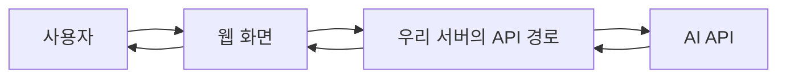
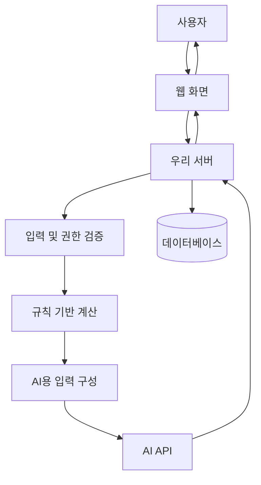
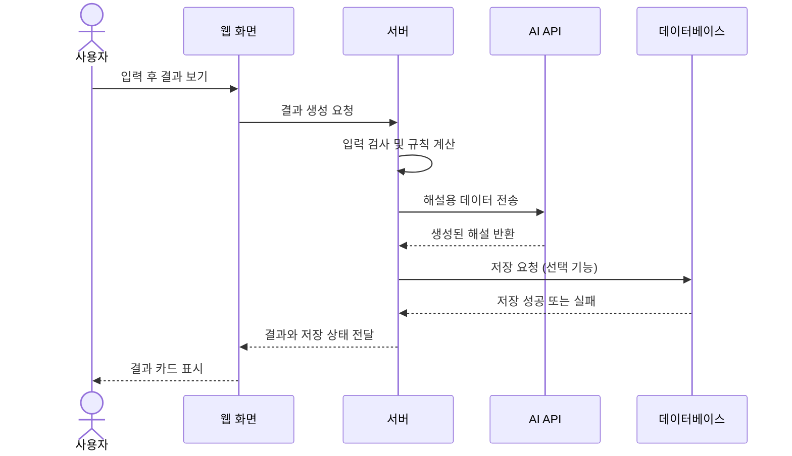
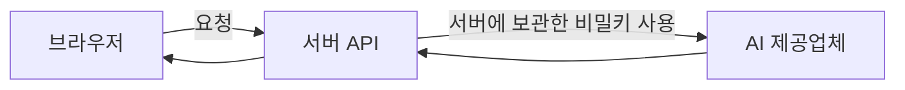
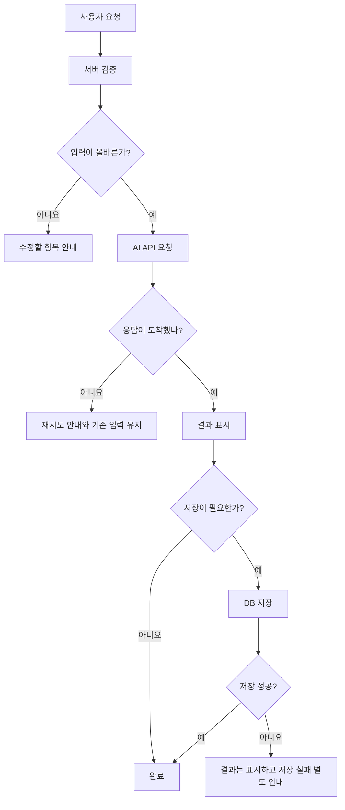
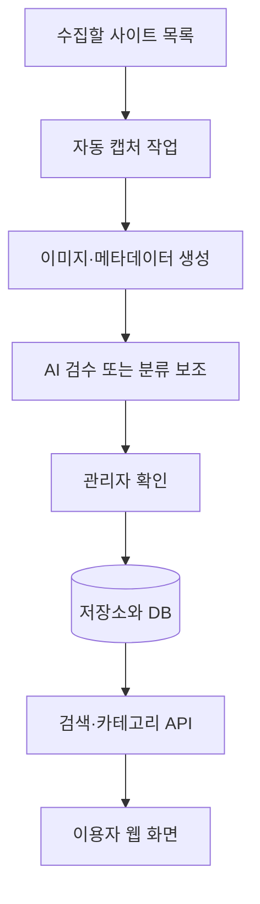

# 13. AI 서비스의 구조를 그림으로 설계하기 — 웹·DB·AI API 연결하기

> **비개발자를 위한 AI 시스템 설계 입문서 · 13**  
> 이번 장의 질문: **사용자가 버튼 하나를 눌렀을 뿐인데, 웹사이트 뒤에서는 어떤 시스템이 어떤 순서로 움직일까요?**

- 난이도: ★★☆☆☆ — 코드를 작성하지 않아도 흐름을 그릴 수 있어요
- 예상 학습 시간: 25~35분
- 먼저 읽기: [12. AI 서비스를 실제로 공개하려면 무엇을 준비해야 할까?](12_AI_서비스를_공개하기_전_배포_확장_장애_대응.md)
- 참고 주제: [AI System Design Guide](https://github.com/ombharatiya/ai-system-design-guide) · 웹 애플리케이션 아키텍처와 AI 시스템 설계

> 이 글은 원문의 문장을 그대로 번역한 자료가 아니라, 웹서비스를 기획하고 만드는 초보자를 위해 다시 쓴 **독립 해설**이에요. 아래의 찐망고 사주풀이 흐름은 개념 학습을 위한 예시 구조이며, 실제 배포된 코드 전체를 감사해 확정한 구현도가 아니에요.

---

## 1. 버튼 하나가 실제로 하는 일

사주풀이 웹사이트에서 사용자가 생년월일을 입력하고 **‘결과 보기’** 버튼을 눌렀다고 해 볼게요.

화면에서는 로딩 표시가 나타나다가 해설 카드가 떠요. 사용자 눈에는 그게 전부예요.

그런데 만드는 사람은 이렇게 물어야 해요.

- 입력한 데이터가 올바른지 누가 검사할까요?
- 사주 계산은 어디서 할까요?
- AI에게 어떤 정보를 보낼까요?
- AI 답변은 어느 화면에 어떻게 표시할까요?
- 나중에 다시 볼 결과는 어디에 저장할까요?
- 요청이 실패했다면 어떤 메시지를 보여줘야 할까요?

이 질문의 답을 **상자와 화살표로 연결한 그림**이 서비스 구조도예요.

**한 줄로 기억하기:** *구조도는 예쁘게 그린 서버 그림이 아니라, 사용자 행동이 어떤 작업과 데이터 이동으로 이어지는지 보여주는 지도예요.*

---

## 2. 웹서비스를 다섯 가지 역할로 나눠 봐요

처음부터 AWS나 Docker를 생각할 필요 없어요. 먼저 누가 무슨 일을 하는지 구분해 볼게요.

| 역할 | 쉽게 말하면 | 예시 |
|---|---|---|
| 프론트엔드(Frontend) | 사용자가 보고 누르는 화면 | 입력 폼, 결과 카드, 로딩 메시지 |
| 백엔드(Backend) | 규칙 검사와 작업을 조정하는 담당자 | 입력 검증, API 호출, 권한 확인 |
| 데이터베이스(DB) | 다시 사용할 데이터를 보관하는 곳 | 계정, 결과, 저장 이력 |
| AI API | 전달받은 자료로 답변을 만들어 주는 외부 서비스 | 해설문 생성 |
| 외부 서비스 | 인증, 이메일, 결제 등 별도 기능 | 로그인, 이메일 발송 |

**주의할 점:** 프론트엔드와 백엔드가 꼭 서로 다른 저장소나 서버여야 한다는 뜻은 아니에요. Next.js 같은 프레임워크 하나에서 화면과 서버 코드를 함께 작성할 수도 있거든요.

### 카페에 비유하면

- 손님이 주문하는 키오스크 = 프론트엔드
- 주문을 확인하고 조리 순서를 정하는 직원 = 백엔드
- 주문 내역을 남기는 장부 = 데이터베이스
- 특별 메뉴를 만들어 주는 외부 주방 = AI API

손님이 키오스크를 눌렀다고 해서 외부 주방에 직접 들어가는 건 아니죠. 중간에서 무엇을 보낼지 판단하는 단계가 필요해요.

---

## 3. 첫 번째 구조도: AI 답변만 보여 주는 작은 서비스

이 구조라면 굳이 데이터베이스가 없어도 시작할 수 있어요. 질문을 보내고 답을 받는 기능만 있기 때문이에요.

**구조를 단순하게 유지해도 되는 경우**

- 로그인이나 이전 결과 저장이 필요 없을 때
- 외부 데이터 검색 없이 생성만 할 때
- 짧은 시범 프로젝트를 검증할 때

여기에 사용자별 저장, 결제, 검색, 관리자 기능이 추가되면 구조도도 함께 자라나요.

---

## 4. 두 번째 구조도: 결과를 저장하는 AI 서비스

찐망고 사주풀이처럼 결과 생성과 저장을 모두 제공하는 상황을 가정해 볼게요.

이 그림에는 **두 종류의 일이 섞여 있어요.**

1. **결정적인 일:** 날짜 형식 검사, 필수 항목 확인, 고정 규칙 계산, 저장 권한 판단
2. **생성적인 일:** 계산 결과를 바탕으로 자연스러운 해설 작성

첫 번째는 가능하면 코드로 처리하고, 두 번째에 AI를 활용하는 편이 검증하기 쉬워요.

**중요:** AI가 쓴 문장을 그대로 믿고 금전 거래, 접근 권한, 저장 대상자를 결정하게 만들면 안 돼요. 이런 판단은 서버의 검증 로직과 DB 정책에서 관리해야 해요.

---

## 5. 한 번의 요청을 순서대로 따라가 봐요

구조도는 상자뿐 아니라 **순서**를 읽을 줄 알아야 해요.

이건 **시퀀스 다이어그램(Sequence Diagram)**이라고 해요. 각 서비스가 어떤 순서로 요청과 응답을 주고받는지 보여줘요.

### 왜 순서가 중요할까요?

예를 들어 AI 해설은 완성됐는데 데이터베이스 저장에 실패했다고 생각해 보세요.

- 사용자는 해설을 볼 수 있을까요?
- 다시 저장 버튼을 누를 수 있을까요?
- 결과를 재생성하면 AI 호출 비용이 또 들까요?
- 저장이 실패했는데 성공했다고 표시하면 어떻게 될까요?

화면만 디자인하면 놓치기 쉬운 질문들이 구조도를 그릴 때 보이기 시작해요.

**실무 포인트:** 생성 성공과 저장 성공은 서로 다른 상태예요. UI에서도 구분해 줘야 해요.

---

## 6. 데이터는 어디로 이동하고, 어디에 남을까요?

모든 정보가 데이터베이스에 저장되는 것은 아니에요.

| 데이터 | 이동하는 곳 | 저장 여부를 판단할 때 |
|---|---|---|
| 사용자가 입력한 값 | 브라우저 → 서버 | 꼭 필요한 항목만 저장해요 |
| 해설 생성을 위한 입력 | 서버 → AI API | 제공업체 데이터 처리 정책 확인 |
| AI가 만든 답변 | AI API → 서버 → 화면 | 사용자 요청에 따라 저장할 수 있어요 |
| 사용자 계정 정보 | 인증 서비스·DB | 사용자별 접근 정책 필수 |
| 오류 로그 | 모니터링 서비스 | 개인정보와 비밀키를 그대로 남기지 않아요 |

데이터 이동 화살표에 **무슨 정보가 지나가는지**까지 적어 보면 개인정보 위험도 함께 보이기 시작해요.

로그인 여부와 관계없이 저장 링크를 제공한다면, 링크를 아는 사람이 어떤 데이터까지 볼 수 있는지도 별도로 검토해야 해요.

---

## 7. 왜 AI API 키를 브라우저에 넣으면 안 될까요?

브라우저는 사용자가 실행하는 공간이에요. 화면에 직접 적지 않았더라도 브라우저로 전달된 자바스크립트와 네트워크 요청은 사용자가 확인할 수 있어요.

따라서 **비밀 API 키는 서버에서 관리**해야 해요.

환경 변수(Environment Variable)를 쓰면 키를 소스코드에 직접 적지 않고 관리할 수 있어요. 하지만 환경 변수라고 해서 자동으로 안전한 건 아니에요.

- 공개 브라우저 번들에 노출되는 변수에 비밀키를 넣지 않기
- 서버 로그와 오류 메시지에 키를 찍지 않기
- 개발·미리보기·운영 환경의 키와 설정 구분하기
- 키가 유출되면 폐기하고 새 키 발급하기

참고: [Vercel 환경 변수 문서](https://vercel.com/docs/environment-variables)

---

## 8. DB는 단순히 저장만 하는 곳이 아니에요

두 사람이 사주 결과를 각각 저장했다고 해 볼게요.

A가 로그인했을 때 B의 비공개 결과까지 볼 수 있다면, 화면 디자인이 아무리 좋아도 서비스는 안전하지 않겠죠.

Supabase를 예로 들면 **RLS(Row Level Security)** 정책으로 어떤 사용자가 어떤 행(row)을 읽거나 수정할 수 있는지 정할 수 있어요.

- 로그인한 사용자 본인의 결과만 조회 허용
- 관리자 기능은 별도의 서버 측 권한 확인
- 공개 공유 기능은 공개 범위와 만료 조건을 별도로 설계

**주의:** 프론트엔드에서 버튼을 숨기는 것만으로 권한을 막을 수는 없어요. 서버 또는 DB에서 실제 접근을 거부해야 해요. 관리자용 비밀키는 브라우저에 전달하면 안 돼요.

참고: [Supabase RLS 공식 문서](https://supabase.com/docs/guides/database/postgres/row-level-security)

---

## 9. 사용자가 많아지면 어디가 느려질까요?

구조도가 필요한 또 다른 이유는 **병목**을 찾기 위해서예요.

사용자가 10명에서 1,000명으로 늘었다고 해 볼게요. 느려지는 이유는 한 가지가 아닐 수 있어요.

| 느린 지점 | 사용자에게 보이는 현상 | 먼저 확인할 것 |
|---|---|---|
| 브라우저 | 화면 조작이 버벅거림 | 이미지 크기, 렌더링, 자바스크립트 |
| 서버 | 버튼 클릭 후 오래 기다림 | 처리 시간, 동시 요청, 시간 제한 |
| AI API | 해설 생성 지연 | 모델 응답 시간, 토큰 수, 제공업체 제한 |
| DB | 저장 또는 조회 지연 | 쿼리, 인덱스, 연결 수 |
| 외부 인증 | 로그인 실패 | 인증 서비스 오류, 리다이렉트 설정 |

따라서 **“사이트가 느리다”를 “어느 상자가 느린가?”라는 질문으로 바꾸는 것**이 구조 설계의 시작이에요.

---

## 10. AI가 실패했을 때는 어떻게 보여줘야 할까요?

이런 그림을 **플로차트(Flowchart)**라고 해요. 사용자의 상태와 서비스의 예외 상황을 정리할 때 유용해요.

### UI 기획자에게 특히 중요한 부분

- 로딩 중에 버튼을 여러 번 누르면 중복 요청이 생기지 않을까요?
- 실패해도 사용자가 입력한 내용을 유지할까요?
- 저장이 실패한 것인지, AI 생성이 실패한 것인지 구분할까요?
- 재시도 버튼을 누르면 비용이 다시 발생할까요?

**UI의 상태 설계와 시스템 구조도는 서로 연결되어 있어요.** 예쁜 로딩 화면을 만드는 것보다 어떤 작업을 기다리는지 정확히 아는 게 먼저예요.

---

## 11. 구조도를 그릴 때 가장 흔한 실수

### 실수 1. 아는 기술 이름부터 전부 적기

처음부터 Next.js, Vercel, Supabase, Redis, Queue를 몽땅 넣으면 그림은 복잡한데 데이터 흐름이 안 보여요.

**먼저** 사용자 → 화면 → 서버 → AI/DB의 흐름을 그리세요. 필요한 기술은 그다음에 붙이면 돼요.

### 실수 2. 모든 화살표를 양방향으로만 그리기

누가 요청하고 누가 응답하는지 드러나지 않으면 오류 원인을 찾기 어려워요. 중요한 구간은 방향과 요청 내용을 표시해 보세요.

### 실수 3. 보안을 구조도 밖의 일로 생각하기

키 보관 위치, 인증, DB 접근 정책은 모두 아키텍처의 일부예요.

### 실수 4. 성공한 경우만 그리기

**실패·재시도·저장 오류·중복 클릭**까지 생각해 봐야 사용자에게 어떤 안내가 필요한지 알 수 있어요.

---

## 12. 직접 그려 보기: 찐망고 레퍼런스라면?

이번에는 AI 해설 서비스 대신, 국내 웹사이트 섹션을 모아 보여 주는 레퍼런스 서비스를 생각해 볼게요.

이 구조에서 질문해 볼 게 있어요.

1. AI가 잘못된 카테고리로 분류하면 누가 고칠까요?
2. 관리자가 직접 등록한 이미지는 다음 자동 수집에서 덮어쓰지 않게 하려면 어디서 막아야 할까요?
3. 저장되는 것은 이미지 파일과 데이터 행 중 무엇일까요? 둘 다일까요?
4. 검색 속도가 느릴 때 AI를 다시 호출해야 할까요, 아니면 검색 인덱스를 확인해야 할까요?

여기서 중요한 판단은 **모든 단계에 AI를 붙이는 게 아니라 필요한 단계에만 AI를 넣는 것**이에요.

---

## 13. 웹 기획 수업에 적용해 볼까요? (20분 실습)

**과제: ‘학생이 자신의 포트폴리오를 제출하면 자동 피드백을 받는 서비스’의 구조도를 그려 보세요.**

### 1단계 — 사용자 행동 세 가지 정하기 (3분)

- 학생이 GitHub 주소 입력
- 분석 결과 확인
- 피드백 기록 다시 열기

### 2단계 — 필요한 역할 다섯 개 골라 보기 (5분)

화면 / 서버 / AI API / 데이터베이스 / GitHub 조회 기능 중 필요한 역할과 이유를 적어 보세요.

### 3단계 — 화살표 그리기 (5분)

어디서 어디로 어떤 데이터가 이동하는지 적어 보세요. ‘AI가 포트폴리오를 본다’가 아니라 **GitHub 파일을 누가 읽어 AI에 전달할지** 결정해야 해요.

### 4단계 — 실패 상황 두 가지 추가 (5분)

- 비공개 저장소라 읽지 못함
- AI 피드백은 생성됐지만 저장 실패

### 5단계 — 친구와 비교하기 (2분)

서로의 구조도에서 **출처가 없는 화살표, 권한이 없는 기능, 실패했을 때 갈 곳이 없는 단계**를 찾아보세요.

**평가 포인트:** 예쁘게 그린 그림보다 사용자 행동 → 시스템 처리 → 결과·오류 상태가 논리적으로 이어지는지 확인해요.

---

## 14. 내가 어디까지 알아야 할까요?

| 수준 | 알아둘 내용 | 우선순위 |
|---|---|---|
| 기본 | 화면·서버·DB·AI API의 역할 | **필수** |
| 기본 | 요청과 응답, 성공과 실패의 흐름 | **필수** |
| 실무 | API 키 보관 위치, 인증과 권한 | **필수** |
| 실무 | 중복 요청 방지, 저장 실패 UI | **필수** |
| 선택 | 비동기 작업, 큐, 캐시 | 서비스 규모에 따라 |
| 심화 | 분산 시스템의 복제·샤딩·오케스트레이션 | 직접 대규모 시스템을 운영할 때 |

기술 이름을 많이 외우는 것보다, **어떤 일을 어느 위치에서 해야 안전하고 유지보수하기 좋은가**를 설명할 수 있으면 충분해요.

---

## 15. 오늘 배운 내용 한 장 정리

- 구조도는 사용자 행동 뒤에 숨어 있는 **역할과 데이터 이동**을 그린 지도예요.
- 프론트엔드·백엔드·DB·AI API의 책임을 구분하면 문제를 찾기 쉬워져요.
- 구조도에는 정상 흐름뿐 아니라 **오류와 복구 흐름**도 필요해요.
- API 비밀키는 서버에, 사용자 접근 권한은 서버·DB에서 강제해야 해요.
- 기능을 추가할 때마다 상자부터 늘리는 게 아니라, **정말 새로운 역할이 필요한지** 물어보세요.

> AI 웹서비스를 설계한다는 건 AI를 어디에 붙일지 결정하는 데서 끝나지 않아요. **AI가 아닌 부분까지 포함해 서비스 전체가 안전하게 움직이도록 설계하는 일**이에요.

---

## 스스로 확인하기

1. 사용자가 클릭하는 버튼이 AI API를 직접 호출하게 만들면 어떤 문제가 생길까요?
2. AI 결과는 생성됐지만 DB 저장이 실패했다면 UI에 어떤 상태를 표시할까요?
3. 구조도에서 프론트엔드와 서버를 구분하는 가장 큰 이유는 무엇일까요?
4. 관리자만 볼 수 있는 데이터는 버튼을 숨기는 것만으로 보호할 수 있을까요?
5. 내 서비스의 흐름에서 굳이 AI가 필요 없는 단계는 어디일까요?

정답 방향 보기

1. 브라우저에 비밀키가 노출되거나 서버 측 검증·사용량 제한이 빠질 수 있어요. 서비스에서 직접 호출을 지원하는 특별한 인증 방식이 있더라도 노출 범위를 따로 확인해야 해요.
2. 해설은 보여 주되 ‘저장 실패’를 분리해서 알리고 다시 저장할 방법을 제공해요.
3. 화면에서 할 일과 서버에서 보호·검증할 일을 나누기 위해서예요.
4. 아니에요. 서버와 DB에서 실제 권한 검사를 해야 해요.
5. 날짜 형식 검사, 고정 규칙 계산, 권한 확인, 중복 처리 등은 코드로 구현하는 게 더 적절해요.

---

## 다음 장 예고

**14. AI 서비스의 데이터는 어떻게 준비하고 관리할까? — 데이터 파이프라인과 품질**  
AI가 멋진 답변을 만들기 전에, 실제로 어떤 데이터를 받고 어떻게 정리하고 검수해야 하는지 살펴볼게요.

## 참고 자료

- [Om Bharatiya, *AI System Design Guide*](https://github.com/ombharatiya/ai-system-design-guide)
- [Vercel — Environment Variables](https://vercel.com/docs/environment-variables)
- [Vercel — Environments](https://vercel.com/docs/deployments/environments)
- [Supabase — Row Level Security](https://supabase.com/docs/guides/database/postgres/row-level-security)