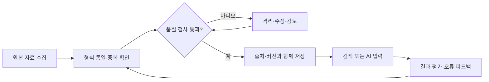
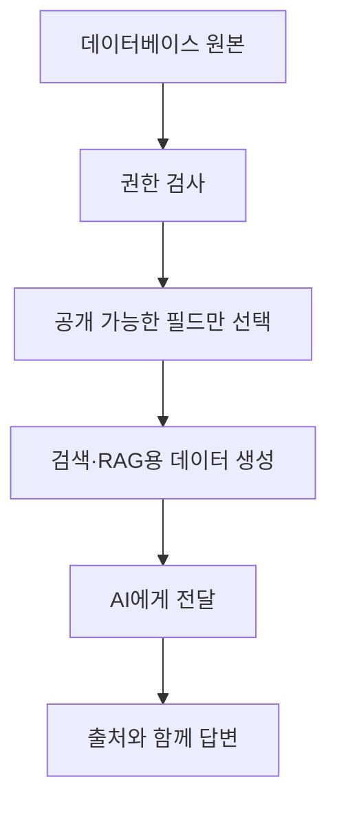
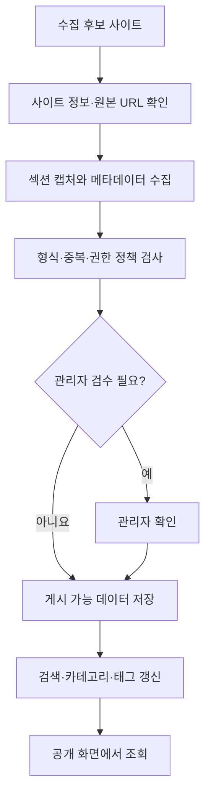

# 14. AI 서비스의 데이터는 어떻게 준비하고 관리할까? — 데이터 파이프라인과 품질

> **비개발자를 위한 AI 시스템 설계 입문서 · 14**  
> 이번 장의 질문: **AI가 똑똑한데도 왜 자료를 잘못 읽을까요? 좋은 데이터를 만드는 일은 어디서부터 시작할까요?**

- 난이도: ★★☆☆☆ — 데이터베이스를 직접 설계하지 않아도 이해할 수 있어요
- 예상 학습 시간: 25~35분
- 먼저 읽기: [03. RAG — AI가 모르는 자료를 찾아 답하는 방법](03_RAG_AI가_자료를_찾아_답하는_방법.md) · [13. AI 서비스의 구조를 그림으로 설계하기](13_AI_서비스의_구조를_그림으로_설계하기.md)
- 참고 원문: [AI System Design Guide](https://github.com/ombharatiya/ai-system-design-guide) — Retrieval Systems의 Data Engineering for AI 주제

> 이 글은 원문을 직역한 번역본이 아니라 핵심 개념을 바탕으로 새로 쓴 **독립적인 초보자 해설**이에요. 예시 데이터와 수치는 설명을 위해 만들었고 실제 운영 데이터가 아니에요.

---

## 1. AI는 맞게 대답했는데, 원본 자료가 틀렸다면?

수업용 AI 도우미를 만들었다고 해 볼게요. 학생이 이렇게 묻습니다.

> “반응형 웹 평가 배점이 몇 점이에요?”

AI가 내부 문서에서 ‘반응형 웹 — 20점’이라는 자료를 찾아서 아주 자신 있게 답해요. 그런데 올해 평가표에는 **15점**으로 바뀌어 있었어요.

AI는 제공된 자료대로 답한 거예요. 하지만 **자료가 오래되어 최종 답변은 틀렸어요.**

이럴 때 프롬프트에 ‘정확하게 답해’라고 열 번 적는다고 해결될까요? 아니에요. 먼저 데이터가 어디서 왔고, 최신인지, 어떤 기준으로 믿을 수 있는지 확인해야 해요.

**이번 장의 핵심 한 줄:** *AI 답변의 품질을 높이려면 모델뿐 아니라 모델에 도착하기 전의 데이터부터 관리해야 해요.*

## 2. 데이터 파이프라인이란 무엇일까요?

**데이터 파이프라인(Data Pipeline)**은 자료를 모으고, 정리하고, 확인하고, 필요한 곳에 전달하는 일련의 흐름이에요.

학교 급식에 비유해 볼게요.

- 식자재 입고 → 자료 수집
- 상태 확인 → 유효성 검증
- 손질과 분류 → 정제·표준화
- 냉장고에 날짜별 보관 → 저장·버전 관리
- 조리실에 필요한 만큼 전달 → 검색·조회·AI 입력

좋은 요리사가 있어도 상한 재료를 넣으면 좋은 음식이 나오기 어렵죠. AI도 마찬가지예요.



이 그림에서 중요한 건 맨 끝에서 끝나지 않는다는 점이에요. **결과에서 발견한 문제를 다시 데이터 정리 과정에 반영하는 순환 구조**가 있어야 해요.

## 3. 수집(Ingestion): 무엇을 가져올지부터 정해야 해요

자료 수집은 단순히 파일을 최대한 많이 모으는 일이 아니에요.

예를 들어 찐망고 레퍼런스에는 여러 웹사이트의 섹션 이미지, 사이트명, 카테고리, 태그, 원본 주소 등이 들어갈 수 있죠.

이때 중요한 질문은 다음과 같아요.

1. 이 자료는 **어디서** 왔나요?
2. **언제** 수집했나요?
3. 원본이 **아직 유효**한가요?
4. 자동 수집한 자료인가요, 관리자가 직접 등록했나요?
5. **공개·사용해도 되는 범위**인가요?

**수집량이 많다고 좋은 데이터가 되는 건 아니에요.** 출처를 모르거나 오래된 자료가 늘어날수록 검색 품질이 오히려 떨어질 수 있어요.

### 수집할 때 함께 보관할 정보

| 필드 | 쉬운 뜻 | 예시 |
|---|---|---|
| `source_url` | 원본 주소 | 사이트의 실제 페이지 URL |
| `collected_at` | 수집 시점 | 2026-10-29 |
| `checked_at` | 마지막 확인 시점 | 2026-10-29 |
| `source_type` | 등록 방식 | `manual` / `automatic` |
| `status` | 현재 상태 | `active` / `hidden` |
| `version` | 자료 버전 | `v2` |

모든 서비스에서 이 필드가 필요한 건 아니지만, **나중에 “왜 이런 결과가 나왔지?” 하고 추적할 단서**는 남겨 두는 게 좋아요.

## 4. 정제(Cleaning): 지저분한 데이터를 정돈해요

이런 자료가 있다고 해 볼게요.

| 원본 데이터 | 문제 |
|---|---|
| `Hero`, `hero`, `히어로` | 같은 의미인데 표기가 다름 |
| `https://a.com`, `https://a.com/` | 사실상 같은 주소가 중복될 수 있음 |
| 사이트명 없음 | 검색 결과가 무엇인지 알기 어려움 |
| 종료된 이벤트가 ‘진행 중’으로 표시 | 오래된 상태 정보 |

이럴 때 하는 작업이 **정제**예요.

- **표준화:** 같은 의미는 같은 카테고리 규칙으로 저장하기
- **중복 제거:** URL뿐 아니라 원본 식별자·콘텐츠 특성도 함께 비교하기
- **결측치 확인:** 꼭 있어야 하는 필드가 비어 있으면 등록 보류하기
- **형식 검사:** 날짜·주소·번호가 약속된 형식인지 검사하기
- **값 범위 검사:** 점수는 0~100점 같은 유효한 범위인지 확인하기

주의할 점도 있어요. 모든 데이터를 자동으로 '수정'하면 안 돼요. 예를 들어 이름이 조금 다르다고 서로 다른 사이트를 같은 사이트로 합치면 더 큰 오류가 생겨요. 애매한 자료는 **자동 병합 대신 검토 대상으로 남기는 편**이 좋아요.

## 5. 데이터 품질은 다섯 가지 질문으로 시작해요

기술 문서에서는 데이터 품질을 여러 기준으로 나눠요. 처음에는 다음 다섯 가지면 충분해요.

| 품질 기준 | 확인 질문 | 수업 자료 예시 |
|---|---|---|
| 정확성(Accuracy) | 사실과 맞나요? | 평가 배점이 실제 기준과 같은가 |
| 완전성(Completeness) | 꼭 필요한 값이 있나요? | 항목명·배점·설명 모두 있는가 |
| 일관성(Consistency) | 같은 뜻이 모순되지 않나요? | 표에는 15점인데 본문에는 20점인가 |
| 최신성(Timeliness) | 지금도 유효한가요? | 작년 평가표를 올해 답변에 쓰지 않는가 |
| 유일성(Uniqueness) | 같은 자료가 불필요하게 반복되나요? | 동일한 과제가 중복 등록되었는가 |

여기서 중요한 점: **정확성과 최신성은 서로 달라요.** 지난해 자료가 지난해 기준으로는 정확했더라도, 올해 질문에 사용하면 틀릴 수 있거든요.

## 6. 검증(Validation): AI에게 보내기 전에 검사할 수 있어요

AI가 문장을 잘 이해하는 건 장점이에요. 하지만 숫자·필수 항목·권한 같은 규칙은 **일반 코드로 먼저 확인**하는 것이 보통 더 확실해요.

예를 들어 수업 평가표 데이터를 이렇게 저장한다고 생각해 볼게요.

```json
{
  "year": 2026,
  "category": "반응형 웹",
  "points": 15,
  "source": "2차 평가표",
  "approved": true
}
```

이때 프로그램은 다음을 자동으로 검사할 수 있어요.

```python
# 개념 설명을 위한 단순한 예시예요.
def validate_item(item):
    required = ["year", "category", "points", "source", "approved"]
    if any(key not in item for key in required):
        return False
    if not isinstance(item["points"], int):
        return False
    if not 0 <= item["points"] <= 100:
        return False
    return item["approved"] is True
```

이 검사는 데이터가 **형식적으로 유효한지** 확인할 뿐, 배점 15점이 실제로 옳은지는 증명하지 못해요. 그래서 **자동 검증 + 원본 대조 + 사람의 승인**을 조합해야 해요.

## 7. 중복 제거는 ‘같아 보인다’와 ‘같다’를 구분해야 해요

레퍼런스 사이트에서 같은 홈페이지의 히어로 섹션이 두 번 수집되었다고 해 볼게요.

- URL이 같고 이미지도 거의 같다면 → 중복 후보
- URL은 같지만 사이트가 리뉴얼되어 디자인이 달라졌다면 → 다른 버전일 수 있음
- 디자인은 비슷하지만 회사가 다르다면 → 별개의 자료

그래서 중복 판단은 **주소 하나만 보는 방식**으로 끝내기 어려워요.

**권장 흐름:** 먼저 중복 후보를 좁히고 → 자동 등록 자료는 정책에 따라 처리하고 → 관리자 직접 등록 자료는 보호하고 → 애매하면 사람이 확인해요.

특히 기존 관리자 등록 자료를 자동 수집 작업이 무심코 덮어쓰지 않게 하려면 **데이터 출처와 우선순위를 코드로 명시**해야 해요. 'AI야, 기존 건 건드리지 마'라는 문장만으로는 안전하지 않아요.

## 8. AI에 넣기 좋게 준비하는 것과 DB에 저장하기 좋은 것은 달라요

데이터베이스에는 상세 정보가 쌓여 있어도, AI에게 그 정보를 매번 전부 보낼 필요는 없어요.

예를 들어 한 레퍼런스 항목에 관리자 메모, 내부 수집 로그, 원본 URL, 태그, 공개 설명이 들어 있다고 해 볼게요.

**이용자가 보는 AI 검색 기능**에는 공개 설명과 허용된 태그만 전달하면 될 수 있어요. 내부 메모나 비공개 필드는 넘기면 안 되겠죠.



**중요:** 원본 DB의 접근 권한과 AI가 참고할 자료의 접근 권한을 따로 설계해야 해요. AI에 넘기기 전에 서버에서 권한을 검사하는 것이 핵심이에요.

## 9. 청킹과 임베딩 전에 할 일이 있어요

[03장 RAG](03_RAG_AI가_자료를_찾아_답하는_방법.md)에서 문서를 나누는 **청킹(Chunking)**, 의미를 숫자로 표현하는 **임베딩(Embedding)**을 배웠죠.

그런데 오래된 문서와 중복 문서를 그대로 임베딩하면 어떤 일이 생길까요?

AI는 오래된 문서도 검색해 올 수 있어요. 검색 기능이 아무리 좋아도 **검색 대상이 잘못되어 있으면 답변 품질이 나빠질 수밖에 없어요.**

따라서 순서를 기억해 두세요.

1. 원본과 사용 권한 확인
2. 유효한 문서인지 검사
3. 중복·오래된 자료 정리
4. 필요한 단위로 청킹
5. 임베딩·검색 색인 생성
6. 질문으로 검색 테스트
7. 답변과 출처를 검증

**인덱스(Index)**는 검색하기 좋게 만든 목록이에요. 원본을 업데이트했는데 인덱스는 갱신하지 않으면 옛날 자료가 계속 나올 수도 있어요.

## 10. 한 번 수집했다고 끝이 아니에요: 갱신과 버전 관리

실제 서비스의 데이터는 계속 변해요.

- 평가표는 학기마다 개정될 수 있어요.
- 웹사이트는 리뉴얼되거나 폐쇄될 수 있어요.
- 제품 정보는 단종·가격 변경이 생길 수 있어요.

여기서 두 개의 날짜를 구분하면 좋아요.

**수집일:** 우리 시스템이 자료를 가져온 날  
**기준일 또는 유효일:** 그 자료가 실제로 적용되는 기간

오늘 수집했다고 반드시 최신 내용인 것은 아니에요. 오래된 PDF를 오늘 다시 내려받았을 수도 있으니까요.

### 변경되면 무엇을 해야 할까요?

| 변경 | 필요한 후속 작업 |
|---|---|
| 문서 내용 변경 | 원본 저장 + 검색 색인 갱신 |
| 접근 권한 변경 | 검색 권한·캐시·색인 접근 재점검 |
| 자료 삭제 요청 | 원본·파생 이미지·색인·캐시 등 삭제 범위 확인 |
| 분류 규칙 변경 | 기존 데이터에 새 규칙 적용할지 결정 |
| 오류 발견 | 원인 기록 + 유사 항목 재검사 |

삭제 요청을 받을 때는 **화면에서 숨기는 것과 모든 저장 위치에서 지우는 것은 다르다**는 점도 기억해야 해요.

## 11. 개인정보가 섞여 있다면?

AI 서비스의 데이터는 단순한 문자열이 아닐 수 있어요. 이름, 이메일, 생년월일, 상담 내용처럼 민감한 맥락을 담을 수 있죠.

데이터를 수집할 때부터 다음 원칙을 적용하는 것이 좋아요.

- 꼭 필요한 정보만 수집하기
- 공개·비공개 데이터를 구분하기
- 외부 AI API에 전달할 필드를 최소화하기
- 테스트할 때 실제 개인정보 대신 가상 데이터 사용하기
- 기록과 백업의 보관 기간 및 삭제 경로 정의하기
- 자료에 접근할 수 있는 사람과 프로그램의 권한 나누기

**주의:** 이름만 가렸다고 완전히 익명화된 것은 아니에요. 여러 정보가 결합되면 특정인을 알아볼 가능성이 생길 수 있거든요.

## 12. 찐망고 레퍼런스로 설계해 보기

레퍼런스 수집 파이프라인을 개념적으로 이렇게 나눠 볼게요. 실제 운영 코드의 내부 구현을 그대로 재현한 도식은 아니에요.



여기서 특히 중요한 설계 포인트는 세 가지예요.

**첫째, 관리자가 등록한 자료와 자동 수집 자료를 구분하기.** 자동 갱신이 수동 등록한 좋은 자료를 덮어쓰지 않게 해야 해요.

**둘째, AI 이미지 검수와 최종 공개 판단을 구분하기.** AI 검수는 분류 후보나 이상 징후를 줄 수 있지만, 권리·정확성 문제를 완전히 보장하지는 못해요.

**셋째, 실패한 데이터가 공개 화면에 바로 나타나지 않게 하기.** 캡처 실패, 누락된 이미지, 잘못된 카테고리는 공개 전에 걸러야 해요.

## 13. 찐망고 사주풀이로 생각해 보기

사주풀이 서비스는 데이터가 틀리면 해설 문장이 아무리 자연스러워도 결과가 잘못될 수 있어요.

가령 사용자의 생년월일, 시간 보정 옵션, 계산된 명식, AI에 전달되는 해석 데이터가 있다고 해 볼게요.

1. 입력이 유효한지 검사해요.
2. 시간대·시간 보정 규칙이 명확한지 확인해요.
3. 계산 로직이 정한 결과와 AI에 보낸 값이 같은지 확인해요.
4. AI가 결과를 잘못 바꾸어 설명하지 않는지 평가해요.
5. 저장·조회 시 다른 이용자 데이터와 섞이지 않게 검사해요.

여기서 AI가 맡을 일은 **설명을 이해하기 쉽게 생성하는 것**이고, 시간 계산이나 사용자 접근 권한처럼 결과가 분명해야 하는 부분은 **검증 가능한 코드와 DB 정책**이 맡는 편이 좋아요.

## 14. 데이터 품질을 어떻게 측정할까요?

느낌으로 ‘요즘 데이터가 괜찮다’고 평가하면 개선하기 어려워요. 작게라도 지표를 만들어 보세요.

| 지표 | 계산 예시 | 해석할 때 주의점 |
|---|---|---|
| 필수 필드 충족률 | 필수 정보가 모두 있는 항목 / 전체 | 필수 정보 정의가 명확해야 해요 |
| 중복 후보 비율 | 중복 후보 / 전체 | 후보가 모두 실제 중복은 아니에요 |
| 최신 확인 비율 | 정해진 기간 안에 검수한 항목 / 전체 | 최신 확인이 사실 정확성을 보장하지는 않아요 |
| 검색 성공률 | 정답 근거를 찾은 테스트 질문 / 전체 | 정답 데이터셋을 먼저 만들어야 해요 |
| AI 답변 근거 일치율 | 근거에 맞게 답한 테스트 / 전체 | 사람 검토나 평가 규칙이 필요해요 |

처음에는 숫자 하나만 정해도 돼요. 예를 들어 **‘평가표에 관한 질문 20개 중 실제 평가표 항목을 정확히 찾은 비율’**을 매주 확인하는 거죠.

이런 지표는 [05장 AI 평가](05_AI_서비스의_품질을_평가하는_방법.md), [11장 모니터링](11_AI_서비스는_어떻게_관찰하고_개선할까_로그_모니터링_운영.md)와 연결돼요.

## 15. 수업에 적용하기: 20분 데이터 품질 점검

**상황:** 학생들이 웹사이트 리뉴얼 분석 자료를 모았는데, 같은 사이트가 두 번 들어 있고 몇 개는 원본 URL이 없어요.

### 연습용 데이터

| ID | 사이트 | 카테고리 | 원본 URL | 최종 확인일 |
|---|---|---|---|---|
| A | 예시카페 | Hero | `https://example.com` | 2026-10-01 |
| B | 예시카페 | hero | `https://example.com/` | 2026-10-01 |
| C | 예시서점 | Footer | 없음 | 2026-09-01 |
| D | 예시브랜드 | 히어로 | `https://example.org` | 2026-10-20 |

*가상의 데이터이며 실제 사이트 정보가 아니에요.*

**1단계(5분):** 어떤 값이 꼭 있어야 하는지 정해 보세요.  
**2단계(5분):** 중복 후보와 누락된 정보를 표시해 보세요.  
**3단계(5분):** 자동 수정과 관리자 확인을 나눠 보세요.  
**4단계(5분):** 공개 화면에 보여 주기 전에 필요한 검사를 세 가지 적어 보세요.

<details>
<summary>정답 방향 보기</summary>

- A와 B는 같은 URL의 중복 후보예요. 하지만 실제 콘텐츠·버전도 확인하고 합쳐야 해요.
- C는 원본 URL이 없어 검토가 필요해요.
- `Hero`, `hero`, `히어로`는 하나의 표준 카테고리로 매핑할 수 있어요.
- 자동 표기 통일은 가능하지만, 출처가 애매한 항목을 AI가 지어내어 채워서는 안 돼요.

</details>

## 16. 지금 알아야 할 수준은 어디까지일까요?

| 개념 | 지금 필요한가요? |
|---|---|
| 수집·정제·검증·저장·검색의 순서 | **필수** |
| 출처·수집일·버전 기록 | **필수** |
| 공개와 비공개 데이터 구분 | **필수** |
| 중복·누락·오래된 자료 처리 기준 | **필수** |
| 검색 색인 갱신과 원본 동기화 | RAG·검색 기능을 만들 때 |
| 분산 스트리밍 처리, 대규모 ETL 오케스트레이션 | 대용량 데이터 플랫폼 운영 시 |

데이터 파이프라인을 처음부터 거창하게 구축할 필요는 없어요. **자료가 들어오고 나가기 전에 지켜야 할 규칙부터 정하는 것**이 출발점이에요.

---

## 17. 오늘 배운 내용 한 장 정리

- 데이터 파이프라인은 수집 → 정제 → 검증 → 저장 → 검색·활용 → 피드백의 흐름이에요.
- **잘못된 자료를 검색하면 AI가 정확하게 답하기 어려워요.**
- 최신성·정확성·완전성·일관성·중복 여부를 따로 확인해야 해요.
- 관리자 직접 등록 자료와 자동 수집 자료는 처리 정책을 달리할 수 있어요.
- 권한 검사는 AI가 아니라 서버와 데이터베이스 정책에서 강제해야 해요.
- 자료 변경이나 삭제는 원본뿐 아니라 검색 색인·캐시 등 파생 데이터까지 살펴봐야 해요.

> **좋은 AI 시스템은 데이터를 많이 가진 시스템이 아니라, 어떤 데이터를 믿고 써도 되는지 관리할 수 있는 시스템이에요.**

---

## 확인 문제

1. 데이터가 오래되어 잘못된 답변이 나왔다면 프롬프트만 고쳐도 해결될까요?
2. 데이터의 수집일과 유효일은 왜 다를까요?
3. 같은 URL의 자료 두 개는 무조건 하나로 합쳐도 될까요?
4. `points`가 숫자라는 검증을 통과하면 실제 배점도 옳다고 보장할까요?
5. 비공개 관리자 메모를 AI 검색 기능에 전달하면 어떤 위험이 있을까요?

<details>
<summary>정답 방향 보기</summary>

1. 아니에요. 원본 데이터와 색인·버전 관리부터 확인해야 해요.
2. 오늘 가져온 자료가 몇 년 전 기준일 수 있어서예요.
3. 아니에요. 리뉴얼 버전이나 다른 콘텐츠인지 확인해야 해요.
4. 아니에요. 형식이 맞는 것과 사실이 맞는 것은 달라요.
5. 내부 정보가 답변에 드러나거나 권한 없는 이용자에게 전달될 수 있어요.

</details>

---

## 다음 장 예고

**15. AI 서비스에 어떤 모델을 선택해야 할까? — 성능·비용·품질 비교**  
똑같은 질문을 해도 모델마다 결과와 비용이 달라요. 가장 유명한 모델을 고르기보다, 내 서비스에 맞는 선택 기준부터 만들어 볼게요.

## 참고 자료

- [Om Bharatiya, AI System Design Guide](https://github.com/ombharatiya/ai-system-design-guide) — Retrieval Systems의 데이터 엔지니어링 주제
- [Google Cloud — Data quality](https://cloud.google.com/learn/what-is-data-quality)
- [AWS — What is ETL?](https://aws.amazon.com/what-is/etl/)
- [OWASP — Top 10 for LLM Applications](https://genai.owasp.org/llm-top-10/)

*원본 주제의 참고 해설이며, 원저작자의 공식 번역본이 아닙니다.*