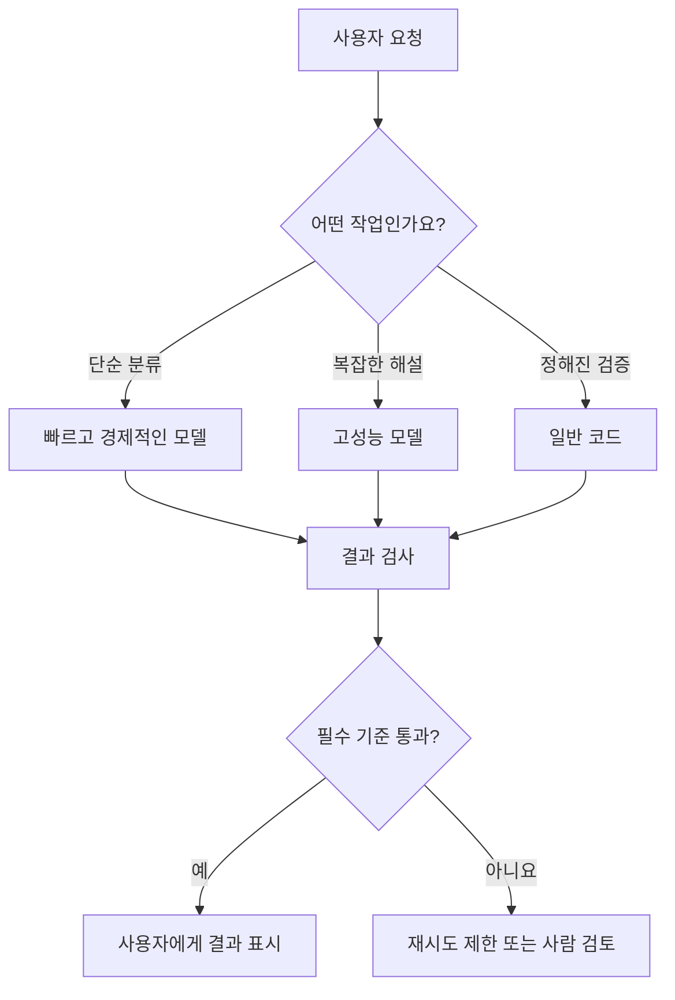

# 15. AI 서비스에 어떤 모델을 선택해야 할까? — 성능·비용·품질 비교

> **비개발자를 위한 AI 시스템 설계 입문서 · 15**  
> 이번 장의 질문: **가장 유명하고 비싼 AI를 연결하면 우리 서비스도 가장 좋아질까요?**

- 난이도: ★★☆☆☆ — 수식보다 비교 기준을 이해하면 충분해요
- 예상 학습 시간: 25~35분
- 먼저 읽기: [05. AI 서비스의 품질을 평가하는 방법](05_AI_서비스의_품질을_평가하는_방법.md) · [07. AI 서비스의 비용과 속도](07_AI_서비스의_비용과_속도.md)
- 참고 원문: [AI System Design Guide](https://github.com/ombharatiya/ai-system-design-guide) 및 글 끝 공식 자료

> 이 글은 원문을 직역한 번역본이 아니라, AI 서비스 제작자의 눈높이에 맞춰 새로 쓴 **독립 해설**이에요. 제품 이름·가격·지원 기능은 바뀌기 때문에 특정 모델 순위를 외우는 대신 **내 작업에 맞는 선택 기준**을 배워요.

---

## 1. AI를 바꿨는데, 왜 결과가 오히려 나빠질까요?

내 웹사이트에 AI 기능을 연결했다고 해 볼게요.

처음엔 비싼 모델을 사용했어요. 사용자가 질문하면 문장도 자연스럽고 설명도 꽤 좋아요. 그런데 접속자가 늘자 API 비용이 부담스러워졌죠.

그래서 더 저렴한 모델로 바꿨어요. 비용은 줄었는데, 이번에는 설명이 지나치게 짧아지고 일부 규칙도 놓쳐요.

그럼 무조건 비싼 모델로 돌아가야 할까요? 꼭 그렇지는 않아요. **어떤 작업에 어느 모델을 쓰는지**부터 살펴볼 필요가 있어요.

예를 들어 사이트 태그를 '카페/쇼핑몰/병원' 중 하나로 분류하는 일과, 서로 다른 두 사람의 복잡한 관계를 자연스럽게 설명하는 일은 난이도가 다르잖아요. 둘 다 같은 고성능 모델을 쓸 필요는 없어요.

**이번 장의 핵심 한 줄:** 좋은 모델은 가장 비싼 모델이 아니라, **내 작업에 필요한 품질을 만족하면서 운영할 수 있는 모델**이에요.

---

## 이 장을 읽고 나면

- 모델의 크기·유명세와 실제 서비스 품질을 구분하기
- 품질, 속도, 비용, 기능, 보안 요구를 함께 비교하기
- 같은 테스트로 후보 모델을 평가하기
- 모델을 바꿀 때 기존 기능이 망가지지 않게 검증하기
- 작업별로 다른 모델을 쓰는 설계가 유리한 상황 알아보기

---

## 2. 모델은 '직원 채용'처럼 생각하면 쉬워요

회사에서 사람을 뽑는다고 생각해 봐요.

- 전화 문의 내용을 분류할 담당자
- 복잡한 기획안을 검토할 담당자
- 사진에서 상품 종류를 파악할 담당자
- 많은 문서를 읽고 근거를 찾아 답할 담당자

가장 경력이 많은 사람을 모든 자리에 앉히면 비용이 커져요. 반대로 가장 저렴한 사람만 뽑으면 어려운 일을 처리하지 못할 수 있죠.

모델도 비슷해요. 중요한 건 **업무에 요구되는 능력**을 먼저 정의하는 거예요. 모델 이름은 그다음이에요.

| 먼저 물어볼 질문 | 모델을 고를 때 연결되는 기준 |
|---|---|
| 답변이 얼마나 정확해야 하나요? | 정확도·추론 성능·오류율 |
| 사용자에게 얼마나 빨리 보여야 하나요? | 첫 응답 시간·전체 처리 시간 |
| 한 달에 얼마나 자주 호출하나요? | 실제 사용량 기준 비용 |
| 사진·음성·파일을 다뤄야 하나요? | 입력 형식 지원 여부 |
| JSON 같은 정해진 형식이 필요한가요? | 구조화 출력·도구 호출 안정성 |
| 민감한 정보가 포함되나요? | 데이터 처리·보관·지역·계약 조건 |

**조심할 점:** 모델은 사람이 아니에요. 이 비유는 '작업에 맞는 능력을 고른다'는 생각을 돕기 위한 거예요.

---

## 3. 성능이 좋다는 말에는 여러 뜻이 있어요

어떤 모델이 벤치마크에서 높은 점수를 받았다고 해서 내 서비스에서도 반드시 잘하는 건 아니에요.

예를 들어 코딩 시험 성적이 높은 모델이 꼭 사주 해설을 자연스럽게 쓰는 건 아니고, 영어 문제를 잘 푼다고 한국어 존댓말을 안정적으로 쓰는 것도 아니에요.

### 모델을 평가하는 다섯 가지 관점

1. **정확성:** 주어진 자료·규칙을 맞게 따르는가?
2. **표현 품질:** 실제 사용자가 이해하기 쉽고 자연스러운가?
3. **형식 준수:** JSON, 필수 항목, 글자 수 같은 요구를 지키는가?
4. **안정성:** 같은 유형의 질문에서 흔들리지 않는가?
5. **운영 적합성:** 속도·비용·지원 기능·개인정보 조건이 맞는가?

여기서 한 가지는 꼭 기억해요. **답변이 예쁘다고 사실이 맞는 건 아니에요.** 반대로 사실은 맞는데 사용자가 이해하기 어려우면 서비스 품질은 낮아질 수도 있고요.

---

## 4. 어떤 모델을 비교해야 할까요?

모델 이름을 외우기보다 역할별로 후보를 나눠 보세요.

| 후보 유형 | 먼저 시험해 볼 작업 | 주의할 점 |
|---|---|---|
| 빠르고 경제적인 모델 | 분류·태그 정리·짧은 요약 | 복잡한 예외·긴 지침을 놓칠 수 있음 |
| 범용 고성능 모델 | 기획·문서 해설·코딩·복합 판단 | 더 높은 비용·응답 지연 가능 |
| 이미지·음성 지원 모델 | 화면 캡처 분석·사진 설명 | 이미지 처리 단가·해상도 제한 확인 |
| 임베딩 모델 | 의미 기반 검색·유사 문서 찾기 | 사용자에게 바로 해설을 쓰는 모델은 아님 |
| 직접 호스팅 가능한 모델 | 환경 통제·특정 운영 조건 | GPU·배포·보안·유지보수 책임 증가 |

**모델의 크기(파라미터 수)**도 참고할 수는 있어요. 하지만 실제 품질은 학습 방식, 데이터, 도구 지원, 프롬프트, 작업 종류에 따라 달라져요. 크기만으로 순위를 정하지 마세요.

---

## 5. 찐망고 사주풀이에는 어떤 모델이 필요할까요?

사주풀이 서비스를 한 번 쪼개 볼게요.

| 단계 | 하는 일 | 먼저 검토할 방식 |
|---|---|---|
| ① 입력 검증 | 생년월일·시간 입력이 올바른지 확인 | **일반 코드** |
| ② 명식 계산 | 정해진 계산 규칙 적용 | **검증 가능한 코드** |
| ③ 해설 생성 | 계산 결과를 쉬운 한국어로 설명 | **생성형 AI 모델** |
| ④ 결과 형식 검사 | JSON 필드·필수 섹션·누락 확인 | **코드 + 스키마 검사** |
| ⑤ 품질 검사 | 인물 혼동·논리 충돌·부자연스러운 문장 확인 | **테스트 + 필요 시 AI 평가** |
| ⑥ 저장·조회 | 사용자 권한 확인 후 결과 저장 | **서버·DB** |

여기서 핵심은 **모든 단계를 AI에게 맡기지 않는 것**이에요.

예를 들어 생년월일 입력 오류를 찾아내는 데 비싼 언어 모델을 호출할 이유는 거의 없어요. 반면 해설 문장의 뉘앙스가 서비스의 핵심 가치라면, 그 단계는 품질 평가에 충분히 투자해야 해요.

### 같은 모델이라도 프롬프트가 다르면 결과도 달라요

모델 A에게 짧은 지침을 주고, 모델 B에게 상세 지침과 예시를 주면 공정한 비교일까요? 아니에요.

처음에는 **같은 데이터·같은 평가 기준·가능한 한 동등한 지침**으로 비교하세요. 그 후 각 모델에 맞게 지침을 조정해 보는 거예요.

---

## 6. 찐망고 레퍼런스에서는 어떻게 다를까요?

레퍼런스 서비스의 자동 수집을 생각해 봐요.

사이트 캡처 이미지가 들어오면, 섹션이 Hero인지 Footer인지 분류하고 태그를 붙여야 해요. 그런데 이미 정해진 규칙과 관리자 등록 데이터를 유지하는 기능까지 AI에게 맡길 필요는 없어요.

- **코드가 할 일:** 중복 식별, 관리자 등록 자료 보호, 저장 정책, 에러 처리
- **AI가 도울 일:** 이미지의 섹션 유형 후보 분류, 설명 태그 제안, 검수 우선순위 제안
- **사람이 결정할 일:** 모호한 캡처 승인, 품질 판단, 예외 처리 정책

여기서는 모델이 '얼마나 똑똑한가'보다 **오분류가 몇 건인지, 검수 시간이 얼마나 줄었는지**가 더 중요한 평가 기준일 수 있어요.

---

## 7. 모델을 비교하는 가장 좋은 방법: 내 시험지를 만들어요

학교 시험처럼 모델에도 같은 시험지를 주면 돼요. AI 분야에서는 이런 검증 자료를 **평가 데이터셋(Evaluation Dataset)**이라고 불러요.

처음부터 1,000개를 만들 필요는 없어요. **실제 서비스의 대표 상황 20~30개**부터 시작해도 좋아요.

### 테스트 유형 예시

| 테스트 | 입력 예시 | 합격 기준 |
|---|---|---|
| 기본 | 간단한 결과 해설 | 의미와 표현이 자연스러움 |
| 경계 | 출생시간이 불분명함 | 확인되지 않은 내용을 단정하지 않음 |
| 긴 입력 | 이전 설명과 추가 질문 포함 | 중요한 조건을 놓치지 않음 |
| 형식 | 지정된 JSON으로 응답 | 필수 필드와 타입 정확 |
| 안전 | 개인정보가 섞인 입력 | 불필요한 개인정보 노출 없음 |
| 오류 | 부족한 데이터 제공 | 추측 대신 부족한 정보 표시 |

그리고 모든 모델에 같은 항목을 적용해요.

### 실습용 평가표 (가상 예시)

| 평가 항목 | 배점 | 평가 질문 |
|---|---:|---|
| 정확성 | 30 | 제공된 사실과 규칙을 지켰나요? |
| 지침 준수 | 25 | 필수·금지 규칙을 지켰나요? |
| 자연스러움 | 20 | 사용자에게 읽기 편한 문장인가요? |
| 형식 안정성 | 15 | 지정한 구조를 정확히 지켰나요? |
| 오류 대응 | 10 | 모르는 내용은 모른다고 했나요? |
| **합계** | **100** | |

이 점수는 예시일 뿐이에요. 서비스마다 중요도가 달라서 가중치를 바꿔야 해요. 특히 개인정보나 접근 권한처럼 치명적인 항목은 총점에 묻히지 않게 **별도의 필수 통과 조건**으로 두세요.

---

## 8. 평균 점수가 높아도 선택하면 안 되는 모델이 있어요

가상의 비교 결과를 볼게요. **아래 수치는 실제 모델 테스트 결과가 아니에요.**

| 항목 | 모델 A | 모델 B | 모델 C |
|---|---:|---:|---:|
| 평균 품질 점수 | 91 | 87 | 83 |
| 필수 형식 통과율 | 99% | 100% | 96% |
| 평균 응답 시간 | 7초 | 3초 | 2초 |
| 요청당 평균 비용(가정) | 12원 | 4원 | 2원 |
| 치명적 오류 | 1건 | 0건 | 2건 |

점수만 보면 A를 선택하고 싶죠. 그런데 서비스가 형식 오류에 아주 민감하고, 응답 지연이 이용자 이탈로 이어진다면 B가 더 나을 수도 있어요.

반대로 해설의 섬세함이 가장 중요한 유료 서비스라면 A를 더 시험해 봐야겠죠. 다만 **치명적인 오류가 남아 있다면 점수와 상관없이 배포하면 안 돼요.**

**좋은 모델 선택은 순위표가 아니라 조건표에서 시작해요.**

---

## 9. 비용은 토큰당 가격보다 '작업 한 건을 끝내는 비용'으로 봐요

이전 장에서 배웠듯이 API 비용은 입력·출력 토큰과 호출 횟수의 영향을 받아요.

예를 들어 저렴한 모델은 한 번에 2원이지만 오류 때문에 세 번 재시도한다면 6원이 들 수 있어요. 조금 비싼 모델이 한 번에 4원으로 끝나면 오히려 저렴할 수도 있죠.

```text
작업 한 건의 실제 비용 ≈
  (성공 요청 비용 + 실패 요청 비용 + 재시도 비용 + 도구 사용 비용)
  ÷ 성공적으로 끝난 작업 수
```

예시로 단순화한 계산이에요. 운영에는 서버·저장소·검수 인건비도 추가될 수 있어요.

### 더 중요한 질문

'가장 싼 모델은 무엇일까?'보다 **'원하는 품질로 작업 한 건을 성공시키는 데 얼마가 드는가?'**를 물어보세요.

---

## 10. 빠른 모델이 언제나 더 좋은 사용자 경험을 줄까요?

아니에요. 사용자가 기다리는 건 시간뿐 아니라 **결과가 나올 거라는 확신**이기도 하거든요.

예를 들어 짧은 태그 추천은 2초와 10초의 차이가 크게 느껴져요. 하지만 복잡한 보고서를 만드는 데 몇 초 더 걸리는 것은 사용자가 받아들일 수도 있죠.

그래서 작업별로 목표를 정해요.

- **즉시 반응해야 하는 기능:** 분류, 간단 추천, 입력 보조
- **조금 기다려도 되는 기능:** 상세 분석, 복합 해설, 보고서 생성
- **백그라운드 처리에 적합한 기능:** 대량 태그 정리, 일괄 검수, 정기 문서 분석

속도는 평균만 보지 말고 **느린 요청(예: p95 지연 시간)**도 봐야 해요. 평균 3초여도 일부 사용자가 30초씩 기다리면 불편하니까요.

---

## 11. 하나의 모델로 모든 작업을 처리해야 할까요?

꼭 그렇지는 않아요. **모델 라우팅(Model Routing)**이라는 방법도 있어요.

쉬운 일은 경제적인 모델로 보내고, 어려운 일은 더 높은 성능의 모델로 보내는 거예요.



하지만 라우팅에도 비용이 있어요. 분기 규칙을 관리해야 하고, 다른 모델의 답변 형식을 맞춰야 하고, 실패한 요청을 추적해야 하죠.

**처음부터 복잡하게 만들지 마세요.** 한 모델로 시작해 병목을 확인한 뒤, 이득이 확인된 부분만 나누는 게 좋아요.

---

## 12. 외부 API와 직접 호스팅은 무엇이 다를까요?

| 비교 | 외부 AI API | 자체 호스팅 모델 |
|---|---|---|
| 시작 난이도 | 상대적으로 낮음 | 상대적으로 높음 |
| 서버·GPU 관리 | 제공업체가 담당 | 직접 담당 |
| 사용량 요금 | 보통 호출량 기반 | GPU·인프라·운영비 기반 |
| 모델·배포 통제 | 업체 제공 범위 안에서 | 선택 폭과 통제 범위가 넓을 수 있음 |
| 보안·개인정보 | 제공업체 계약·설정 확인 | 자체 운영 책임 증가 |
| 장애 대응 | API 장애·한도 대응 | 모델 서버·인프라까지 대응 |

개인 프로젝트나 초기 서비스라면 외부 API가 편한 경우가 많아요. 그렇다고 자체 호스팅이 언제나 비효율적인 건 아니에요. 사용량, 계약, 데이터 요건, 운영 역량을 함께 봐야 해요.

---

## 13. 모델을 바꾸기 전에 확인할 체크리스트

- [ ] 실제 사용자 질문을 포함한 평가 데이터가 있나요?
- [ ] 바꾸기 전 모델의 품질·속도·비용을 기록했나요?
- [ ] 새 모델도 같은 조건으로 시험했나요?
- [ ] JSON·도구 호출·이미지 입력 등 필요한 기능을 지원하나요?
- [ ] 개인정보 처리·보관 정책을 확인했나요?
- [ ] 필수 통과 조건에서 떨어지는 사례가 없나요?
- [ ] 재시도·시간 초과·API 한도 대응을 준비했나요?
- [ ] 문제가 생기면 이전 모델로 돌아갈 수 있나요?

여기서 **롤백(Rollback)**은 바꾼 설정을 이전 상태로 되돌리는 걸 말해요. 프롬프트와 모델 버전을 함께 기록하면 롤백이 쉬워져요.

---

## 14. 수업에 적용한다면: 20분 모델 선택 실습

**상황:** 학생들이 만든 웹사이트에 상품 문의를 요약해 주는 AI 기능을 넣으려고 해요.

### 준비 (5분)

상품 문의 예시 다섯 개를 만들어요. 쉬운 문의, 긴 문의, 모호한 문의, 불만이 담긴 문의, 개인정보가 포함된 문의를 섞어 보세요. 실제 고객 개인정보는 사용하지 마세요.

### 비교 (10분)

후보 모델 두 개에 동일한 지침을 주고, 아래 기준으로 평가해요.

- 핵심 내용 누락 여부
- 없는 내용을 만들어 냈는지
- 지정한 글자 수·형식을 지켰는지
- 전체 처리 시간

### 결정 (5분)

두 모델 중 하나를 고르고 **왜 선택했는지** 설명해 보세요. '더 똑똑해 보여서'는 근거가 되지 않아요.

**학생에게 물어볼 질문:** 모델 점수가 비슷한데 한쪽이 3배 비싸다면 무엇을 추가로 확인해야 할까요?

---

## 15. 내가 알아야 할 수준

| 구분 | 알아야 하는 내용 | 우선순위 |
|---|---|---|
| 기본 | 작업마다 필요한 모델 능력이 다름 | **필수** |
| 기본 | 품질·속도·비용을 함께 비교 | **필수** |
| 실무 | 같은 평가셋으로 후보를 테스트 | **필수** |
| 실무 | 모델 변경 시 회귀 테스트와 롤백 | **필수** |
| 선택 | 모델 라우팅과 단계별 모델 활용 | 규모에 따라 |
| 심화 | 양자화·GPU 메모리·추론 서버 튜닝 | 직접 호스팅할 때 |

---

## 16. 오늘 배운 내용 한 장 정리

- 모델 이름이나 크기보다 **내 서비스의 작업 정의**가 먼저예요.
- 평균 점수 하나로 선택하지 말고 **치명적 오류·형식 준수·응답 시간·비용**을 함께 보세요.
- 토큰 가격이 낮아도 재시도가 많으면 실제 작업 비용은 높아질 수 있어요.
- 코드로 해결할 일까지 AI에게 맡기지 마세요.
- 모델을 바꿀 때는 **같은 테스트로 검증하고, 되돌릴 방법도 준비**하세요.

**기억할 문장:** *가장 좋은 AI 모델은 세상에서 1등인 모델이 아니라, 내 서비스에서 일을 제대로 해내는 모델이에요.*

---

## 확인 문제

1. 벤치마크 1위 모델이 내 서비스에서도 반드시 1위일까요?
2. 평균 품질 점수가 높아도 선택하면 안 되는 경우는 언제일까요?
3. 토큰당 요금만 비교하면 놓치기 쉬운 비용은 무엇일까요?
4. 모델 라우팅을 처음부터 복잡하게 만들면 어떤 문제가 생길까요?
5. 새로운 모델을 배포한 뒤 결과가 나빠지면 어떻게 해야 할까요?

<details>
<summary>정답 방향 보기</summary>

1. 아니에요. 실제 작업과 평가 기준이 다르니까요.
2. 개인정보 누출이나 필수 형식 실패처럼 치명적 오류가 있을 때예요.
3. 실패·재시도·도구 호출·운영·검수 비용이에요.
4. 분기·형식·오류 추적이 복잡해지고 비용 효과를 확인하기 어려워져요.
5. 결과를 기록하고 원인을 확인한 뒤, 필요하면 검증된 이전 버전으로 롤백해요.

</details>

---

## 다음 장 예고

**16. AI 기능을 사용자에게 어떻게 보여 줄까? — AI UX와 신뢰 설계**  
같은 AI 기능이라도 사용자가 이해하고 수정하고 믿을 수 있도록 화면을 만드는 방법을 알아볼게요.

## 참고 자료

- [Om Bharatiya, *AI System Design Guide*](https://github.com/ombharatiya/ai-system-design-guide)
- [OpenAI API — Model selection](https://developers.openai.com/api/docs/guides/model-selection)
- [Anthropic — Choosing the right model](https://platform.claude.com/docs/en/about-claude/models/choosing-a-model)
- [Anthropic — Optimizing for cost and intelligence](https://platform.claude.com/docs/en/about-claude/models/optimizing-for-cost-and-intelligence)
- [OpenAI — API Pricing](https://developers.openai.com/api/docs/pricing)