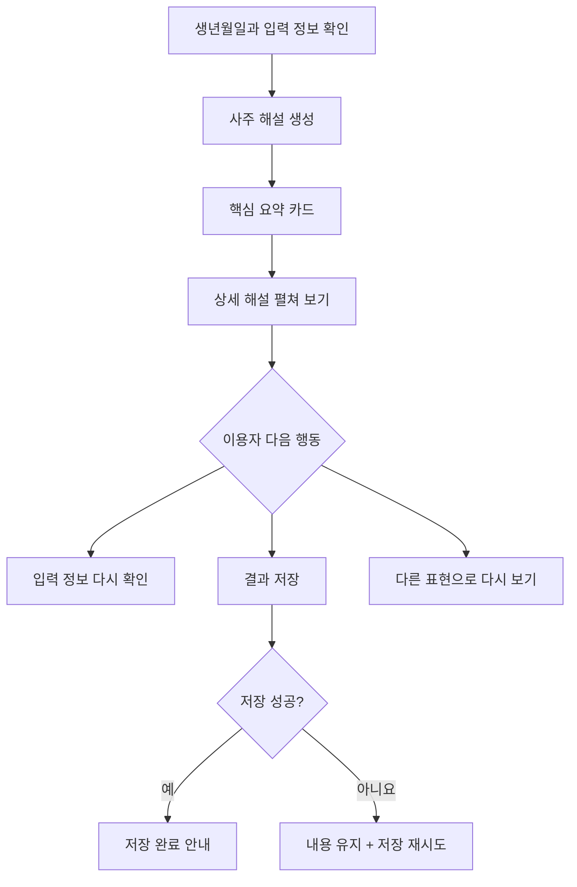
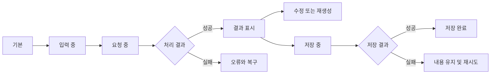

# 16. AI 기능을 사용자에게 어떻게 보여 줄까? — AI UX와 신뢰 설계

> **비개발자를 위한 AI 시스템 설계 입문서 · 16**  
> 이번 장의 질문: **AI가 좋은 답을 만들어도 사용자가 그 결과를 이해하거나 믿지 못하면, 좋은 서비스라고 할 수 있을까요?**

- 난이도: ★★☆☆☆ — UX를 처음 배우는 사람도 이해할 수 있어요
- 예상 학습 시간: 25~35분
- 먼저 읽기: [05. AI 서비스의 품질을 평가하는 방법](05_AI_서비스의_품질을_평가하는_방법.md) · [06. AI 서비스의 오류와 안전장치](06_AI_서비스의_오류와_안전장치.md)
- 참고 자료: [Google People + AI Guidebook](https://pair.withgoogle.com/guidebook-v2/chapters) · [Microsoft Guidelines for Human-AI Interaction](https://www.microsoft.com/en-us/research/project/guidelines-for-human-ai-interaction/)

> 이 글은 원문을 옮긴 번역본이 아니라, AI UX 연구와 앞서 배운 AI 시스템 설계 원리를 비전공자 눈높이에서 새로 풀어 쓴 **독립 해설**이에요. 아래 화면 문구와 서비스 흐름은 이해를 위한 설계 예시이며 실제 서비스에 이미 적용됐다는 뜻은 아니에요.

---

## 1. AI가 답은 잘했는데, 사용자가 떠났어요

웹사이트에 AI 상담 기능을 붙였다고 해 볼게요.

사용자가 질문을 입력했어요. 화면은 20초 동안 아무 변화가 없다가 긴 답변을 한꺼번에 보여 줬죠. 그런데 그 답변에 왜 그런 결론이 나왔는지 설명이 없고, 마음에 들지 않아도 수정할 버튼이 없어요.

AI가 만든 문장 자체는 꽤 훌륭했을지도 몰라요. 하지만 사용자는 이렇게 생각할 수 있어요.

> "버튼이 눌린 건 맞나? 이 말은 뭘 근거로 한 거지? 수정하려면 처음부터 다시 해야 하나?"

이건 AI 모델의 성능만으로 해결할 수 있는 문제가 아니에요. **사용자가 AI의 능력과 한계를 이해하고, 결과를 확인하고, 필요하면 고칠 수 있도록 화면을 만드는 문제**예요.

이런 설계가 바로 **AI UX(User Experience)**에서 중요한 부분이에요.

**이번 장의 핵심 한 줄:** AI를 믿으라고 설득하는 화면보다, **사용자가 스스로 판단하고 통제할 수 있는 화면**이 더 좋은 출발점이에요.

---

## 이 장을 읽고 나면

- 기존 웹 UX와 AI UX가 무엇이 다른지 설명할 수 있어요.
- AI가 확실하지 않을 때 어떤 안내를 해야 할지 판단할 수 있어요.
- 로딩·오류·재시도·수정·저장 상태를 구분할 수 있어요.
- AI 결과의 출처, 신뢰, 통제권을 화면 요소로 연결할 수 있어요.
- 실제 서비스 하나를 정해 AI UX 점검표를 만들 수 있어요.

---

## 2. 일반 웹 기능과 AI 기능은 무엇이 다를까요?

일반적인 계산기라면 `2 + 3`을 입력했을 때 결과는 항상 `5`예요. 상품을 장바구니에 넣는 버튼도 성공하면 정해진 상태로 바뀌죠.

반면 AI가 "이 브랜드에 어울리는 소개 문구를 써 줘"라는 요청을 받으면, 같은 요청이라도 여러 표현이 나올 수 있어요. 그중에는 의도에 잘 맞는 것도 있고, 그럴듯하지만 틀린 내용도 있어요.

| 구분 | 일반적인 규칙 기반 기능 | 생성형 AI 기능 |
|---|---|---|
| 결과 | 조건이 같으면 대체로 정해짐 | 표현이나 세부 결과가 달라질 수 있음 |
| 오류 | 비교적 명확한 실패 코드 | 자연스러운 문장 안에 오류가 숨을 수 있음 |
| 기다림 | 저장·조회 같은 작업 중심 | 답변 생성 시간이 가변적일 수 있음 |
| 수정 | 사용자가 값을 직접 변경 | 다시 생성하거나 부분 수정할 수도 있음 |
| 신뢰 | 입력값과 처리 결과 확인 | 근거·한계·사용자 판단이 더 중요해짐 |

**중요해요.** AI 기능이라고 해서 모든 결과가 매번 달라지는 건 아니고, 일반 웹에서도 복잡한 오류가 생겨요. 다만 AI는 **출력 내용 자체의 정확도와 적절함을 따로 검토해야 한다는 점**이 더 두드러져요.

---

## 3. 먼저 'AI가 할 수 있는 일'을 정확히 알려 주세요

사용자가 기능을 처음 볼 때 가장 먼저 궁금한 건 기술 이름이 아니에요.

> "이걸 누르면 나한테 어떤 도움이 되는데?"

예를 들어 웹사이트에 `AI 분석` 버튼만 있다고 해 봐요. 무엇을 분석하는지, 얼마나 걸리는지, 어떤 결과가 나오는지 모르겠죠.

이렇게 바꿔 볼 수 있어요.

**모호한 안내**

> AI로 분석하기

**기대치를 조정한 안내**

> 입력한 사이트의 화면 구성과 주요 콘텐츠를 정리해 드려요. 결과는 검토 후 수정할 수 있어요.

좋은 안내에는 보통 세 가지가 들어가요.

1. **입력:** 사용자가 무엇을 제공해야 하나요?
2. **출력:** AI가 무엇을 만들어 주나요?
3. **한계:** 무엇은 직접 확인해야 하나요?

Google의 People + AI Guidebook과 Microsoft의 인간-AI 상호작용 지침도 처음 사용할 때 기능과 능력 범위를 명확히 알리는 것을 강조해요.

---

## 4. 신뢰는 많이 만드는 게 아니라, 알맞게 만드는 거예요

AI가 쓴 문장을 자신감 있게 보여 주면 사용자는 더 믿을까요? 그럴 수도 있지만, 틀린 답도 사실처럼 받아들일 위험이 있어요.

**신뢰 설계(Trust Calibration)**는 사용자가 AI를 무조건 믿게 만드는 일이 아니에요. **믿어도 되는 부분은 활용하고, 검증해야 할 부분은 확인하도록 돕는 일**이에요.

### 사례: AI가 학생 웹사이트를 평가할 때

좋지 않은 화면:

> 점수: 95점. 아주 훌륭합니다.

더 나은 화면:

> 임시 평가: 95점  
> 확인된 항목: 메뉴 구조, 주요 섹션, 반응형 브레이크포인트  
> 직접 검토할 항목: 키보드 접근성, 실제 모바일 터치 동작  
> 평가 기준표 보기 · 근거 확인 · 점수 수정

AI가 확인하지 못한 항목을 확인한 척하지 않는 게 핵심이에요. **모른다고 말할 수 있는 서비스가 오히려 더 믿을 만해질 수 있어요.**

### 주의: 가짜 확신도 숫자를 만들지 마세요

"AI 정확도 98%"라는 배지가 있어도 평가 방법이나 적용 범위가 없다면 별 의미가 없어요. 모델의 확률값을 사용자에게 보여 준다고 그것이 곧 '정답일 확률'은 아니고요.

확률이나 신뢰 점수를 표시하려면 **무엇을 측정한 값인지, 실제 결과와 얼마나 잘 맞는지** 검증해야 해요. 그게 어렵다면 `검토 필요`, `출처 확인` 같은 상태 안내가 더 적절할 수 있어요.

---

## 5. 결과 화면에는 '다음 행동'이 있어야 해요

AI가 글을 길게 써 줬다고 해서 사용자 업무가 끝나는 건 아니에요.

예를 들어 블로그 소개 문구를 생성했다면, 사용자는 다음 중 하나를 하고 싶을 거예요.

- 이대로 사용하기
- 너무 긴 부분만 줄이기
- 어조를 바꾸기
- 다시 생성하기
- 편집한 내용을 저장하기

여기서 중요한 건 **'다시 생성'과 '수정'을 다른 기능으로 생각하는 것**이에요.

`다시 생성`은 결과 전체가 바뀔 수 있고, `이 문장만 수정`은 사용자가 마음에 든 나머지 부분을 유지할 수 있어요.

사용자가 기존 결과를 잃지 않도록 **원본 보존, 수정 취소, 버전 비교**를 고려하면 더 좋아요. 모든 서비스에 복잡한 버전 관리가 필요한 건 아니지만, 긴 글이나 중요한 평가에는 유용하죠.

---

## 6. 기다리는 화면도 UX예요

AI 응답이 느릴 때 화면에 아무것도 표시하지 않으면 사용자는 버튼이 작동하지 않는다고 느낄 수 있어요.

단계를 나누어 볼게요.

| 상태 | 사용자에게 보여 줄 수 있는 안내 | 실제 의미 |
|---|---|---|
| 요청 전 | 결과 만들기 | 아직 시작하지 않음 |
| 요청 접수 | 요청을 받았어요 | 서버에 요청이 전달됨 |
| 생성 중 | 결과를 작성하고 있어요 | 처리 또는 응답 생성 중 |
| 완료 | 결과가 준비됐어요 | 표시 가능한 결과가 도착함 |
| 저장 중 | 결과를 저장하고 있어요 | 저장 작업은 아직 끝나지 않음 |
| 저장 완료 | 저장했어요 | 저장 성공을 확인함 |
| 실패 | 연결이 끊겼어요. 다시 시도해 주세요 | 실패 원인에 맞게 복구 경로 제공 |

**절대 섞지 말 것:** AI가 결과를 생성한 것과 DB 저장까지 성공한 것은 서로 다른 상태예요. 결과가 화면에 보이더라도 저장이 실패할 수 있어요.

### 진행률 73%를 마음대로 표시해도 될까요?

실제 작업 진행도를 측정하지 못한다면 `73%` 같은 숫자는 정확한 정보가 아니에요.

그럴 땐 퍼센트보다 **현재 단계**를 알려 주세요. 예를 들어 `자료 확인 중 → 답변 작성 중 → 결과 표시`처럼요. 물론 이 단계도 실제 처리 과정과 연결돼야 해요.

### 스트리밍은 무엇이 좋을까요?

AI가 글을 완성할 때까지 기다리지 않고 일부를 먼저 보여 주면 **체감 대기 시간**이 줄어들 수 있어요. 하지만 전체 처리 시간이 반드시 짧아지는 건 아니에요.

또 스트리밍 중에 문장이 계속 바뀌거나 화면이 크게 움직이면 읽기 어려울 수 있어요. 자동 스크롤을 강제하지 않고, 중단이나 복사 가능 시점을 명확히 하는 것도 중요해요.

---

## 7. 실패했을 때 '다시 시도'만 있으면 충분할까요?

실패 원인에 따라 사용자가 할 수 있는 일이 달라져요.

**네트워크 오류**라면 다시 시도가 적절할 수 있어요. **입력 형식 오류**라면 잘못 입력한 칸을 고쳐야 하고요. **근거 자료가 없는 경우**라면 존재하지 않는 답을 생성하기보다 자료가 없다고 알려 주는 게 맞아요.

| 문제 | 좋지 않은 안내 | 더 나은 안내 |
|---|---|---|
| 네트워크 끊김 | 오류 발생 | 연결이 끊겼어요. 입력은 남겨 뒀어요. 다시 시도해 주세요. |
| 저장 실패 | 완료됐어요 | 결과는 생성됐지만 저장하지 못했어요. 저장을 다시 시도해 주세요. |
| 자료 없음 | 적당한 추측 제시 | 확인 가능한 자료를 찾지 못했어요. 검색 조건을 바꿔 보세요. |
| 권한 없음 | 알 수 없는 오류 | 이 자료를 볼 권한이 없어요. 접근 권한을 확인해 주세요. |
| 처리 시간 초과 | 무한 로딩 | 처리 시간이 길어져 중단됐어요. 재시도하거나 입력을 줄여 보세요. |

재시도 버튼을 누른다고 같은 요청이 무한히 중복 실행되면 안 돼요. 특히 유료 호출·파일 저장·메일 발송은 서버에서 **중복 실행 방지와 호출 제한**을 함께 설계해야 해요.

---

## 8. RAG의 출처 표시도 화면 설계의 일부예요

앞서 RAG를 배웠죠. AI가 외부 자료를 찾아 답하는 구조였어요.

그런데 답변 끝에 `참고: 내부 매뉴얼`이라고만 적혀 있으면 사용자는 사실을 확인하기 어려워요.

더 좋은 방법은 다음과 같아요.

> 반응형 웹 항목은 15점이에요.  
> 출처: **2차 평가표 > 반응형 웹** [해당 기준 열기]

핵심은 **실제로 검색해서 사용한 문서의 위치로 연결하는 것**이에요. AI가 만들어 낸 출처나 실제로 열리지 않는 링크를 표시해서는 안 되죠.

자료가 여러 개이고 서로 충돌한다면, 어떤 버전인지와 확인 날짜를 함께 보여 주는 것도 도움이 돼요.

---

## 9. 찐망고 사주풀이에 적용하면?

사주 해설은 특히 사용자가 결과를 개인적인 판단에 연결하기 쉬워요. 그러니 멋진 문장을 만드는 것만큼 **서비스가 무엇을 제공하는지 분명히 하는 UI**가 중요해요.

예시로 결과 화면을 다시 설계해 볼게요.

### 이런 부분을 점검해 보세요

1. **입력 확인:** 양력·음력, 출생 시간과 시간 보정 등 사용자가 제공한 조건을 결과에서 확인할 수 있나요?
2. **핵심 요약:** 긴 글을 읽기 전에 가장 중요한 내용을 이해할 수 있나요?
3. **해설과 사실 구분:** 명식 계산 결과와 AI가 만든 해석 문장이 섞여 있지 않나요?
4. **저장 상태:** 생성 완료와 저장 완료를 구분해 알려 주나요?
5. **수정 경로:** 결과가 이상할 때 입력 내용을 다시 확인할 수 있나요?

여기서 중요한 건 **사주 해석을 검증된 사실처럼 표시하지 않는 것**이에요. 계산된 입력 정보와 전통적 해석·개인화된 설명의 성격을 구분하면 사용자가 과도하게 확신하는 일을 줄일 수 있어요.

---

## 10. 찐망고 레퍼런스에 적용하면?

섹션을 자동으로 모으고 분류하는 서비스에는 AI가 추천한 결과를 **관리자가 승인하는 단계**가 중요할 수 있어요.

예를 들어 Hero 섹션으로 자동 분류된 이미지가 사실은 제품 목록이라고 해 볼게요.

나쁜 UX는 `AI가 분류했으니 그대로 등록`하는 방식이에요.

더 나은 관리자 화면은 이런 정보를 보여 줄 수 있어요.

| 표시 항목 | 필요한 이유 |
|---|---|
| 원본 이미지와 사이트 주소 | 실제 출처 확인 |
| AI 제안 카테고리 | 빠른 검토 |
| 관리자 수정 카테고리 | 오분류 바로잡기 |
| 기존 등록 여부 | 중복 방지 |
| 등록·보류·숨김 | 작업 결과를 통제 |
| 변경 기록 | 나중에 오류 원인 추적 |

이미 사람이 직접 등록한 자료를 자동 수집이 덮어쓰지 않는 정책도 **AI를 사람의 판단 위에 두지 않는 UX·운영 설계**로 볼 수 있어요.

다만 저작권이나 원본 콘텐츠 이용 문제는 화면에 출처를 적었다는 이유만으로 자동 해결되는 건 아니니 별도로 검토해야 해요.

---

## 11. AI UX에서 특히 조심할 다섯 가지

### ① AI가 하지 않은 일을 한 것처럼 말하기

자료를 확인하지 않았는데 `검증 완료`라고 표시하면 안 돼요. 검증 단계가 실제로 수행돼야 해요.

### ② 선택권 없이 자동 실행하기

메일 발송, 파일 삭제, 외부 공개 같은 되돌리기 어려운 작업은 사용자 확인을 두는 편이 안전해요.

### ③ 근거 없는 확률·정확도 표시하기

`신뢰도 99%` 같은 수치는 측정 의미와 검증 근거가 없으면 오히려 오해를 만들어요.

### ④ 실수한 결과를 고칠 수 없게 하기

AI 결과는 초안일 수 있어요. 수정·재시도·취소가 어려우면 사용자는 처음부터 다시 작업해야 하죠.

### ⑤ 사용자가 원하지 않는 변화 강요하기

AI 추천 문구가 바뀔 때마다 화면이 자동으로 덮어써지면 편집 중인 내용을 잃을 수 있어요. 기존 작업을 보호해야 해요.

---

## 12. 실무에서 가장 먼저 확인할 7가지 상태

웹사이트에 AI 기능을 붙일 때 화면 디자인만 보지 말고 다음 상태를 직접 그려 보세요.

여기에 `입력 오류`, `사용자 취소`, `요청 시간 초과`, `권한 없음`이 필요한지 서비스별로 판단하면 돼요.

**UX 설계는 예쁜 성공 화면 하나가 아니라, 성공하지 않았을 때도 사용자가 길을 잃지 않게 만드는 일이에요.**

---

## 13. 수업에 적용한다면 — 20분 활동

### 과제: AI로 만든 웹사이트 설명문 생성 화면을 개선해 보세요

**상황:** 학생이 브랜드명과 상품 특징을 입력하면 AI가 메인페이지 소개 문구를 만들어 줘요. 그런데 현재 화면에는 입력창·생성 버튼·결과 텍스트만 있어요.

**1단계 · 5분 — 사용자 걱정 찾기**

- 생성이 오래 걸리면 어떻게 알릴까요?
- 마음에 들지 않는 문장을 고치려면 어떻게 할까요?
- AI가 사실과 다른 내용을 썼다면 어떻게 확인할까요?

**2단계 · 10분 — 화면 상태 설계하기**

Figma에서 기본·생성 중·결과·오류 네 가지 프레임을 만들어 보세요. 여유가 있다면 부분 수정과 저장 실패도 추가해요.

**3단계 · 5분 — 서로 평가하기**

옆 학생의 화면을 보고 아래 질문에 답해 봐요.

- 지금 시스템이 무엇을 하고 있는지 알 수 있나요?
- 결과를 사용자가 바꿀 수 있나요?
- 오류가 나도 작성한 입력이 남아 있나요?
- AI가 확인하지 않은 내용을 사실처럼 보여 주지 않나요?

**수업의 핵심:** AI 기능의 UX는 멋진 프롬프트 문장보다 **사용자의 다음 행동과 통제권**을 설계하는 데서 완성돼요.

---

## 14. 내가 알아야 할 수준

| 구분 | 알아야 하는 내용 | 우선순위 |
|---|---|---|
| 기본 | AI 기능의 범위와 한계를 처음부터 알려 주기 | 필수 |
| 기본 | 생성 중·생성 완료·저장 완료 상태 구분 | 필수 |
| 기본 | 다시 생성·부분 수정·취소 흐름 | 필수 |
| 실무 | 오류 유형별 안내와 복구 경로 | 필수 |
| 실무 | 근거 자료와 출처 표시 | RAG 서비스라면 필수 |
| 실무 | 사용자 피드백으로 개선하기 | 권장 |
| 심화 | 확률 보정, 신뢰도 측정, AI 실험 설계 | 필요할 때 |

우리가 지금 당장 공부할 건 모델의 확률 계산이 아니에요. **이 화면을 쓰는 사람이 무엇을 알고, 무엇을 고칠 수 있는지**부터 점검하면 충분해요.

---

## 15. 오늘 배운 내용 한 장 정리

- AI 답변 품질이 높아도 화면의 안내와 통제권이 부족하면 서비스 경험은 나빠질 수 있어요.
- `AI 처리 성공`과 `저장 성공`은 다른 상태예요.
- 결과에 신뢰를 강요하기보다, 확인할 근거와 수정 방법을 알려 주세요.
- 진행률을 측정하지 못한다면 임의의 퍼센트를 만들지 마세요.
- 결과를 재생성할 때 사용자가 편집한 내용을 보호하세요.
- 실제로 수행하지 않은 검증이나 검색을 완료했다고 표시하지 마세요.

> **좋은 AI UX는 AI가 얼마나 똑똑한지 보여 주는 화면이 아니라, 사용자가 AI의 도움을 받아 더 잘 판단하도록 만드는 화면이에요.**

---

## 확인 문제

1. AI가 좋은 답변을 만들었는데도 사용자 경험이 나빠질 수 있는 이유는 뭘까요?
2. 생성 완료와 저장 완료를 구분해야 하는 이유는 뭘까요?
3. `다시 생성`과 `이 문장 수정`은 어떻게 다를까요?
4. 출처 표시가 필요한 답변에서 어떤 링크가 가장 도움이 될까요?
5. AI UX에서 신뢰를 높인다는 것은 사용자가 AI를 무조건 믿게 만드는 일일까요?

정답 방향 보기

1. 로딩 안내, 결과 이해, 수정·복구 경로, 한계 설명이 부족할 수 있어요.
2. 생성은 성공했지만 DB 저장은 실패할 수 있기 때문이에요.
3. 전체 교체와 일부 보존·편집이라는 차이가 있어요.
4. 실제 근거로 사용된 원문과 해당 위치를 확인할 수 있는 링크예요.
5. 아니에요. 믿을 부분과 검증할 부분을 구분하게 하는 게 중요해요.

---

## 다음 장 예고

**17. AI 기능을 더 잘 만들려면 무엇을 측정할까? — 사용자 테스트와 개선 실험** (준비 중)  
이번 장에서 화면을 설계했다면, 다음에는 사용자가 정말 이해하고 편하게 쓰는지 작은 테스트로 확인해 볼게요.

---

## 참고 자료

- [Google People + AI Guidebook — Chapters](https://pair.withgoogle.com/guidebook-v2/chapters)
- [Google People + AI Guidebook — Explainability + Trust](https://pair.withgoogle.com/guidebook-v2/chapter/explainability-trust/)
- [Google People + AI Guidebook — Errors + Graceful Failure](https://pair.withgoogle.com/chapter/errors-failing/)
- [Microsoft Research — Guidelines for Human-AI Interaction](https://www.microsoft.com/en-us/research/project/guidelines-for-human-ai-interaction/)
- [Microsoft Research — 18 Human-AI Interaction Guidelines](https://www.microsoft.com/en-us/research/group/customer-insights-research/articles/guidelines-for-human-ai-interaction-eighteen-best-practices-for-human-centered-ai-design/)

> **자료 성격:** 이 문서는 위 자료와 AI 시스템 설계 기본 개념을 참고해 독립적으로 작성한 초보자용 학습 교재예요. 특정 기업의 공식 번역본은 아니에요.