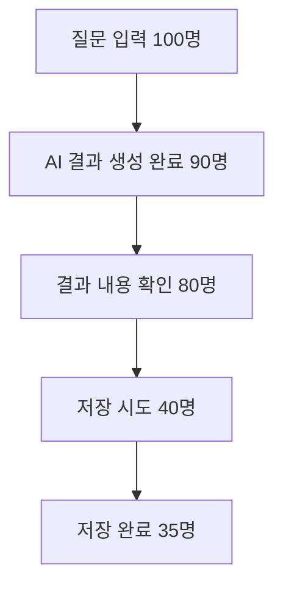
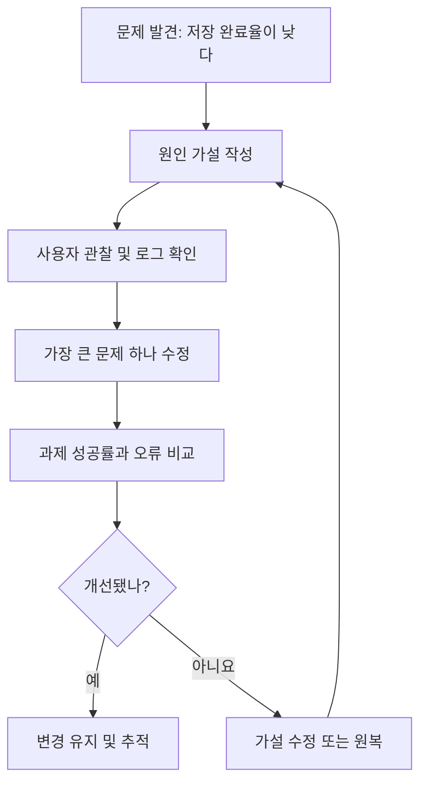

# 17. AI 기능을 더 잘 만들려면 무엇을 측정할까? — 사용자 테스트와 개선 실험

> **비개발자를 위한 AI 시스템 설계 입문서 · 17**  
> 이번 장의 질문: **AI 답변이 정확해졌는데, 왜 사용자는 여전히 불편하다고 할까요?**

- 난이도: ★★☆☆☆ — 통계 공식보다 비교 기준을 정하는 방법에 집중해요.
- 예상 학습 시간: 25~35분
- 먼저 읽기: [05. AI 서비스의 품질을 평가하는 방법](05_AI_서비스의_품질을_평가하는_방법.md) · [16. AI UX와 신뢰 설계](16_AI_기능을_사용자에게_보여주는_방법_AI_UX와_신뢰_설계.md)
- 참고 자료: [Google People + AI Guidebook](https://pair.withgoogle.com/guidebook-v2/chapters) · [Microsoft Human-AI Interaction Guidelines](https://www.microsoft.com/en-us/haxtoolkit/ai-guidelines/) · [NN/g A/B Testing 101](https://www.nngroup.com/articles/ab-testing/)

> 이 글은 원문을 그대로 옮긴 번역본이 아니에요. AI 시스템 평가와 사용자 조사 자료를 바탕으로 **비전공자도 직접 실험을 설계할 수 있도록 새로 쓴 독립 해설**이에요. 아래 숫자는 별도로 표시하지 않는 한 모두 이해를 위한 가상 예시예요.

---

## 1. AI가 잘 답했는데, 사용자는 왜 다시 질문할까요?

찐망고 사주풀이를 이용한 사람이 결과를 받았다고 해 볼게요.

AI는 요청된 형식을 정확히 지켰어요. 오류도 없고, 문장도 자연스러워요. 개발자가 만든 자동 테스트도 모두 통과했죠.

그런데 이용자는 결과를 보고 다시 물어요.

> "그래서 제가 어떻게 행동해야 한다는 거예요?"

개발자 입장에서는 성공한 답변인데, 이용자 입장에서는 아직 원하는 답을 못 얻은 거예요.

**여기서 중요한 차이가 하나 생겨요.**

- AI가 지시를 잘 따랐는가?
- 사용자가 실제로 문제를 해결했는가?

둘은 같은 질문이 아니에요. 좋은 AI 서비스는 **모델 결과의 품질**과 **사용 경험의 성공**을 함께 봐야 해요.

## 이 장을 읽고 나면

- AI 답변 평가와 UX 평가가 어떻게 다른지 설명할 수 있어요.
- 내 서비스에서 먼저 측정할 성공 지표를 하나 고를 수 있어요.
- 사용성 테스트와 A/B 테스트를 목적에 맞게 구분할 수 있어요.
- 숫자가 좋아졌더라도 바로 성공이라고 결론 내리면 안 되는 이유를 알게 돼요.
- 작은 실험을 안전하게 설계하고 다음 개선 항목을 정할 수 있어요.

---

## 2. 점수는 높은데 서비스가 불편할 수 있어요

학교 시험을 떠올려 볼게요. 학생이 문제를 모두 맞혔다면 시험 성적은 좋겠죠. 그런데 실습 현장에서 그 지식을 제대로 활용하는지는 또 확인해야 해요.

AI 서비스도 비슷해요.

| 구분 | 확인하는 질문 | 예시 |
|---|---|---|
| **AI 출력 품질 평가(Eval)** | 결과가 정확하고 요구사항을 지켰나요? | 사주 해설에 인물 혼동이 없나요? |
| **사용성 테스트(Usability Test)** | 이용자가 기능을 이해하고 끝낼 수 있나요? | 저장 버튼을 스스로 찾나요? |
| **행동 지표(Product Metrics)** | 실제 이용 과정에서 무엇이 일어나나요? | 결과를 확인한 뒤 저장까지 이어지나요? |
| **사용자 의견(Feedback)** | 무엇이 도움이 됐고 어려웠나요? | 문장이 길어서 핵심을 모르겠다는 의견 |

예를 들어 저장 성공률이 낮다면 AI의 해설 품질 문제가 아닐 수 있어요. 버튼 위치, 로그인 요구, 네트워크 오류, 저장 완료 안내가 문제일 수도 있거든요.

**핵심:** 지표를 보기 전에 *무엇을 개선하고 싶은지*부터 정해야 해요.

---

## 3. 좋은 지표는 숫자가 아니라 질문에서 시작해요

"방문자가 늘면 성공"이라고 정하면 편할까요? 꼭 그렇지는 않아요.

광고를 보고 들어온 사람이 5초 만에 나간다면 방문자는 늘었어도 서비스의 가치를 경험한 건 아닐 수 있어요.

먼저 이렇게 질문해 보세요.

> "우리 서비스에서 이용자가 반드시 성공해야 하는 행동은 무엇일까?"

### 찐망고 사주풀이 예시

**목표:** 사용자가 해설을 이해하고, 필요한 경우 다시 확인할 수 있도록 한다.

- 주요 지표: 결과 생성 이후 저장 완료 비율
- 보조 지표: 결과 생성 실패율, 재시도 비율, 해설 유용성 피드백
- 보호 지표: 개인정보 오류, 저장 권한 실패, 응답 지연

### 찐망고 레퍼런스 예시

**목표:** 사용자가 원하는 디자인 사례를 찾아 무드보드에 활용한다.

- 주요 지표: 검색을 시작한 이용자 중 원하는 레퍼런스를 찾아 보드에 추가한 비율
- 보조 지표: 검색어 재입력 횟수, 상세 보기 이후 보드 추가율
- 보호 지표: 잘못된 분류 신고, 삭제 요청 처리 오류

다만 **사용자가 저장하지 않았다고 무조건 실패는 아니에요.** 그냥 결과를 읽는 것만 목적이었을 수도 있죠. 그래서 숫자만 보지 말고 직접 관찰과 인터뷰를 함께 해야 해요.

---

## 4. 퍼널(Funnel): 어디서 사람들이 멈출까요?

온라인 쇼핑에서 상품 보기 → 장바구니 → 주문 → 결제로 이어지는 흐름을 퍼널이라고 하죠. AI 서비스에도 적용할 수 있어요.



위 숫자는 전부 가상의 예시예요.

이때 저장 완료율을 **35/100 = 35%**로 계산할 수도 있고, 저장을 시도한 사람 기준 성공률을 **35/40 = 87.5%**로 계산할 수도 있어요.

둘은 다른 의미예요.

- 35%: 질문을 시작한 전체 이용자 중 실제 저장까지 간 비율
- 87.5%: 저장을 시도한 사람 중 성공한 비율

분모를 명확히 적지 않고 "성공률 87.5%"라고만 하면 해석이 달라질 수 있어요.

또 숫자만으로 원인을 알 수는 없어요. 결과를 보고 만족해서 떠난 사람과 오류 때문에 떠난 사람은 구분해야 하니까요.

**실무 메모:** 퍼널 단계마다 이벤트 이름, 발생 시점, 중복 기록 여부를 함께 정의해 두세요.

---

## 5. 사용자 테스트: 버튼을 누르는 모습을 직접 봐요

AI가 만든 결과를 잘 이해하는지 확인할 때 가장 간단한 방법 중 하나는 **실제 사용 과정을 관찰**하는 거예요.

예를 들어 5명의 학생에게 이렇게 요청해 볼 수 있어요.

> "검색 결과에서 마음에 드는 Hero 디자인을 찾아 무드보드에 추가해 보세요. 진행하면서 무엇을 찾고 있는지 말로 설명해 주세요."

관찰자는 대신 클릭해 주지 않아요. 작업을 어떻게 이해하는지, 어디서 멈추는지 기록해요.

### 관찰할 내용

| 관찰 항목 | 기록 예시 |
|---|---|
| 과제 완료 | 5명 중 3명이 스스로 완료 |
| 어려웠던 단계 | 2명이 '보드 추가' 기능을 찾지 못함 |
| 혼동한 표현 | '내 무드보드로 가져오기'를 다운로드 기능으로 이해 |
| 완료 시간 | 개인별 소요 시간 기록 |
| 사용자 설명 | "추가했는데 어디에 저장됐는지 모르겠어요" |

이 숫자를 전체 사용자 비율로 일반화하면 안 돼요. 소규모 사용성 테스트는 주로 **어떤 문제가 왜 생기는지 발견하는 데** 유용해요.

### 인터뷰 질문도 중요해요

"편했나요?"라고만 물으면 대답이 짧아요. 대신 이런 질문을 해 보세요.

- 이 화면에서 무엇을 할 수 있다고 생각했나요?
- 다음에 누를 버튼이 무엇이라고 예상했나요?
- 가장 확신이 없었던 순간이 어디였나요?
- 결과를 보고 실제로 어떤 결정을 내릴 수 있었나요?

칭찬보다 **행동과 혼동 지점**을 기록하는 게 개선에 도움이 돼요.

---

## 6. A/B 테스트: 두 가지 개선안 중 무엇이 더 나을까요?

사용자 인터뷰에서 이런 문제가 발견됐다고 해 볼게요.

> "AI가 결과를 만들고 있는지 모르겠어요."

해결안을 두 개 생각했어요.

- **A안:** '분석 중입니다'라는 문구만 표시
- **B안:** 진행 단계를 설명하는 메시지와 취소 버튼 표시

어느 쪽이 좋은지 실제 이용자에게 비교해 볼 수 있어요. 이것이 **A/B 테스트**의 기본 생각이에요.

단, A/B 테스트는 단순히 두 시안을 나란히 보여 주고 선호를 묻는 것과 달라요. 일반적으로 실제 이용자를 무작위 그룹으로 나눠 서로 다른 경험을 제공하고, **미리 정한 행동 지표**를 비교해요.

### 무엇을 측정할까요?

- 주요 지표: 결과 생성 도중 이탈한 비율
- 보호 지표: 실제 오류 발생률, 응답 시간, 비용
- 보조 지표: 취소 버튼 이용률, 혼란 관련 피드백

B안이 이탈을 줄였더라도 지연 시간이나 오류가 커졌다면 무조건 성공이라고 보기 어려워요.

### 가상 예시

| 지표 | A안 | B안 |
|---|---:|---:|
| 결과 완료 | 200명 중 150명 (75%) | 200명 중 162명 (81%) |
| 중도 이탈 | 25% | 19% |
| 기술 오류 | 2% | 2% |

B안의 완료율이 6%p 높아요. 하지만 **이 예시만으로 통계적으로 확실히 더 낫다고 결론 낼 수는 없어요.** 표본 크기, 그룹 분배, 관찰 기간, 불확실성 범위를 확인해야 하죠.

그리고 실험 도중 결과가 좋아 보인다는 이유로 계속 들여다보다가 임의로 종료하면 잘못된 결론을 내릴 위험이 있어요. 실험 전에 기간과 판단 기준을 정해 두는 게 좋아요.

---

## 7. 사용성 테스트와 A/B 테스트는 경쟁 관계가 아니에요

| 알고 싶은 것 | 더 적합한 방법 |
|---|---|
| 사용자가 왜 저장 버튼을 못 찾는지 | 사용성 테스트·관찰 |
| 저장 버튼 위치 A/B 중 실제 완료율이 높은지 | A/B 테스트 |
| AI 답변이 특정 형식을 어기는지 | 자동 평가(Eval) |
| 결과 문장이 이해하기 어려운 이유 | 인터뷰·문장 이해 테스트 |
| 변경 후 심각한 오류가 늘었는지 | 모니터링·회귀 테스트 |

가장 좋은 방법은 **하나만 고집하지 않고 질문에 맞게 고르는 것**이에요.

작은 서비스에서 이용자가 충분하지 않다면 A/B 테스트가 오랜 시간이 걸리거나 결과가 불확실할 수 있어요. 이때는 소규모 사용자 관찰, 전문가 검토, 정해진 평가 사례 반복 테스트부터 시작하는 편이 현실적이에요.

---

## 8. AI 서비스에는 '좋아요' 버튼만으로 부족할 때가 있어요

AI 답변 아래에 엄지손가락 버튼을 달면 바로 품질을 알 수 있을까요?

"싫어요"를 누른 이유가 여러 가지일 수 있어요.

- 사실이 틀렸어요.
- 너무 길어서 읽기 힘들어요.
- 질문에 답하지 않았어요.
- 말투가 불편했어요.
- 정답은 맞지만 쓸모가 없어요.

이렇게 이유가 다르면 고치는 방법도 달라져요.

피드백 항목을 너무 많이 만들면 이용자가 귀찮아서 참여하지 않을 수도 있어요. 처음엔 **간단한 평가 + 선택적인 이유 입력** 정도로 시작해 보세요.

```text
이 답변이 도움이 됐나요? [도움 됐어요] [아쉬워요]

아쉬운 이유 (선택)
[내용이 틀림] [너무 어려움] [원하는 답이 아님] [기타]
```

피드백을 받았다고 해서 모델이 즉시 학습하거나 다음 답변에서 자동으로 반영된다고 안내하면 안 돼요. 실제 개선 파이프라인이 연결돼 있는지에 따라 달라지거든요.

Google의 People + AI Guidebook에서도 사용자에게 피드백의 목적과 영향에 대한 적절한 기대를 주는 것이 중요하다고 설명해요.

---

## 9. 이벤트를 기록할 때 개인정보도 생각해야 해요

측정한다고 해서 사용자 질문 전문이나 민감한 정보를 무조건 로그로 남길 필요는 없어요.

예를 들어 다음과 같은 정보만으로도 기본 퍼널을 만들 수 있어요.

```json
{
  "event": "ai_result_saved",
  "anonymous_session_id": "session-example-001",
  "timestamp": "2026-10-29T09:00:00+09:00",
  "model_version": "example-model-v1",
  "result": "success",
  "duration_ms": 830
}
```

이 JSON은 연습용 예시예요. 실제 서비스에서는 식별자, 보관 기간, 접근 권한, 동의와 법적 근거 등을 별도로 설계해야 해요. **익명처럼 보이는 세션 ID도 다른 정보와 결합되면 개인을 구분할 가능성이 있어요.**

특히 사주풀이처럼 생년월일과 관계 정보가 입력되는 서비스라면 원문 전체를 분석 로그에 남기기 전에 필요성과 위험을 따져 보세요.

---

## 10. 무엇을 고칠지 정하는 순서가 있어요

이용자 불편을 10개 찾았다고 모두 한꺼번에 수정하면 무엇 때문에 좋아졌는지 알기 어려워요.

**문제 발견 → 원인 가설 → 작은 수정 → 확인 → 다음 수정** 순서로 움직여 보세요.



이때 원인이 AI 모델 자체인지, 프롬프트인지, 화면인지, API 오류인지 구분하는 습관이 중요해요.

---

## 11. 찐망고 서비스에 적용한다면

### 찐망고 사주풀이: 해설을 이해했는지 확인하기

**문제 가정:** 결과는 생성되지만 이용자가 원하는 행동 조언을 찾지 못해요.

1. 관찰: 결과 화면에서 어떤 문단을 읽고 어디서 멈추는지 확인해요.
2. 정성 질문: "이 해설을 보고 어떤 점이 이해됐나요?"라고 물어요.
3. 가설: 긴 문단 때문에 핵심 조언이 눈에 들어오지 않을 수 있어요.
4. 작은 개선: 핵심 조언 카드와 자세히 보기 영역을 분리해요.
5. 비교: 과제 수행률, 이해도 피드백, 해설 품질 평가를 함께 봐요.

여기서 중요한 건 **짧아졌다고 정확해진 건 아니라는 점**이에요. 요약 화면을 만들더라도 원래 뜻이 왜곡되지 않는지 확인해야 해요.

### 찐망고 레퍼런스: 검색과 무드보드 연결하기

**문제 가정:** 레퍼런스를 구경하지만 무드보드에 담는 사람이 적어요.

1. 과제: '제품 소개 Hero를 세 개 찾아 보드에 담기'
2. 관찰: 검색어를 바꾸는 순간, 상세보기와 추가 버튼을 찾는 과정 기록
3. 가설: 기능 이름과 저장 상태가 충분히 드러나지 않아요.
4. 변경: 상세 화면에서 '무드보드에 추가' 상태를 명확히 표시해요.
5. 비교: 과제 완료율과 혼동 관련 피드백을 확인해요.

무드보드에 적게 담는 이용자가 전부 실패한 것은 아니니 **방문 목적별로 구분해서 해석**하는 것도 중요해요.

---

## 12. 수업에서 활용한다면: 20분 개선 실험 설계

**실습 주제: AI 결과 화면, 무엇을 측정하면 좋을까?**

학생들에게 같은 AI 결과 화면을 주고, 아래 순서로 진행해 보세요.

1. **3분 — 문제 정의:** 사용자가 어려워할 장면 한 가지 고르기
2. **4분 — 가설 작성:** "○○ 때문에 △△ 행동을 하지 못할 것이다"
3. **5분 — 화면 수정:** 버튼 문구·상태 안내·결과 구조 중 한 가지 수정하기
4. **5분 — 테스트 설계:** 사용자에게 줄 과제, 기록할 행동, 성공 조건 정하기
5. **3분 — 공유:** 무엇을 측정하고 어떤 경우 개선이라고 판단할지 설명하기

### 실습 작성 양식

| 항목 | 작성 내용 |
|---|---|
| 사용자 목표 | 예: 결과 저장하기 |
| 관찰된 문제 | 예: 저장 여부를 확인하지 못함 |
| 원인 가설 | 예: 완료 메시지가 눈에 띄지 않음 |
| 바꿀 요소 | 예: 완료 상태와 이동 버튼 |
| 주요 지표 | 예: 저장 성공 후 상태 인지 과제 완료율 |
| 보호 지표 | 예: 중복 저장·오류 증가 여부 |
| 확인 방법 | 예: 사용자 관찰 5명 + 이벤트 로그 |

여기서 가장 중요한 평가는 **예쁜 시안을 만들었는가가 아니라, 무엇이 개선됐는지 확인할 수 있게 설계했는가**예요.

---

## 13. 내가 알아야 할 수준

| 수준 | 알아야 하는 내용 | 지금 필요한가요? |
|---|---|---|
| 기본 | AI 출력 평가와 UX 평가 차이 | **필수** |
| 기본 | 사용자 목표에 맞는 지표 선택 | **필수** |
| 기본 | 사용자 관찰과 인터뷰 질문 작성 | **필수** |
| 실무 | 이벤트 정의, 분모, 중복 집계 확인 | **중요** |
| 실무 | 작은 개선 실험과 보호 지표 설계 | **중요** |
| 선택 | A/B 테스트 실험 운영 | 트래픽이 충분할 때 |
| 심화 | 통계 검정·검정력·순차 실험 | 실험을 대규모로 운영할 때 |

---

## 14. 오늘 배운 내용 한 장 정리

- **AI가 정확한 답을 했는지**와 **사용자가 일을 끝냈는지**는 다른 문제예요.
- 조회수보다 사용자가 이루려는 목적을 먼저 정해 보세요.
- 사용성 테스트는 *왜 불편한지*, A/B 테스트는 *어느 대안의 지표가 나은지* 살피는 데 도움이 돼요.
- 개선할 때는 하나씩 바꾸고, 주요 지표와 보호 지표를 같이 확인하세요.
- 작은 표본의 숫자로 전체 이용자의 행동을 단정하지 마세요.
- 사용자 피드백과 행동 기록은 개인정보를 보호하며 수집해야 해요.

**기억할 문장:** AI가 일을 잘했는지 확인하는 것을 넘어, **사람이 실제로 일을 끝냈는지 확인하는 것**이 서비스 개선의 시작이에요.

---

## 확인 문제

1. 자동 평가에서 100점을 받은 AI 답변도 UX가 나쁠 수 있을까요?
2. 저장 완료율이 떨어지면 곧바로 저장 버튼 디자인이 문제라고 판단해도 될까요?
3. 사용자 5명이 테스트한 결과를 전체 이용자 성공률로 일반화해도 될까요?
4. A/B 테스트에서 B안의 숫자가 조금 높으면 바로 배포해도 될까요?
5. "별로예요"라는 피드백에 이유를 선택하도록 하면 어떤 점이 좋아질까요?

<details>
<summary>정답 방향 보기</summary>

1. 네. 답변이 정확해도 읽기 어렵거나 사용자가 작업을 못 끝낼 수 있어요.
2. 아니요. 결과 만족, 로그인 과정, 기술 오류 등 다른 이유를 확인해야 해요.
3. 아니요. 작은 사용성 테스트는 문제 발견에는 유용하지만 전체 비율을 추정하기엔 제한이 있어요.
4. 아니요. 불확실성, 표본, 보호 지표, 실험 기간을 함께 봐야 해요.
5. 사실 오류와 표현 문제 등을 구분해 개선 방향을 정하기 쉬워져요.

</details>

---

## 다음 장 예고

**18. AI 기능을 누구나 사용할 수 있게 만들려면? — 접근성과 포용적 설계**  
글을 읽기 어렵거나, 키보드만 사용하거나, 화면을 보기 어려운 이용자도 AI 기능을 쓸 수 있으려면 무엇을 준비해야 할까요?

## 참고 자료

- [Google People + AI Guidebook — User Needs + Defining Success](https://pair.withgoogle.com/guidebook-v2/chapters)
- [Google People + AI Guidebook — Feedback + Control](https://pair.withgoogle.com/guidebook-v2/chapter/feedback-controls/)
- [Microsoft — Guidelines for Human-AI Interaction](https://www.microsoft.com/en-us/haxtoolkit/ai-guidelines/)
- [Nielsen Norman Group — A/B Testing 101](https://www.nngroup.com/articles/ab-testing/)

> **문서 구분:** 이 글은 위 자료의 개념을 참고한 교육용 독립 해설이에요. 예시 수치와 화면 시나리오는 설명을 위해 구성한 가상 사례이며, 실제 운영 지표가 아니에요.