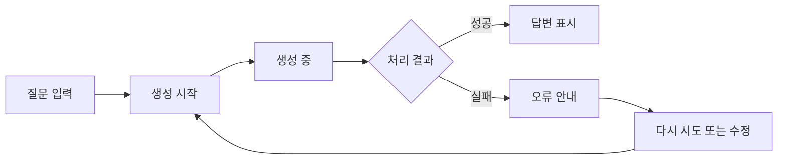
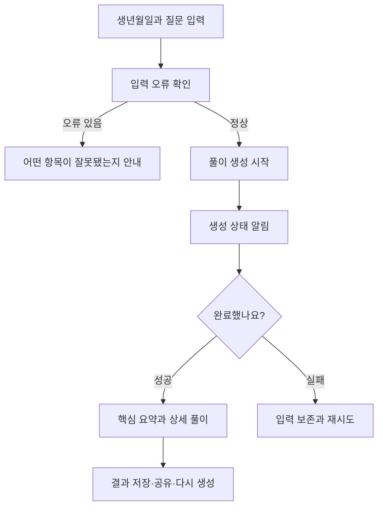

# 18. AI 기능을 누구나 사용할 수 있게 만들려면? — 접근성과 포용적 설계

> **비개발자를 위한 AI 시스템 설계 입문서 · 18**  
> 이번 장의 질문: **AI가 친절하게 답해도, 그 답을 읽거나 조작할 수 없는 사람이 있다면 좋은 서비스일까요?**

- 난이도: ★★☆☆☆ — 웹디자인·퍼블리싱을 배운 적이 있다면 더 익숙해요
- 예상 학습 시간: 25~35분
- 먼저 읽기: [16. AI 기능을 사용자에게 어떻게 보여 줄까?](16_AI_기능을_사용자에게_보여주는_방법_AI_UX와_신뢰_설계.md) · [17. AI 기능을 더 잘 만들려면 무엇을 측정할까?](17_AI_기능을_더_잘_만들려면_무엇을_측정할까.md)
- 주요 기준: [WCAG 2.2](https://www.w3.org/TR/WCAG22/) · [WAI 상태 메시지 설명](https://www.w3.org/WAI/WCAG22/Understanding/status-messages.html)

> 이 글은 접근성 표준을 처음 접하는 사람을 위한 **독립적인 학습 해설**이에요. 특정 서비스를 접근성 적합 판정하는 문서는 아니에요. 기술 예시는 이해를 위한 최소한의 구현이며, 실제로는 브라우저와 보조 기술을 함께 테스트해야 해요.

---

## 1. AI 답변은 성공했는데, 사용자는 아무것도 몰랐어요

사주 풀이 버튼을 눌렀다고 해 볼게요. 화면에서는 빙글빙글 도는 아이콘이 나타나고, 잠시 뒤 풀이가 완성됐어요. 개발자는 이렇게 생각할 수 있죠.

> "로딩도 보여 줬고 결과도 나왔으니 잘 만들었네!"

그런데 화면을 보지 않고 **스크린리더**로 웹사이트를 이용하는 사람에게는 로딩 시작이나 완료 상태가 전달되지 않을 수 있어요. 또 마우스를 사용할 수 없어 키보드로 이동하는 사람은 '결과 다시 만들기' 버튼까지 도달하지 못할 수도 있고요.

**AI가 답을 만들어 냈다 = 사용자가 AI를 이용할 수 있다**는 뜻은 아니에요.

이번 장에서는 AI의 똑똑함보다, **사용자가 AI 기능을 시작하고, 기다리고, 결과를 읽고, 고치고, 실패했을 때 회복할 수 있는지**에 집중해 볼게요.

## 이 장을 읽고 나면

- 접근성(Accessibility)과 포용적 설계(Inclusive Design)를 구분하기
- AI 화면의 입력·로딩·완료·오류 상태를 다양한 사용자 관점에서 점검하기
- 키보드, 스크린리더, 대비, 문장 난이도의 기본 원리를 이해하기
- AI가 생성한 콘텐츠 자체도 접근성 검수가 필요하다는 사실 알기
- Figma 시안과 HTML 화면을 함께 점검하는 간단한 실습하기

---

## 2. 접근성은 '특별한 사람을 위한 옵션'이 아니에요

**웹 접근성**은 장애 유무나 사용 환경에 관계없이 웹 기능과 정보를 이용할 수 있도록 만드는 일이에요.

예를 들어 이런 상황이 있어요.

| 사용자 상황 | 불편해지는 순간 | 설계에서 확인할 것 |
|---|---|---|
| 마우스를 사용할 수 없음 | 생성 버튼에 포커스가 가지 않음 | 키보드 조작과 포커스 순서 |
| 화면을 보지 않고 사용함 | 로딩 완료를 알 수 없음 | 상태 메시지와 의미 있는 마크업 |
| 저시력·화면 확대 | 버튼·텍스트가 잘리거나 겹침 | 확대와 반응형 리플로우 |
| 색 구분이 어려움 | 오류를 빨간 테두리로만 표시 | 색 외에 텍스트·아이콘 등 병행 |
| 읽기 어려운 긴 문장 | AI 설명을 끝까지 따라가기 힘듦 | 쉬운 문장, 제목, 요약과 상세 설명 분리 |
| 느린 네트워크 | 화면이 멈춘 것처럼 느껴짐 | 진행 상태, 재시도, 작업 보존 |

포용적 설계는 한 걸음 더 넓어요. 다양한 사람과 환경을 고려하고, 실제 사용자를 참여시켜서 누구에게 어떤 장벽이 있는지 발견하는 과정까지 포함하죠.

**기억할 문장:** 접근성은 화면을 더 예쁘게 만드는 작업이 아니라, **이용할 수 없었던 기능을 이용할 수 있게 만드는 설계**예요.

---

## 3. AI 서비스는 일반 웹보다 '상태 변화'가 많아요

일반적인 페이지는 클릭하면 다른 페이지로 이동하기도 하지만, AI 서비스는 같은 화면 안에서 상태가 계속 바뀌어요.



시각적으로는 버튼이 바뀌거나 로딩 애니메이션이 움직이면 알아차리기 쉬워요. 그런데 **화면에 그려진 변화가 보조 기술에도 자동으로 전달되는 것은 아니에요.**

### 상태별로 생각하기

| 상태 | 화면에 보여 줄 내용 | 접근성 관점에서 확인할 내용 |
|---|---|---|
| 입력 전 | 질문 입력과 실행 버튼 | label, 안내문, 오류 설명 |
| 생성 중 | '답변을 만들고 있어요' | 스크린리더에 상태 안내, 중복 실행 방지 |
| 완료 | 제목·본문·후속 행동 | 완료 알림, 결과로 이동하는 방법 |
| 오류 | 실패 이유와 다시 시도 | 이해 가능한 설명, 입력 보존 |
| 재생성 | 이전 결과와 새 결과 구분 | 현재 상태와 선택된 결과 설명 |

여기서 중요한 것은 모든 상황에서 포커스를 강제로 옮기는 게 아니라는 점이에요. **상태 알림**과 **사용자가 실제로 이동해야 하는 위치**를 구분해야 해요.

---

## 4. 키보드만으로 이용해 보기

마우스를 치우고 `Tab`, `Shift + Tab`, `Enter`, `Space`만으로 AI 기능을 사용해 보세요.

1. 질문 입력창으로 이동할 수 있나요?
2. 실행 버튼이 어디에 있는지 보이나요?
3. 로딩 중에 버튼이 무슨 상태인지 알 수 있나요?
4. 완료 후 결과와 복사·저장 버튼으로 이동할 수 있나요?
5. 팝업을 열었다면 닫고 원래 위치로 돌아올 수 있나요?

이 중 한 단계라도 막히면 **'기능은 존재하지만 누구나 쓸 수 있는 기능은 아닌'** 상태예요.

### 좋은 HTML은 시작점이 돼요

```html
<label for="question">궁금한 내용을 입력해 주세요</label>
<textarea id="question" name="question"></textarea>
<button type="submit">AI 답변 생성</button>
```

버튼처럼 보이게 만든 `div`보다 실제 `button`을 쓰는 편이 기본 키보드 동작과 의미 전달에 유리해요.

```html
<!-- 시각적으로 버튼처럼 보여도 기본적으로 버튼이 아니에요 -->
<div class="generate-button">AI 답변 생성</div>
```

기본 시멘틱 요소로 해결할 수 있다면, 복잡한 ARIA 코드를 덧붙이기보다 그것부터 쓰는 게 좋아요.

---

## 5. AI가 '작업 중'이라는 사실을 스크린리더에 알려 주기

AI 답변 생성 화면에는 이런 문장이 나타날 수 있어요.

> 답변을 만들고 있어요…

이 메시지가 시각적으로만 나타난다면 화면을 듣는 사람은 놓칠 수 있어요. 이때 활용하는 개념이 **라이브 리전(Live Region)**이에요.

```html
<p id="generation-status" role="status"></p>
```

생성 요청 후 JavaScript가 해당 요소의 내용을 바꾼다고 생각해 보세요.

```js
const status = document.querySelector('#generation-status');

status.textContent = '답변을 만들고 있어요.';
// 작업 성공 후
status.textContent = '답변이 완성됐어요.';
```

`role="status"`는 일반적인 상태 메시지에 쓰며, 스크린리더가 사용자의 작업을 과도하게 끊지 않고 알릴 수 있도록 도와줘요.

**주의할 점이 있어요.** `role="alert"`는 긴급하거나 즉각적인 주의가 필요한 상황에 제한적으로 사용해야 해요. 일반적인 '생성 중' 메시지까지 모두 `alert`로 처리하면 오히려 사용하기 어려워질 수 있어요. 또 라이브 리전은 처음부터 DOM에 존재하도록 준비하고, 이후 내용을 갱신하는 편이 안정적이에요. <https://www.w3.org/WAI/WCAG22/Understanding/status-messages.html>

### 진행률을 숫자로 표시해야 할까요?

AI 생성 시간이 일정하지 않은데도 '83%'처럼 숫자를 임의로 보여 주면 오해를 만들어요. 실제 진행률을 측정할 수 없다면 **진행 중이라는 상태**를 솔직히 알려 주는 편이 좋아요.

---

## 6. 답변이 완성되면 포커스는 어디로 가야 할까요?

무조건 결과 제목으로 포커스를 옮길까요? 꼭 그렇지는 않아요.

- 짧은 상태 변화만 알리면 충분한 경우: `role="status"`로 완료 알림을 전달해요.
- 새로운 결과 영역이 매우 길고 이동이 필요한 경우: '답변으로 이동' 버튼이나 링크를 제공할 수 있어요.
- 대화형 입력을 이어가야 하는 경우: 사용자가 입력 위치를 유지하는 게 더 자연스러울 수 있어요.

**원칙은 하나예요. 사용자가 원하지 않은 위치로 갑자기 끌려가지 않도록 하기.** 실제 포커스 이동은 사용자 작업 흐름과 보조 기술 테스트를 바탕으로 정해야 해요.

---

## 7. AI가 만든 긴 설명도 '읽을 수 있게' 설계해야 해요

사주 풀이 결과가 3천 자라고 생각해 볼게요. 글이 길다는 이유만으로 나쁜 건 아니에요. 하지만 핵심과 상세 설명이 뒤섞이면 읽다가 지치기 쉬워요.

### 같은 내용, 다른 표현

**어려운 설명**

> 사용자의 의사결정 경향은 외부 변인의 상호작용으로 인하여 선택적 지연 양상을 보일 수 있습니다.

**쉬운 설명**

> 선택지가 많아지면 결정을 미루기 쉬워요. 그래서 중요한 기준을 두세 개 먼저 정하는 게 도움이 돼요.

AI가 어려운 문장을 만들었다면 '모델이 원래 그렇게 답해서'라고 넘길 수 없어요. **결과를 서비스에 표시하기 전에 문장 구조와 이해도를 어떻게 관리할지** 설계할 수 있거든요.

- 처음에는 핵심을 2~3문장으로 요약해요.
- 한 문단은 한 가지 주제를 중심으로 써요.
- 전문 용어가 처음 등장하면 풀어서 설명해요.
- 상세 내용은 제목으로 나누되, 숨겨 둔 내용을 다시 펼칠 수 있게 해요.
- 한자나 낯선 용어가 꼭 필요하면 읽는 법과 뜻을 함께 제시해요.

**쉬운 글과 짧은 글은 같은 뜻이 아니에요.** 문장을 너무 줄이면 필요한 설명과 맥락이 사라질 수 있어요.

---

## 8. 색과 애니메이션만으로 의미를 전달하지 않기

디자인 시안에서 오류 입력창을 빨간 테두리로 표시했다고 해 볼게요. 그런데 색을 구분하기 어려운 사람은 무엇이 잘못됐는지 알기 어려울 수 있어요.

```text
부족한 예: 빨간 테두리만 표시
더 나은 예: 빨간 테두리 + '이메일 형식을 확인해 주세요'라는 설명
```

로딩도 마찬가지예요. 회전하는 아이콘만 보여 주는 대신 '답변 생성 중' 같은 텍스트를 곁들이면 상태를 더 쉽게 알 수 있어요.

또 계속 움직이는 애니메이션은 일부 사용자에게 불편할 수 있어요. `prefers-reduced-motion` 설정을 고려해서 필요하지 않은 움직임을 줄이는 것도 방법이에요.

```css
@media (prefers-reduced-motion: reduce) {
  .loading-spinner {
    animation: none;
  }
}
```

애니메이션을 끄더라도 **로딩 중이라는 의미는 텍스트로 남겨 둬야** 해요.

### 대비와 글자 크기

WCAG 2.2에서 일반 본문 텍스트의 최소 대비 기준은 AA에서 보통 **4.5:1**, 큰 텍스트는 **3:1**이에요. 다만 구성 요소와 상태 표시 등에는 별도 기준이 적용될 수 있으니, 모든 색 조합을 이 숫자 하나로 판단하면 안 돼요.

특히 회색 플레이스홀더, 비활성 버튼, 작은 안내문이 시각적으로 지나치게 약하지 않은지 함께 살펴봐야 해요.

---

## 9. AI가 만드는 콘텐츠 자체에도 접근성이 필요해요

AI가 만들어 준 결과를 무조건 그대로 화면에 표시해도 될까요? 예를 들어 아래와 같은 문제가 생길 수 있어요.

| AI가 만든 결과 | 생길 수 있는 문제 | 확인할 내용 |
|---|---|---|
| 이미지 설명 | 중요한 장면을 빠뜨림 | 실제 맥락을 설명하는 대체 텍스트인지 |
| 표 | 화면이 좁아지면 가로로 밀림 | 제목·머리글·모바일 보기 |
| 긴 답변 | 구조 없이 문단만 이어짐 | 제목과 목록, 읽기 순서 |
| 차트 해설 | 색상만으로 범례를 설명 | 데이터와 단위의 텍스트 제공 |
| 자동 자막 | 고유명사·숫자를 틀림 | 사람의 검토와 정정 방법 |

AI를 이용해 대체 텍스트를 **초안 생성**할 수는 있지만, 이미지의 목적과 주변 문맥까지 자동으로 판단한다고 가정하면 안 돼요. 중요한 콘텐츠일수록 검수 절차가 필요해요.

---

## 10. 찐망고 사주풀이의 결과 화면에 적용한다면

다음은 실제 구현 상태를 단정하지 않고 **점검할 수 있는 설계 시나리오**예요.

### 사용자 여정



이 흐름에서 특히 확인하면 좋은 건 다음이에요.

1. 입력한 값이 잘못됐을 때 어떤 항목을 고쳐야 하는지 말해 주나요?
2. 생성 중임을 화면과 스크린리더가 모두 알 수 있나요?
3. 결과에 제목과 구분된 단락이 있나요?
4. 접힌 상세 해설을 키보드로 펼칠 수 있나요?
5. 저장 실패 후에도 생성된 결과가 사라지지 않나요?

**서비스 설계의 핵심:** AI 답변의 내용뿐 아니라 **답변에 도착하는 과정 전체를 접근 가능하게** 만들어야 해요.

---

## 11. 찐망고 레퍼런스에도 적용해 보기

섹션 이미지가 많은 아카이브에서는 접근성 문제가 다른 형태로 나타날 수 있어요.

- 썸네일을 이미지로만 나열한다면, 제목·카테고리·원본 사이트를 텍스트로도 확인할 수 있나요?
- 이전·다음 이동은 키보드로 가능한가요?
- 크게 보기 화면을 닫으면 적절한 위치로 돌아가나요?
- '내 무드보드로 가져오기'를 누른 뒤 성공·실패 메시지가 전달되나요?
- 자동 생성된 태그나 설명을 사람이 수정할 수 있나요?

여기서 이미지에 붙는 대체 텍스트는 모든 시각 요소를 장황하게 묘사하는 게 목표가 아니에요. **그 화면에서 이미지가 어떤 정보를 전달하는지**가 우선이에요.

---

## 12. Figma에서 20분 실습해 보기

**과제: AI 답변 생성 화면을 접근 가능한 화면으로 다시 설계하기**

### 1단계 (5분): 상태 정의

입력 전 / 생성 중 / 완료 / 오류의 네 가지 프레임을 만들어요. 네 상태의 버튼, 안내문, 결과 영역이 어떻게 달라지는지 표시해요.

### 2단계 (5분): 사용자 관점 검토

마우스를 쓰지 못하는 사용자, 스크린리더 사용자, 긴 문장을 읽기 어려운 사용자를 각각 떠올리고 장벽을 한 가지씩 적어요.

### 3단계 (5분): 개선

상태 안내 텍스트, 버튼의 명확한 레이블, 오류 설명, 요약 영역을 추가해요. 포커스가 어디로 이동할지도 메모해요.

### 4단계 (5분): 확인

화면을 서로 바꿔 보고 '보지 않고도 상태를 알 수 있을까?', '오류가 나도 다시 진행할 수 있을까?'를 질문해요.

**중요:** Figma에서 적합해 보이는 것은 접근성 검증의 출발점일 뿐이에요. 구현된 HTML에서 실제 키보드와 스크린리더 테스트를 해야 해요.

---

## 13. 개발할 때 확인하는 작은 체크리스트

- [ ] 입력 요소에 연결된 이름(label)이 있어요.
- [ ] 모든 주요 기능을 키보드로 조작할 수 있어요.
- [ ] 포커스 표시가 잘 보여요.
- [ ] 로딩과 완료 상태를 텍스트로 알 수 있어요.
- [ ] 중요한 동적 상태를 적절한 라이브 리전으로 전달해요.
- [ ] 오류 내용과 수정 방법을 안내해요.
- [ ] 색만으로 성공·실패를 구분하지 않아요.
- [ ] 글을 확대해도 주요 콘텐츠와 기능을 사용할 수 있어요.
- [ ] AI 답변에 의미 있는 제목·문단 구조가 있어요.
- [ ] AI가 만든 이미지 설명·자막 등은 실제 맥락에 맞게 검토해요.

이 목록을 모두 체크했다고 자동으로 WCAG 적합 판정을 받는 것은 아니에요. **사용성 테스트와 표준 기준 확인을 병행**해야 해요.

---

## 14. 내가 알아야 할 수준

| 수준 | 알아야 할 내용 | 권장 시점 |
|---|---|---|
| 기본 | 키보드·텍스트 안내·색 외 상태 표시 | 지금 |
| 기본 | 접근성과 포용적 설계의 차이 | 지금 |
| 실무 | label·button·focus·role=status | 지금 |
| 실무 | 로딩·완료·오류·재시도 UX | 지금 |
| 실무 | 스크린리더로 실제 작업 흐름 검증 | 프로토타입 구현 후 |
| 심화 | 복잡한 동적 위젯의 ARIA 패턴 | 해당 기능을 만들 때 |
| 심화 | WCAG 적합성 심사와 보조 기술 조합별 테스트 | 서비스 운영 단계 |

복잡한 ARIA 속성을 외우는 것부터 시작하지 않아도 돼요. **의미에 맞는 HTML과 사용자가 실제로 작업을 끝낼 수 있는 흐름**을 먼저 만드는 게 중요해요.

---

## 15. 이 장 핵심 정리

- AI 답변이 생성됐다는 사실과 사용자가 답변을 이용할 수 있다는 사실은 달라요.
- AI 화면은 입력·로딩·완료·오류처럼 자주 변하므로 상태를 시각과 보조 기술 양쪽에 전달해야 해요.
- 접근성은 예쁜 UI 위에 나중에 붙이는 기능이 아니라 **처음부터 설계해야 할 이용 조건**이에요.
- AI가 생성한 글·이미지 설명·표도 검토가 필요해요.
- 자동 검사 도구만으로 끝내지 말고 키보드와 스크린리더를 이용해 직접 테스트해요.

> **좋은 AI UX는 AI가 얼마나 똑똑한지 보여 주는 화면이 아니라, 사용자가 원하는 일을 끝까지 해낼 수 있는 화면이에요.**

---

## 확인 문제

1. AI 답변이 완성돼도 스크린리더 사용자가 이를 모를 수 있는 이유는 뭘까요?
2. 일반적인 '생성 중' 상태를 모두 `role="alert"`로 처리하면 왜 불편할까요?
3. 오류 메시지를 빨간색만으로 표시하면 어떤 문제가 생길까요?
4. 접근성을 고려한 Figma 시안만 있으면 실제 웹 접근성 검증을 끝낸 걸까요?
5. AI가 생성한 이미지 설명을 사람의 확인 없이 사용하면 왜 문제가 생길까요?

<details>
<summary>정답 방향 보기</summary>

1. 동적 상태 변화가 보조 기술에 전달되도록 구현되지 않았을 수 있어요.
2. 잦은 긴급 알림이 사용자의 현재 작업을 끊을 수 있어요.
3. 색을 구분하지 못하는 사용자에게 의미가 전달되지 않을 수 있어요.
4. 아니에요. 실제 키보드·스크린리더·확대 환경 등에서 확인해야 해요.
5. 화면의 목적이나 중요한 맥락을 빠뜨리거나 사실과 다른 설명을 할 수 있기 때문이에요.

</details>

---

## 다음 장 예고

**19. AI 시스템을 설계할 때 마지막으로 무엇을 확인할까? — 기획부터 운영까지 한 장으로 연결하기**  
지금까지 익힌 개념을 실제 AI 서비스 기획서와 출시 체크리스트로 모아 볼게요.

## 참고 자료

- [W3C, Web Content Accessibility Guidelines (WCAG) 2.2](https://www.w3.org/TR/WCAG22/)
- [W3C, Understanding Status Messages (4.1.3)](https://www.w3.org/WAI/WCAG22/Understanding/status-messages.html)
- [MDN, ARIA live regions](https://developer.mozilla.org/en-US/docs/Web/Accessibility/ARIA/Guides/Live_regions)
- [MDN, ARIA role=status](https://developer.mozilla.org/en-US/docs/Web/Accessibility/ARIA/Reference/Roles/status_role)

> 이 문서는 원본 AI 시스템 설계 자료와 웹 접근성 표준을 참고하여 새로 작성한 초보자용 독립 해설이에요. 기술적 구현 여부는 각 서비스에서 직접 확인해야 해요.