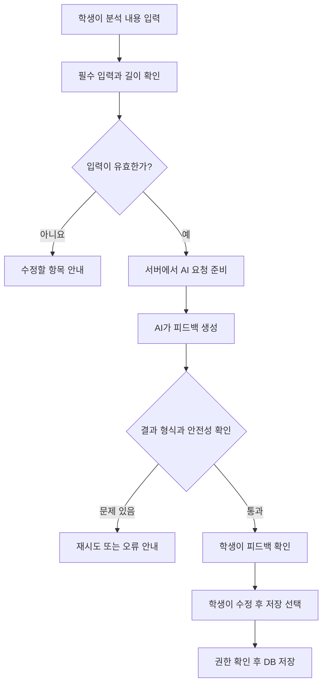
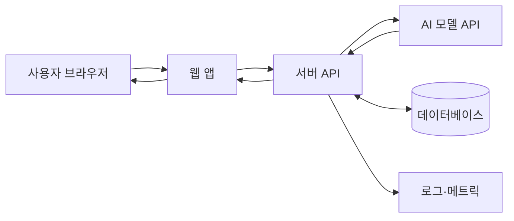
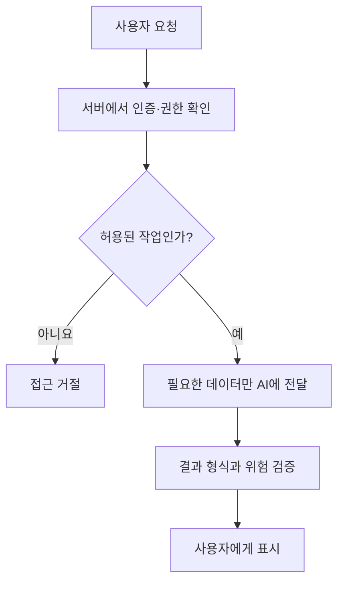

# 19. AI 시스템을 설계할 때 마지막으로 무엇을 확인할까? — 기획부터 운영까지 연결하기

> **비개발자를 위한 AI 시스템 설계 입문서 · 19**  
> 이번 장의 질문: **AI 기능을 하나 만들었다면, 무엇을 확인해야 '서비스를 설계했다'고 말할 수 있을까요?**

- 난이도: ★★☆☆☆ — 앞선 내용을 한 번에 연결하는 종합편
- 예상 학습 시간: 35~50분 (실습은 별도 40분)
- 먼저 읽기: [18. AI 기능을 누구나 사용할 수 있게 만들려면?](18_AI_기능을_누구나_사용할_수_있게_만들려면.md)
- 참고 원문: [AI System Design Guide](https://github.com/ombharatiya/ai-system-design-guide) — 시스템 설계 패턴·평가·운영 주제

> 이 글은 원문의 전체 번역이 아니라, 핵심 개념을 웹서비스 기획자·디자이너·AI 활용 개발자 관점에서 새로 연결한 **독립 해설**이에요. 예시 구성과 수치는 설명용이며 실제 운영 상태나 성능을 의미하지 않아요.

---

## 먼저 상황 하나

AI로 만든 서비스가 있어요. 입력 화면도 예쁘고, 버튼을 누르면 그럴듯한 답변도 나와요.

그런데 누군가 이렇게 묻는다면요?

> "그 답은 무엇을 근거로 만든 건가요?"  
> "같은 사람이 버튼을 세 번 누르면 요금도 세 번 나가나요?"  
> "로그인하지 않은 사람이 남의 결과를 볼 수 있나요?"  
> "AI 업체가 잠깐 멈추면 우리 사이트는 어떻게 되나요?"

이 질문에 답할 수 없다면 기능은 만들었어도 **서비스 전체를 설계한 상태**라고 보기는 어려워요.

그렇다고 엄청난 서버를 먼저 만들라는 뜻은 아니에요. 중요한 건 **어떤 일이 벌어지는지 그려 보고, 위험한 지점을 찾아 두는 것**이에요.

이 장에서는 작은 AI 서비스 하나를 처음부터 공개·운영 단계까지 설계해 볼게요.

## 이 장을 읽고 나면

- AI 서비스의 핵심 문제를 기능과 구분해 정의하기
- 프론트엔드·서버·DB·AI API의 역할을 설명하기
- 입력·출력·저장·실패·권한 흐름을 하나의 구조도로 그리기
- 품질·비용·속도·보안·접근성에 대한 최소 점검 기준 만들기
- '지금 필요한 기능'과 '이용자가 늘면 추가할 기능'을 구분하기

---

## 1. 예제 서비스부터 정해 볼게요

가상의 서비스 이름은 **'웹사이트 리뉴얼 도우미'**예요.

학생이 사이트 분석 결과를 입력하면 AI가 문제 정의와 개선 방향을 검토해 주고, 학생은 내용을 수정해서 저장할 수 있어요.

**이 서비스가 해결할 문제**는 'AI로 긴 보고서를 자동 생성하기'가 아니에요. 학생이 **자기가 분석한 내용을 더 구체적으로 점검하고 개선하는 일**이에요.

| 먼저 정할 것 | 이 서비스의 예 |
|---|---|
| 주 사용자 | 웹사이트 리뉴얼 과제를 수행하는 학생 |
| 사용자의 목표 | 문제 정의와 개선 방향의 타당성을 검토하기 |
| 입력 | 사이트명, 대상 사용자, 문제점, 개선안 |
| AI의 역할 | 빠진 근거를 질문하고 모호한 문장을 지적하기 |
| 사람이 할 일 | 분석 근거 확인, 최종 수정, 제출 결정 |
| 성공 조건 | 피드백을 보고 학생이 실제 수정할 수 있음 |
| 하지 않을 일 | 근거 없는 점수 확정, 실재하지 않는 조사 결과 생성 |

**핵심은 'AI가 뭘 할까?'보다 '사용자가 무엇을 끝내야 할까?'가 먼저라는 것**이에요.

## 2. 기능을 적기 전에, 한 번의 사용 흐름을 그려요



이 그림에서 AI는 한 단계만 맡고 있어요. **입력 검증, 저장 권한, 오류 처리까지 AI에게 맡기지 않았죠.**

실무에서 자주 생기는 문제는 이 단계들이 구분되지 않을 때예요. '프롬프트에 잘 써 두면 괜찮겠지'라고 생각하기 쉽거든요.

## 3. 화면, 서버, DB, AI는 각자 하는 일이 달라요

| 구성 | 주된 역할 | 하지 말아야 할 일 |
|---|---|---|
| 프론트엔드 | 입력·상태·결과·수정 화면 표시 | 비밀 API 키 보관 |
| 서버/API 라우트 | 사용자 검증, 요청 조립, AI 호출, 결과 검증 | 클라이언트가 보낸 권한 주장 맹신 |
| 데이터베이스 | 사용자·작업·저장 결과 관리 | 권한 없이 다른 사용자 데이터 노출 |
| AI API | 제공된 맥락에 따라 피드백 생성 | 저장 권한·최종 채점의 유일한 결정자 역할 |
| 모니터링 | 오류·속도·비용·품질 추적 | 민감한 원문을 아무 제한 없이 기록 |



**내가 알아야 할 수준**

- 지금 알기: 어떤 정보가 어디로 가고, 누가 권한을 검사하는지
- 서비스 개발 중 알기: API 요청/응답, DB 저장 정책, 에러 코드
- 나중에: 분산 처리·서버 클러스터·전문 GPU 인프라

---

## 4. 'AI가 알아서 해줘'보다 먼저 정해야 할 입력과 출력

AI에 요청할 내용을 세 가지로 나눠 봐요.

1. **고정 지침:** 피드백의 목적, 평가 기준, 금지할 추측
2. **사용자 데이터:** 학생이 실제로 작성한 분석 내용
3. **출력 형식:** 잘한 점, 수정할 점, 확인 질문, 근거 부족 표시

예시 출력 구조예요. 코드에 가까워 보이지만 뜻만 보면 돼요.

```json
{
  "strengths": ["타깃 사용자를 구체적으로 적었어요"],
  "improvements": ["문제의 근거 화면을 추가해 주세요"],
  "questions": ["사용자가 원하는 행동은 무엇인가요?"],
  "needs_human_review": true
}
```

**중요한 점:** AI가 JSON처럼 생긴 글을 보내더라도 올바른 구조라고 단정할 수 없어요. 서버가 실제 형식과 필수 항목을 확인해야 해요.

그리고 AI가 만들어 낸 '근거'는 실제 조사 자료와 다를 수 있어요. **실제 자료가 제공되지 않았다면 없는 근거를 만드는 대신 부족하다고 알려 주는 설계**가 좋아요.

## 5. 자료가 필요하다면 RAG부터 떠올리되, 무조건 만들지는 않아요

리뉴얼 과제의 평가표가 수시로 바뀌고 학생별 자료가 많아졌다고 가정해 봐요.

- 자료가 몇 장이고 고정돼 있다면 → 서버에서 검증된 평가 기준을 그대로 전달
- 자료가 수백 장이고 자주 바뀐다면 → 검색·문서 버전 관리가 포함된 RAG 검토
- 학생별 비공개 자료를 검색한다면 → 검색 *이전*에 접근 가능한 자료인지 확인

RAG를 붙이는 이유는 멋있어 보여서가 아니라 **필요한 근거를 정확히 가져오기 위해서**예요.

찾은 문서의 내용이 잘못되거나 오래됐다면 AI가 좋은 답변을 하기 어렵다는 것도 잊지 마세요.

## 6. AI 모델은 '가장 비싼 것'보다 '이 작업을 해내는 것'

모델 A와 B를 비교한다고 해 볼게요.

| 비교 기준 | 모델 A | 모델 B |
|---|---|---|
| 피드백 정확성 | 테스트 필요 | 테스트 필요 |
| 학생이 이해하기 쉬운 문장 | 테스트 필요 | 테스트 필요 |
| JSON 형식 준수 | 테스트 필요 | 테스트 필요 |
| 한 번의 성공 작업 비용 | 측정 필요 | 측정 필요 |
| 실제 응답 시간 | 측정 필요 | 측정 필요 |

**모델을 고르기 전에 테스트 문항 20~30개부터 만드는 편이 나아요.** 실제로 틀렸던 사례, 쉬운 사례, 애매한 사례를 섞어야 하거든요.

작업마다 다른 모델을 쓰는 것도 가능하지만, 처음부터 복잡한 자동 라우팅을 만들 필요는 없어요.

---

## 7. 비용은 버튼 횟수가 아니라 실제 호출을 기준으로 계산해요

연습용 **가상 숫자**로 계산해 볼게요.

- 한 번의 피드백 요청: 입력 3,000토큰, 출력 800토큰
- 가상 단가: 입력 100만 토큰당 $1, 출력 100만 토큰당 $4

```text
입력: 3,000 ÷ 1,000,000 × $1 = $0.003
출력: 800 ÷ 1,000,000 × $4 = $0.0032
합계: 요청 한 번에 $0.0062
```

하루 200건, 30일이면 단순 계산으로 **$37.20**예요. 다만 재시도·도구 호출·다른 서버 비용·환율·세금은 빠져 있어요.

더 중요한 질문은 이거예요.

> 학생이 한 번 클릭했는데 네트워크 오류로 API가 세 번 호출된다면요?

그래서 **중복 실행 방지, 재시도 상한, 사용자별 이용 한도**가 필요해요.

## 8. 사용자가 느끼는 속도와 실제 속도를 따로 봐요

AI가 답변을 시작하는 데 2초, 끝까지 생성하는 데 18초가 걸린다고 해 봐요. 실제 수치는 예시예요.

- **첫 결과까지의 시간(TTFT):** 언제부터 답이 보이나요?
- **전체 완료 시간:** 끝날 때까지 얼마나 걸리나요?
- **작업 성공률:** 사용자가 실제로 피드백을 받았나요?

스트리밍을 사용하면 조금씩 내용을 보여 줄 수 있지만, **모델의 계산 자체가 반드시 빨라지는 건 아니에요.**

UI에서는 진행 중임을 알려 주고, 같은 버튼을 반복해서 누르지 않게 하고, 실패했을 때 다시 시도할 방법을 제공해야 해요.

## 9. 성공 화면만 만들지 말고 실패 화면까지 설계해요

| 상태 | 화면에서 할 일 |
|---|---|
| 입력 전 | 무엇을 입력해야 하는지 안내 |
| 입력 오류 | 어느 항목을 어떻게 고칠지 알려 주기 |
| 생성 중 | 진행 상태 표시, 중복 실행 관리 |
| 완료 | 피드백과 근거 부족 부분 구분 |
| 생성 실패 | 상황 설명, 안전한 재시도 제공 |
| 저장 실패 | 작업 결과를 잃지 않도록 임시 내용 유지 |
| 접근 불가 | 권한을 확인하라는 안내, 민감정보 미노출 |

**'오류가 발생했습니다'로 끝내지 않는 것**이 중요해요. 사용자는 다음에 무엇을 해야 할지 알아야 하거든요.

### 접근성도 이때 함께 봐요

- 키보드만으로 입력부터 저장까지 이동할 수 있나요?
- 포커스가 어디에 있는지 눈에 보이나요?
- 로딩과 완료 상태가 스크린리더에도 전달되나요?
- 색깔만으로 오류 여부를 구별하지 않나요?
- 재생성 버튼과 저장 버튼의 차이가 명확한가요?

---

## 10. 보안은 'AI에게 조심하라고 말하기'로 해결되지 않아요

학생이 작성한 내용을 AI에게 보낼 때도 생각할 일이 많아요.

1. **인증:** 지금 요청한 사용자가 누구인지 확인했나요?
2. **인가:** 이 데이터에 접근하고 저장할 권한이 있나요?
3. **최소 수집:** 굳이 보내지 않아도 되는 개인정보를 빼고 있나요?
4. **비밀키:** AI API 키가 브라우저 코드에 노출되지 않나요?
5. **외부 지시:** 문서 속 '이전 규칙을 무시하라'는 문장을 명령으로 따르지 않나요?
6. **로그:** 제출물·개인정보를 통째로 로그에 남기지 않나요?



프롬프트는 설명과 행동을 유도하는 장치이고, **권한 검사는 실제 서버와 데이터베이스에서 강제해야 하는 규칙**이에요.

## 11. 공개 전에는 '최소한의 평가 세트'를 만들어요

아래는 예제 서비스용 검사표예요.

| 검증할 것 | 테스트 예시 | 통과 조건 예시 |
|---|---|---|
| 입력 유효성 | 빈 분석 제출 | AI 호출 전 오류 안내 |
| 근거 없는 추측 | 자료 없는 통계 요구 | 숫자를 지어내지 않음 |
| 결과 구조 | 다양한 길이의 분석 20건 | 모든 필수 항목이 유효 |
| 학생별 권한 | 다른 학생 결과 주소 접근 | 서버에서 접근 거부 |
| 응답 실패 | AI API 실패 가정 | 재시도 안내, 입력 유지 |
| 저장 오류 | DB 요청 실패 가정 | 저장되지 않았음을 명확히 표시 |
| 비용 | 같은 작업 반복 | 호출 수·토큰 사용량 측정 |
| 접근성 | 키보드만으로 진행 | 핵심 작업 완료 가능 |

이 표의 통과 기준은 어디까지나 **프로젝트에 맞게 수정할 출발점**이에요. '20건 전부 성공'만으로 실제 서비스의 안전과 품질을 보장하는 건 아니에요.

## 12. 로그를 남기되, 내용을 다 저장하지는 않아요

운영하면서 적어도 이런 것은 알고 있어야 해요.

- 언제 오류가 났는지
- 어느 단계에서 실패했는지
- AI API 호출이 몇 번 발생했는지
- 입력·출력 토큰이 얼마나 사용됐는지
- 답변 생성 및 저장에 얼마나 걸렸는지
- 사용자에게 성공 또는 오류 상태가 전달됐는지

그러나 학생 이름, 비밀번호, 제출 원문, 세션 토큰 같은 정보는 **목적 없이 로그에 남기면 안 돼요.**

**예시 기록(가상 데이터)**

```json
{
  "request_id": "req_demo_001",
  "stage": "ai_generation",
  "status": "timeout",
  "duration_ms": 15000,
  "retry_count": 1
}
```

로그는 개발자가 나중에 문제를 찾도록 돕는 정보예요. 사용자에게 보여 줄 결과물과는 달라요.

## 13. 장애를 없애는 것보다, 실패했을 때 돌아올 길을 만들어요

AI 업체가 일시적으로 느리거나 DB에 연결되지 않을 수 있어요. 그런 날을 기준으로 동작을 정해 두세요.

| 상황 | 서비스가 할 수 있는 대응 |
|---|---|
| AI 호출 시간 초과 | 제한된 재시도 후 오류 안내 |
| AI 제공업체 장애 | 생성 잠시 중단, 입력 유지 |
| 저장 중 실패 | 결과 보존, 저장 재시도 |
| 잘못된 배포 | 검증된 이전 버전으로 롤백 |
| 이상한 결과 급증 | 새 프롬프트/모델 사용 중지 검토 |

**백업과 롤백은 다르다**는 것도 기억해 주세요.

- 백업: 데이터가 손상되었을 때 복구할 사본
- 롤백: 잘못 배포한 코드를 이전 버전으로 돌리는 작업

그리고 **롤백이 데이터베이스 변경까지 자동으로 되돌려 주는 것은 아니에요.** DB 구조 변경은 따로 복구 계획이 필요해요.

---

## 14. 찐망고 사주풀이에 적용한다면

이번에는 가상의 새 서비스를 넘어 실제 운영을 점검할 때의 질문으로 연결해 볼게요. 아래는 **현재 구현을 확인한 진단 결과가 아니라, 확인할 항목**이에요.

| 흐름 | 점검 질문 |
|---|---|
| 입력 | 필수 생년월일·시간 선택과 시간 보정이 명확한가요? |
| 계산 | 확정 가능한 사주 계산은 코드에서 처리하나요? |
| AI 생성 | 해설의 문체·인물 구분·출력 구조를 검사하나요? |
| 저장 | 생성 성공과 저장 성공을 별도 상태로 보여 주나요? |
| 개인정보 | 다른 사람의 결과에 무단 접근하지 못하도록 검증하나요? |
| 비용 | 무료 이용량·재시도·장문 해설 호출을 측정하나요? |
| 운영 | 오류를 재현할 요청 식별자와 검증 절차가 있나요? |

사주 해설은 해석적 콘텐츠이기 때문에, **형식과 일관성을 검증하는 것과 운세의 사실적 정확성을 증명하는 것은 다른 일**이에요. 이 둘을 구분하면 서비스가 무엇을 보장하는지도 더 명확해져요.

## 15. 찐망고 레퍼런스에 적용한다면

이미지 수집과 AI 분류를 연결한 서비스라면 또 다른 문제가 생겨요.

- **수집:** 중복 사이트를 어떻게 판별하나요?
- **자동 분류:** AI가 분류한 결과를 언제 자동 반영하고 언제 검수하나요?
- **관리자 등록:** 사람이 등록한 데이터가 자동 수집으로 덮어써지지 않나요?
- **저작권·요청:** 삭제 요청과 공개 범위를 어떻게 처리하나요?
- **갱신:** 원본 사이트가 변경되면 어떤 자료가 오래되었다고 표시되나요?

여기서는 생성 모델의 능력보다 **데이터 상태 관리와 관리자 검수 정책**이 더 중요할 수도 있어요.

---

## 16. 출시 전 한 장 체크리스트

복사해서 실제 프로젝트에 적용해 보세요.

### 기획

- [ ] 한 문장으로 사용자 문제를 설명할 수 있다
- [ ] AI가 해야 하는 일과 사람이 최종 결정할 일을 구분했다
- [ ] AI 없이 일반 코드로 처리할 부분을 정했다

### 데이터·모델

- [ ] 입력 데이터의 출처와 갱신 기준을 확인했다
- [ ] 모델 선택 이유를 품질·속도·비용으로 설명할 수 있다
- [ ] 근거가 없을 때 답변하는 정책을 정했다
- [ ] 출력 형식 검증과 실패 처리를 구현했다

### 화면·권한

- [ ] 로딩·완료·오류·저장 실패 화면이 있다
- [ ] 키보드와 스크린리더 사용 흐름을 점검했다
- [ ] 개인정보와 비밀키를 안전하게 관리한다
- [ ] 서버 및 DB 권한 검증을 확인했다

### 운영

- [ ] AI 호출 횟수와 비용 상한을 정했다
- [ ] 로그·오류 알림·재시도 정책을 정했다
- [ ] 품질 회귀 테스트와 배포 전 점검표가 있다
- [ ] 롤백과 데이터 복구 경로를 점검했다
- [ ] 사용자 피드백을 모으고 개선 우선순위를 정했다

이 가운데 체크되지 않은 항목이 있다고 반드시 공개를 못 하는 것은 아니에요. 다만 **위험이 큰 항목부터 해결하고, 나머지는 언제 할지 기록하는 것**이 중요해요.

## 17. 40분 종합 실습: AI 기능 한 개를 설계해 보기

**목표:** 코드를 작성하기 전에 기획서 1장과 구조도 1개를 완성해요.

### 1단계 (10분): 기능 정의

아래 문장을 채워 보세요.

> 이 서비스는 **[누가]** **[어떤 상황에서]** **[무슨 일을 끝내도록]** 돕습니다.  
> AI는 **[어떤 부분]**을 담당하고, 최종 결정은 **[누가]** 합니다.

### 2단계 (10분): 데이터와 처리 흐름

- 사용자가 무엇을 입력하나요?
- AI에 어떤 자료를 보내나요?
- 어떤 정보는 보내지 않나요?
- 결과를 저장하나요? 저장한다면 누가 볼 수 있나요?

간단한 Mermaid나 Figma 도형으로 그려도 충분해요.

### 3단계 (10분): 실패와 위험 설계

아래 세 가지를 골라 화면과 시스템의 대응을 작성해요.

1. AI 답변이 틀림
2. AI API 요청 실패
3. 저장 실패
4. 다른 사람 데이터 접근
5. 사용량 초과

### 4단계 (10분): 성공 기준

- 사용자가 작업을 끝냈는지 어떻게 확인할까요?
- AI가 유용한 피드백을 했는지 어떻게 평가할까요?
- 비용과 속도를 어떤 주기로 볼까요?

**제출물:** 사용자 문제 1문장 + 데이터 흐름도 + 화면 상태 4개 + 테스트 기준 5개

## 18. 이 장 핵심 정리

| 지금까지 배운 개념 | 설계할 때 묻는 질문 |
|---|---|
| LLM·토큰·컨텍스트 | AI에게 무엇을 얼마나 보내나요? |
| 프롬프트 | 어떤 역할·규칙·형식을 알려 주나요? |
| RAG·데이터 | 어떤 근거를 찾아서 쓰나요? |
| 에이전트·MCP | AI가 실제로 어떤 도구를 사용할 수 있나요? |
| 메모리 | 무엇을 기억하고 무엇을 삭제하나요? |
| 평가 | 결과가 나아졌다는 근거가 있나요? |
| 비용·속도 | 요청 한 번이 얼마나 들고 얼마나 걸리나요? |
| 보안·접근성 | 사용자가 안전하고 불편 없이 이용하나요? |
| 모니터링·배포 | 문제가 생기면 발견하고 되돌릴 수 있나요? |

처음부터 모든 기술을 넣을 필요는 없어요.

**문제를 정하기 → 가장 작은 흐름 만들기 → 실패 조건 정하기 → 측정하기 → 검증된 부분만 확장하기.**

이 순서가 작은 AI 서비스에도, 이용자가 많은 서비스에도 유효한 출발점이에요.

---

## 스스로 확인하기

1. AI API가 성공했다면 DB 저장도 성공한 걸까요?
2. RAG를 붙이면 근거 없는 답변이 완전히 사라질까요?
3. 모델 A가 더 똑똑하다고 알려졌다면 무조건 교체해야 할까요?
4. 사용자에게 보이는 오류 메시지와 운영 로그는 왜 다를까요?
5. 새 기능을 만들기 전에 가장 먼저 정해야 할 것은 무엇일까요?

<details>
<summary>정답 방향 보기</summary>

1. 아니에요. 생성과 저장은 서로 다른 단계여서 별도 확인이 필요해요.
2. 아니에요. 검색된 자료가 틀리거나 사용을 잘못하면 오답이 나올 수 있어요.
3. 아니에요. 서비스 과제에서의 품질·비용·속도를 직접 평가해야 해요.
4. 사용자는 다음 행동을 알아야 하고, 로그는 개발자가 문제 원인을 찾는 데 필요하기 때문이에요.
5. '누가 어떤 일을 끝내도록 돕는가'라는 사용자 문제예요.

</details>

## 시리즈를 마치며

**AI를 잘 설계하는 사람은 AI에게 무엇이든 시키는 사람이 아니라, AI가 해야 할 일과 하지 않아야 할 일을 구분하는 사람이에요.**

처음에는 낯설었던 토큰, RAG, 평가, 에이전트, 컨텍스트가 이제는 실제 서비스를 설명하는 언어가 되었을 거예요.

아직 모르는 기술이 많아도 괜찮아요. 서비스마다 필요한 깊이는 달라요. 중요한 건 **새로운 기술을 만났을 때 '이게 무슨 문제를 해결하지?'라고 묻는 습관**이에요.

다음 단계로는 자신이 만든 서비스를 이 체크리스트로 한 번 점검해 보세요. 모르는 부분이 나타나면 그때 해당 장으로 돌아가면 돼요.

---

## 참고 자료

- [Om Bharatiya, AI System Design Guide](https://github.com/ombharatiya/ai-system-design-guide) — 원본 기술 참고서 (MIT 라이선스)
- [OWASP Top 10 for LLM Applications](https://genai.owasp.org/llm-top-10/) — 생성형 AI 애플리케이션 보안 위험
- [W3C WCAG 2.2](https://www.w3.org/TR/WCAG22/) — 웹 콘텐츠 접근성 기준
- [Google People + AI Guidebook](https://pair.withgoogle.com/guidebook/) — 사람 중심 AI 설계
- [OpenTelemetry Generative AI Semantic Conventions](https://opentelemetry.io/docs/specs/semconv/gen-ai/) — 생성형 AI 운영 관찰 개념

> 이 교재 시리즈는 원문을 대체하는 공식 번역이 아니며, 원저작자의 기술 주제를 참고하여 비전공자를 위한 독립적인 학습 자료로 재구성했어요.